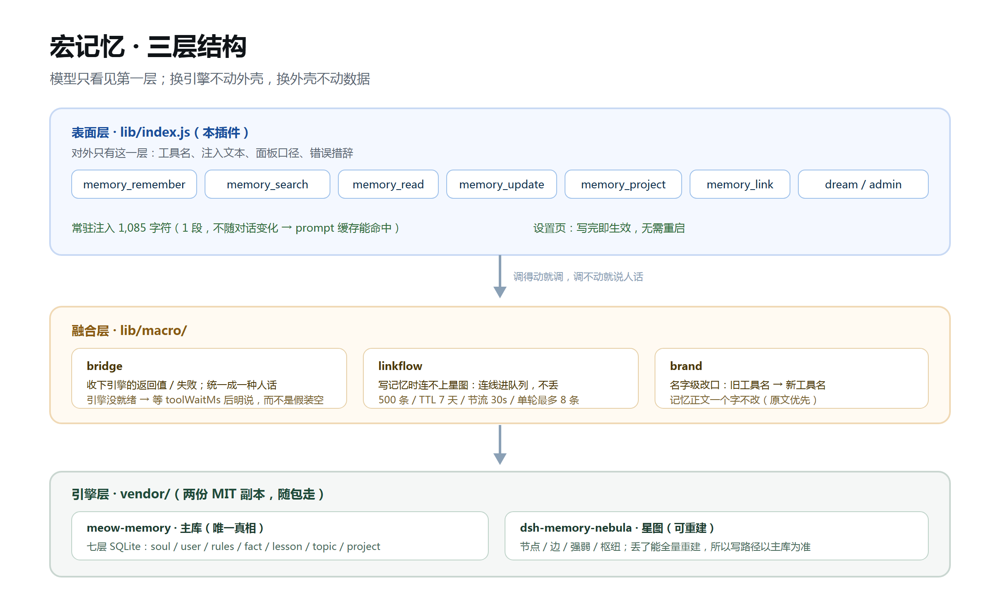

# 宏记忆 · Macro Memory

> 一个记忆插件，接管全部记忆能力：**8 个工具、一段 1,085 字符的常驻注入**，主库仍是 meow 的七层 SQLite，星图退成可重建的索引。
>
> 适用：DeepSeek Harness（DSH）。版本 **0.2.95** · 许可 MIT · 内置 meow-memory 与 dsh-memory-nebula 的完整副本（均为 MIT，见[第三方声明](#第三方声明与来源)）。

| 指标 | 融合前（三插件并存） | 现在（0.2.95） | 变化 |
| --- | --- | --- | --- |
| 工具 schema 合计 | 17 个工具 / 56,759 B | **8 个工具 / 8,655 B** | **−84.7%** |
| 常驻注入 | 4,085 字符（meow 3,396 + nebula 689） | **1,085 字符（1 段）** | **−73.4%** |
| 每轮固定开销 | 约 14–16K token | **约 2.2K token** | **−85%** |
| 面板 / 工具来源 | 三个插件各一套 | 一个插件两个面板 | 口径统一 |

---

## 目录

- [它解决什么问题](#它解决什么问题)
- [它是怎么搭起来的](#它是怎么搭起来的)
- [记忆怎么工作](#记忆怎么工作)
- [省 token 的账怎么算](#省-token-的账怎么算)
- [8 个工具](#8-个工具)
- [安装](#安装)
- [设置与热应用](#设置与热应用)
- [兼容与迁移](#兼容与迁移)
- [质量：怎么证明它没坏](#质量怎么证明它没坏)
- [目录结构](#目录结构)
- [第三方声明与来源](#第三方声明与来源)
- [English](#english)

---

## 它解决什么问题

记忆插件通常各干各的：一个存长期记忆、一个建关系图谱、一个做性格画像。装三套的代价不是磁盘，是**每一轮都要重付的上下文税**：

1. **工具 schema 税**：每个工具的参数说明都进请求前缀。三个插件 17 个工具，光 schema 就 56,759 B，约 14–16K token，占每轮固定开销八成以上——用户还没说话，钱已经花掉了。
2. **注入税**：每个插件都想在 system prompt 里讲一段「怎么用我」。三段叠加 4,085 字符，而且各自都写「先调用我」。
3. **口径税**：面板里三个名字、工具里两套命名、日志里三种前缀。模型照着 A 插件的注入去调 B 插件的工具，拿到「工具不存在」，接着开始乱试。

宏记忆的做法是**把工具面和注入面收上来**：两个引擎（meow 的记忆库、nebula 的星图）退到后面当内核，对外只有一套 8 个 `memory_*` 工具和一段注入。能力一条没砍，重的是壳，不是功能。

## 它是怎么搭起来的



三层，从上往下：

- **表面层（本插件）**：`lib/index.js` 装配 8 个统一工具 + 一段常驻注入 + 一张设置页；所有对外文案、品牌名、错误措辞都在这一层（`lib/macro/`）。
- **融合层**：`bridge` 负责「叫得动引擎、叫不动就说人话」；`linkflow` 负责写记忆时连不上星图的连线**不丢**（排队补连）；`brand` 负责把引擎输出里的旧工具名翻成新名字。
- **引擎层**：`vendor/meow-memory`（主库：七层 SQLite + 梦境巩固 + 反射）+ `vendor/dsh-memory-nebula`（索引：节点/边/强弱/枢纽），两者都在 `vendor/` 里带完整副本，随本包一起走，**不依赖用户另外安装**。

关键取舍：**主库只有一份，星图可以重建**。七层表有 `status`/`importance`/`keywords` 语义，星图节点只有 id 和文本；星图丢了能全量重建，主库丢一条就永远丢。所以写路径先落主库，再尽力更新星图，失败就排队。

## 记忆怎么工作


### 写入

```
memory_remember(content, level, project, keywords, importance, links)
  ├─ 落主库（.dsh-meow/memory.db，七层之一）
  ├─ 尽力把关联节点写进星图（links）
  └─ 连不上 → 落 $DSH_HOME/macro-memory/pending-links.jsonl 排队（上限 500、TTL 7 天）
```

`links` 失败**不会**让这次写入失败，也不会静默丢掉：进队列，之后任意一次 `memory_search` / `memory_read` / `memory_link` / `memory_admin` 顺手补连（节流 30s、预算 1.2s、单轮最多 8 条、星图整体不可用时立刻停手）。用户在 `memory_admin(action="links")` 里能看到「谁在等谁、等了多久、为什么没连上」。

### 读取

```
memory_search(query, mode=local|graph|bridge|similar)
  ├─ local：主库关键词检索（importance × 时间衰减）
  ├─ graph：沿星图关联扩散
  ├─ bridge：强相关但还没读过的邻居
  └─ similar：给一条记忆，找相似的
```

参数给错模式会**明说没生效**（「你给的 `expand` 在 graph 模式里没用上，扩散请用 graph」），不会先跑一遍别的检索再让你误读结果。

### 巩固

`memory_dream` 把本窗口建立/提取过的记忆封存成跨会话记忆，按七层归档，顺手补连线。梦境任务空转时只做巡检，不刷日志。

### 注入

每轮常驻的只有一段 1,085 字符的 L0（怎么用、有条目怎么找、没条目怎么办），**不随对话变化**——这是 prompt 缓存能命中的前提。真正的内容靠工具按需拉：变化的东西不进 system prompt 前缀。

## 省 token 的账怎么算


| 项 | 融合前 | 现在 | 说明 |
| --- | --- | --- | --- |
| 工具 schema | 56,759 B（17 个） | **8,655 B（8 个）** | `tools/probe-host.mjs` 实测 D2 判据 |
| 常驻注入 | 4,085 字符 | **1,085 字符** | 同一支探针 E2 判据，上限 1,300 |
| 旧工具名残留在注入里 | 有（`nebula_recall` 等） | **0** | E4 判据 |
| 别名工具 | — | 默认关闭 | 打开后 19 个工具，供老会话/老脚本过渡 |

按 JSON schema 约 3.9 B/token 折算：**每轮少付约 1.2 万 token**。会话越长越赚——这部分是**固定开销**，第 1 轮和第 200 轮一样要付。

省 token 的三刀，按收益排序：

1. **砍工具面**（17 → 8，−84.7%）：合并同义工具，`mode` 用一个枚举代替四个工具。
2. **压注入**（4,085 → 1,085 字符，−73.4%）：只留「怎么用 + 没找到怎么办」，全文手册改成 `memory_admin(action="guide")` 按需取，用完即弃。
3. **禁掉每轮自动邻域注入**（nebula 原来每轮把邻居关系塞进 prompt）：改成工具按需拉（`memory_search({mode:"graph"|"bridge"})`）。

## 8 个工具

| 工具 | 干什么 | 关键参数 |
| --- | --- | --- |
| `memory_remember` | 写一条记忆 | `content` / `level` / `project` / `keywords` / `importance` / `links` |
| `memory_search` | 检索（四种模式） | `query` / `mode` / `k` / `limit` / `expand` / `id` / `memory_ids` |
| `memory_read` | 读一条（连邻居一起带出） | `id` / `neighbors` |
| `memory_update` | 改内容/状态/关键词/归属 | `id` / `content` / `status` / `keywords` / `importance` / `project` / `links` |
| `memory_project` | 一个项目的全景 | `project` |
| `memory_link` | 星图连线：连/断/屏蔽/解释路径 | `action` / `a` / `b` / `note` / `maxHops` |
| `memory_dream` | 记忆整理（封存本窗口） | — |
| `memory_admin` | 运维面板 | `action` = home/stats/hygiene/sources/ingest/cost/links/guide |

七层：`soul`（AI 自身）/ `user`（用户与环境）/ `rules`（准则）/ `fact`（原子事实）/ `lesson`（经验）/ `topic`（一件事的来龙去脉）/ `project`（项目，含 overview/structure/decisions/quotes/ops/todo）。

## 安装

### 从插件市场

DSH → 设置 → 插件市场 → 索引源填本仓库的索引地址：

```
https://raw.githubusercontent.com/hanhan9999999999999999999/dsh-macro-memory/main/plugin-market/index.json
```

索引是 [格式 1](https://github.com/deepseek-ai/deepseek-harness) 的 JSON（`plugin-market/index.json`，随包校验：`tools/check-market.mjs`）。

国内网络拉不到 `raw.githubusercontent.com` 时，把索引源换成镜像（`plugin-market/index.cn.json`：与主索引逐字段相同，只有仓库地址带反代前缀，钉同一个 commit）：

```
https://gh-proxy.com/https:/raw.githubusercontent.com/hanhan9999999999999999999/dsh-macro-memory/main/plugin-market/index.cn.json
```

实测（2026-11-19，本机）：`raw.githubusercontent.com` / `cdn.jsdelivr.net` / `cdn.statically.io` 直连全部失败；`gh-proxy.com` 取索引 1.9 s、取图标 3.4 s。市场安装要 `git clone`，直连 GitHub 300 s 超时，走反代 23 s 拉完 164 个文件、checkout 到钉住的 commit 成功。

> 反代地址里的内层协议只写一个斜杠（`https:/github.com/...`）不是笔误：宿主校验 git 源时要求 `new URL(v).href === v`，写成 `https://` 会被压成 `/https://` 而被判「不是规范 URL」。

### 手动

```bash
# 1) 放进 vendor（或任意路径），装进 profile
cd <DSH_HOME>/vendor
git clone <THIS_REPO> dsh-macro-memory

# 2) profile 里登记（file: 协议，pnpm 不会在 install 时删掉它）
#    profiles/<名字>/package.json → dependencies
#    "dsh-macro-memory": "file:D:/dsh-home/vendor/dsh-macro-memory"

# 3) 只留一条 bundle
#    profiles/<名字>/cordis.patch.yml
- insert:
    - id: macro-memory
      name: 'dsh-macro-memory'
      config:
        homeDir: dsh-storage
        reflectTurns: 5
        promptLang: zh
        nebula: {}
```

**必须关掉原来的 `meow-memory` 与 `dsh-memory-nebula`**：本包 `vendor/` 里是它们的内核，再装原包会重复注册工具与客户端 UI。

重启 DSH 生效（不是刷新页面）。

## 设置与热应用

设置页的每一个字段都真能写，而且**写完就生效**：

| 改的是谁 | 生效方式 | 要重启吗 |
| --- | --- | --- |
| 融合层四键（`compatAliases` / `guideMaxChars` / `toolWaitMs` / `flushThrottleMs`） | 150ms 去抖后重建工具面与注入 | 不用 |
| 引擎字段（`hitTopK` / `reflectTurns` / `homeDir` / `dream` …） | 拆掉那只引擎重挂，再重建表面 | 不用重启进程，但扫描从头开始 |
| `nebula` 段 | 同上，只重挂星图 | 同上 |

一个坑写在这里省别人一轮：宿主给的配置是 **volatile 引用**，引擎只认普通对象——把引用直接喂给引擎，它装不起来却不报错，只会表现成「工具都不见了」。所以引擎永远拿 `resolveConfig()` 解包后的普通对象。

## 兼容与迁移

- **老配置形状**：`config.meow.{…}` 旧写法仍然认（根字段覆盖），启动时打一句 warn 点名哪些键被盖住。
- **老注入消息**：注入来源 `kind` 从 `plugin:meow-memory` 改成 `plugin:macro-memory`，但老值仍认得（`LEGACY_PLUGIN_KINDS`）。历史会话里的折叠、锚点、重放不受影响——`kind` 是数据契约，不是装饰。
- **老工具名**：默认不注册 `nebula_*` / `memory_find_similar` / `memory_home`；需要时把 `compatAliases` 打开（19 个工具）。引擎输出里出现的旧名字会被翻成新名字，**返回的记忆原文一个字不改**。
- **不改用户数据**：`.dsh/sessions` 里的历史消息不改写；旧库目录不搬，切 `homeDir` 只切指针。

## 质量：怎么证明它没坏

```bash
node tools/check-all.mjs          # 21 支自检，1,938 条断言，137s
node verify.mjs                   # 单支：宿主契约 + 浏览器装配
node tools/doctor.mjs             # 体检：两棵树字节一致、加载面、注入长度、队列、账本
```

- **21 支自检 / 1,938 条断言**，全部可执行，覆盖：宿主装配契约、真 vendor 端到端联动（含星图缺席降级）、真 meow 库 + 真 nebula 引擎的节点/边/生命周期、真 cordis + 真 ToolsService + 真 SystemPrompt、浏览器侧 UI 注册、17 个原工具 → 8 个统一工具的参数级覆盖审计、17 个原工具的清单与字面量体积、工具账本（每个脚本有归属）、口径总账（手册/schema 常量/对外文案同源）、召回校准（相关度优先 + 重要度进分数 + 相关度下限 min_rel）、合并账本（关键词并集 / 归属不搬 / 变短默认不换 / overwrite 才换）、跨层重复（写时点名另一层 / 检索折叠逐字级重复 / dedupe: false 看全量）、相似检索（基准与候选同一把尺子 / 本会话刚写的也算候选 / 端过的不再端）、两把尺子（相似度 cosine 与逐字重复度 Jaccard 并报 / 与写侧合并判据同源 / 长文嵌一句要点名）、记忆体检口径（「相似 N」是稀有词签名估算、判「同一句存两层」看 repeat、两把尺子靠一句口径说明指路）、dream 重复对（整理清单里点名逐字重复的对子 / 没对子一个字不加 / 短 id 在清单内互不撞前缀）、dream 跨轮次重复（同一句话一条 fact 一条 topic 也点名 / 一对只说一次 / 半边标「另一组」并说清怎么处置）、dream 重复详写（短摘录 + 长详写也算同一件事 / 覆盖度 ≥90% 且短条至少 8 个词 / 与逐字重复块互斥不重复点）、dream 合并处方（每个重复详写对下面点名短条里长条没有的词、最多 6 个 / 无损时明说「没有长条之外的词」/ 三把尺子各管一段：重复合并、相似不许合并），都含阴性对照、注入体、加载器判据、组合产物、YAML 接线、市场索引、体检。
- **断言数基线**：`tools/baselines.json` 记每支的 PASS 条数——少了判红（有人删了东西），多了只提醒。
- **耗时预算**：每支 4×实测且不低于 30s，超时 SIGKILL；比基线慢 1.5 倍只提醒不判红（慢不等于坏）。
- **vendor 账本**：`vendor/VENDOR.json` 记两棵 vendor 树的文件数/字节/整树指纹，改过没重记就 FAIL；另有 25 条「我们故意打的补丁还在位」的内容断言。
- **阴性对照**：每轮都先把判据打红一次再还原，证明判据不是纸做的。

## 目录结构

```
lib/
  index.js            唯一入口：Config（平铺 volatile）、装配、热应用
  client.js           浏览器侧产物（build.mjs 从两个 vendor client 拼出）
  macro/
    bridge.js         收下与转调（createBridge / errText / wrapPlugin）
    facade.js         三个 Proxy：ctx.tools / ctx.systemPrompt / 最外层
    render.js         纯函数出文本，零 import
    tools.js          8 个统一工具的装配器
    defs/             一个工具一个文件（remember/search/read/update/project/link/dream/admin）
    linkflow.js       待补连线队列（排队、节流、补连、判永久失败）
    brand.js          名字级改口（不改返回正文）
    prompt.js         L0 注入文本 + 完整手册
    store.js          唯一碰 node:fs 与 DSH_HOME 的地方
    cost.js / links.js / shared.js / panel.js
vendor/
  meow-memory/        主库内核（MIT，见第三方声明）
  dsh-memory-nebula/  星图内核（MIT）
tools/                自检与探针（15 支 + 账本/体检）
plugin-market/        市场索引（格式 1）
DESIGN.md             设计取舍与教训（内部）
docs/                 INTERNAL.md 逐轮开发日志、images/ 配图
```

## 第三方声明与来源

本包 **MIT** 许可（见 [LICENSE](LICENSE)）。

内置两份第三方代码，均为 MIT，完整许可原文随包保留：

| 组件 | 来源 | 许可 | 说明 |
| --- | --- | --- | --- |
| `meow-memory@0.32.8` | [Phant0Meow/dsh-meow-memory](https://github.com/Phant0Meow/dsh-meow-memory) | MIT © 2026 Phant0Meow | 主库内核：七层 SQLite、梦境巩固、反射。`vendor/meow-memory/LICENSE` 为其原文 |
| `dsh-memory-nebula@1.11.74` | 本仓库作者 | MIT © 2026 主人 & 小代码酱 | 星图内核。`vendor/dsh-memory-nebula/LICENSE` |

改动说明（MIT 要求「显著修改需说明」，逐条记在 [THIRD-PARTY-NOTICES.md](THIRD-PARTY-NOTICES.md)）：

- meow：注入消息的来源 `kind` 改为 `plugin:macro-memory`（老值仍认）；设置页文案与热应用说明改写；其余内核逻辑未改。
- nebula：`systemPrompt.context` 恒返回一条稳定 RULE（移除每轮自动邻域注入）；`recall` 过滤归档节点；工具归因表统一到 `plugin:macro-memory`。

两棵 vendor 树的可核指纹在 `vendor/VENDOR.json`，任何人都能验证「这是一份改了哪几处的副本，而不是另写的东西」。

## English

**Macro Memory** (DSH plugin, MIT) folds several memory plugins into one surface: **8 tools + a single 1,085-character standing injection**, while the storage engine stays meow-memory's seven-layer SQLite and the graph becomes a rebuildable index.

- Tool schemas: 17 tools / 56,759 B → **8 tools / 8,655 B** (−84.7%).
- Standing prompt: 4,085 chars → **1,085 chars** (−73.4%).
- Per-turn fixed cost: ~14–16K → **~2.2K tokens**.
- Nothing was dropped: every original tool is reachable through the unified surface (audited by `tools/coverage-audit.mjs` and `tools/param-audit.mjs`).
- Writes land in the main store first; graph links that cannot be written are **queued, not lost** (500 entries, 7-day TTL, auto-flushed).
- 21 self-check scripts / 1,938 assertions / `node tools/check-all.mjs`.

Bundled third-party code is MIT: `meow-memory` © 2026 Phant0Meow ([source](https://github.com/Phant0Meow/dsh-meow-memory)), `dsh-memory-nebula` © 2026 the authors. See `THIRD-PARTY-NOTICES.md` for the exact list of modifications.

---

<sub>内部开发日志（0.1.x 起逐轮记录，含每次事故与判据）在 [docs/INTERNAL.md](docs/INTERNAL.md)；设计取舍在 [DESIGN.md](DESIGN.md)。`lib/client.js` 为构建产物：163,239 B，sha256 `2F546AA8…`。</sub>
