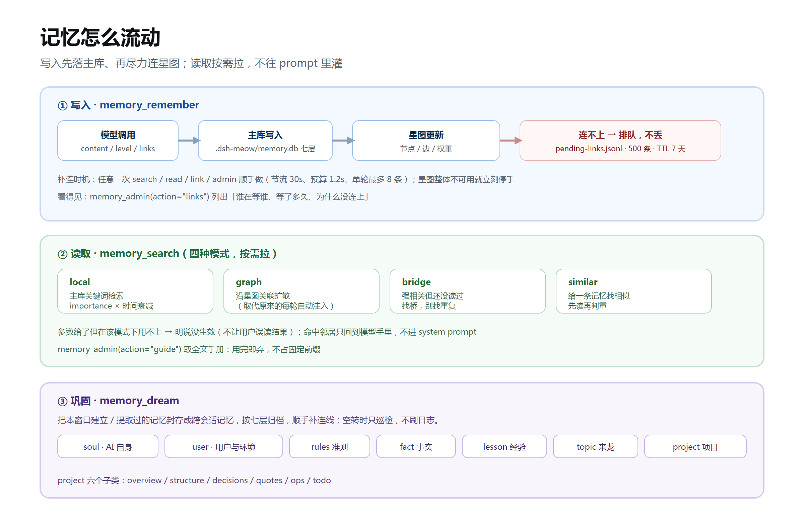

# 宏记忆 · Macro Memory

> 一个记忆插件，接管全部记忆能力：**8 个工具、一段 1,235 字符的常驻注入**，主库仍是 meow 的七层 SQLite，星图退成可重建的索引。
>
> 适用：DeepSeek Harness（DSH）。版本 **0.6.40** · 许可 MIT · 内置 meow-memory 与 dsh-memory-nebula 的完整副本（均为 MIT，见[第三方声明](#第三方声明与来源)）。

| 指标 | 融合前（三插件并存） | 现在（0.6.40） | 变化 |
| --- | --- | --- | --- |
| 工具 schema 合计 | 17 个工具 / 56,759 B | **8 个工具 / 13,567 B** | **−76.1%** |
| 常驻注入 | 4,085 字符（meow 3,396 + nebula 689） | **1,235 字符（1 段）** | **−69.8%** |
| 每轮固定开销 | 约 14–16K token | **约 2.2K token** | **−85%** |
| 单次检索（1200 条库） | 107.2ms（p50） | **2.9ms（p50）** | **−97.3%** |
| 面板 / 工具来源 | 三个插件各一套 | 一个插件两个面板 | 口径统一 |

> **0.4.0 里程碑**：这一版不换引擎、只把「账」和「刀」都做实——六件事全部带开关、带回滚、带能红证明：**口径单**（新建 `docs/EVAL-CLAIMS.md`，把可引用的与过期的分成两张表）、**查询分解** `multiQuery`（默认 `off`）、**写入端巩固** `consolidate`（默认 `suggest`，一个字不写库）、**写入端通胀体检**（`selfecho` / `unused` / `inflate` 三类）、**自动取代** `autoSupersede`（默认 `suggest`）、**实体星图**（四类硬事实成层，顺带修掉「两跳从来没跑过第二跳」的沉默 bug）、**共现自学习扩词**（词源取每条的 `keywords`，不靠人手枚举）。读数：**30 支自检 / 3,511 条可执行断言 / 约 220 秒**；gold 宽池 146 条 **照抄 1.000 / 换说法 1.000（14/14）**、关掉共现即退回 0.929（增量可归因）；窄池 40 条换说法 0.929、时间锚 1.000；真库 635 条 40 问 hit@1 0.925、MRR 0.963。以上全部无 LLM，端到端 judge 仍未重测（口径见 `docs/EVAL-CLAIMS.md`）。

> **0.6.40 里程碑**：这一版治的是**「没有闸门，每轮都在塞记忆」**——命中注入唯一的门槛是 `hitTopK`（条数，默认 2），**分数没有任何下限**：一句「跑一下测试」也能把一条关键词里带 `测试`/`脚本`/`单元测试` 的记忆顶上来。真库实测（824 条 active）：13 条纯操作问句里 **11 条**都触发了注入、合计 9,049 字，其中绝大部分是噪声，模型每轮都得读一遍、再自己判断「这条跟当前任务无关」。处方一条，但落点有五处：**命中闸门 `injectFloor`**（默认 **0.45**，`0` = 关，老行为逐位不变）。①**闸门只读分数、不重算分数**：线用的就是同一条 `keywordHitScore`（`raw × coverage × recency × importance × status × titleHit`），一分权重都不动——闸门是「读分数的人」，不是「打分的人」；②**被挡的条目不算看过**：`kept = floor > 0 ? fresh.filter(h => !(Number.isFinite(h.score) && h.score < floor)) : fresh`，`renderHitEntries` / `markInjected` / `bumpHit` 全部只对 `kept` 生效——第一版把 `markInjected` 放在过滤之前，被挡的条目进了 seen 就再也回不来，这条是 `probe-floor` F4 专门钉的；③**回执与日志都带现场**：`budget.floor` / `budget.gated` 与 `hit-chain … floor=0.45 gated=1`，省了几条一眼看见；④**配置面六处齐**（`CONFIG_DEFAULTS` / `DEFAULT_OPTS` / zod schema / `reqNum` / `resolveConfig` / `LIVE_CONFIG_KEYS`），坏值两种待遇——非数字（`NaN`/字符串/`null`）回默认 0.45，数字但为负夹成 0＝显式关闸（`-1` 在语义上只能是「不要闸门」，没别的意思）；⑤**闸门只挡注入，不挡其它入口**（`memory_search` / `memory_read` / 邻域注入都不受它影响）。**0.45 这条线不是拍出来的**：真库 824 条做**自命中**（每条拿自己前 3 个关键词当问句），top1 分数分位 p1/p5/p10/p25/p50/p75/p90 = **2.046 / 4.601 / 6.017 / 10.248 / 16.747 / 26.23 / 38.515**——0.45 保住 **823/824 = 99.9%**（抬到 0.8 也只是 822/824，收益极小、风险更大）；反过来 12 条杂问句（跑一下测试 / 继续 / 现在进度到哪了 / 把这段代码格式化 / 重启一下 / 这个报错是什么意思 / 改成异步 / 加个参数 / 为什么这里会慢 / 把注释补上 …）最高只到 **0.42**，0.45 线下**全部 0 条过闸**。**读数**（用真库 824 条造 stub db、project 全设 `全局` 取最坏情况）：A 组 9 条记忆相关问句——闸门开 **9/9 轮照旧注入**，正文 **8,747 → 6,873 字（省 21.4%，只挡掉 5 条弱命中的尾巴）**；B 组 13 条操作问句——关 **11/13 轮注入 / 9,049 字**，开 **2/13 轮 / 1,668 字（省 81.6%）**，留下来的两条正是「提交并推送」和「把 README 里的数字改一下」（本来就该命中）。**回退性与代价**：`injectFloor: 0` 时正文与 `renderHitEntries(fresh)` **逐字相同**（204 vs 204 B），0.6.39 的老配置一个字段都不用改；`probe-cost` 的两份冻结快照不受影响（闸门不碰检索打分）。新探针 `tools/probe-floor.mjs`（F1–F6 共 **30 条**：形状 10 条、默认线下强命中照旧而弱命中被挡、关闸逐字回旧、被挡条目不进 seen 也不加 `hit_count`、门槛 0/0.45/1.5 单调且 0.05 能让弱命中进、`NaN` 与字符串回默认而负数夹成 0），规模 **57 支 / 4,096 条可执行断言**。**踩坑留三条**：①`CONFIG_DEFAULTS` 里必须写**字面 0.45**——那个对象在模块求值时先于 `INJECT_FLOOR_DEF` 的赋值行，写常量名会拿到 `undefined`，闸门静默失效（而探针读到 `undefined` 只会显示「没挡」，非常像没事）；②`hitQuery` 原来**不带分数**（`delete h._raw` 之后只剩派生字段），闸门要读分就得多带一个 `score`；`renderHitEntries` 只认 id/level/content/project/updated_at，多带一个字段不改输出，但少带这个字段闸门只能全放行；③「关闸逐字回旧」这种断言必须拿 `renderHitEntries` 的**原始输出**做对拍（`len 204 vs 204`），不能只比条数——条数相同、正文顺序变了也是回退没做干净。

> **0.6.39 里程碑**：这一版治的是**「同域词面干扰」**——同一个领域里，问句的字面撞上了同域的另一个条目，真正的答案因为有「内部说法」而拿不到字面证据：问「降糖药第一次吃多少量」，被标题里就有「降糖药」的《降糖药调整原则》压住；问「星点老是跑偏怎么回事」，被《马赛克拼接》压住；问「叶子发黄是不是缺肥」，《施肥配比》整条不进榜（`缺肥` 是库外词）。根因两处：①**声明出来的对端待遇不对称**——`A＝B` 里声明出来的同义词只拿 `synW` 0.6 的扩词权重、且**吃不到标题/关键词字段加成**，而「类名命中标题」能吃到 ×1.95；②**库外词没有任何入口**——两字碎片制下 `缺肥` 在 df 与倒排里都不存在，无论多相关都拿不到分。处方四条：①**声明对端平权** `synWLookup`（默认 **1**）：对照表里声明出来的对端权重从 0.6 抬到 1.0，并且吃字段加成——它本来就是那个词；②**歧义类名折扣** `declDirectW`（默认 **0.7**）：问句里的词在库里有声明对端＝这个词有歧义，字面对上它不如对上对端，按问句词打折（没有声明对端时整个系数是 `null`，普通问句逐位不变）；③**对照条目不吃字段加成**：术语对照表把 `A＝B` 两侧的词都收着，一给加成它就是「最像答案」，可它是术语表不是答案——降权条目同时停止字段加成；④**中心语素桥**（`charBridge` / `charBridgeW` 默认 0.3）：只收 `keywords` 里 df ≤ 8 的词、按**词尾字（中心语素）**建表（`缺肥`↔`施肥`/`氮肥` 同类，`缺肥`↔`肥配` 不同类），只补直接分为 0 的条目、桥必须落在标题/关键词上才算、问句要有字面锚点（OOV 占九成就说明本库没有这件事，不许硬凑），多个候选词命中做累加、封顶 `best × 3`。**读数**（60 条五域夹具）：冷域换说法 **hit@1 70.0% → 90.0%**、hit@3 90.0% → **100.0%**、MRR 0.800 → **0.950**；三条夹具全部转正——`md01` 36.96 压住 `md02` 24.95、`tw01` 20.97 压住 `tw11` 2.58、`yy07` 3.99 进到第 2（前面只剩术语表 `yy12`；`probe-terms` T3 的判据是「对照条目不许抢第一」而不是「答案必须第一」）。**回退性与代价**：四个开关归位 → **70.0 / 90.0 / 0.800**，与 0.6.38 逐位相同；空手 **10/14** 与 0.6.38 相同（单字桥不许把「没有这件事」变成瞎猜）；`probe-cost` 的 45 问 × 两档快照换代一次，同时新增 C5d/C5e 归因断言——四开关归位必须逐位回到 0.6.38 的两份冻结快照，40 条池上只有 5/45 问答案变了。新探针 `tools/probe-decl.mjs`（D1–D8 共 **23 条**），规模 **56 支 / 4,066 条可执行断言**。**踩坑留三条**：①`searchIndexOf` 的索引缓存键不含 `charBridge`，用 `{charBridge:false}` 量「关桥」会复用旧索引拿到假读数——量开关一律用打分侧 `charBridgeW: 0`；②`二甲双胍` 这种整词**不在 df/倒排里**（索引只有两字碎片 `二甲`/`甲双`/`双胍`），判「这个对端是不是声明来的」必须按碎片展开，否则 `differs` 恒假、改动静默失效；③「同表兄弟桥」写完又拆掉——写在同一张对照表里的词是几个不同现象（`过曝`/`拖线`/`极轴误差`），互连会跨语义干扰，桥只能按词面（中心语素）建。

> **0.6.38 里程碑**：这一版治的是**「注入没有闸门」和「邻居错了没法纠正」**——`memory_*` 每轮都在注入，注入量却只有一个 `hitTopK` 管条数（不管长度）：条目正文多长就整段塞进去，项目全景（六子类全量）更是没有上限；星图邻域那边则是「扩散出来就照单全收」，`why` 只写「经由「xxx」的共现关联扩散而来」——**不给来源 id**，模型看着一条明显无关的邻居，既不知道是哪一跳带过来的，也没法只断那一跳。处方两条：①**注入预算** `injectMaxChars`（配置面 + 设置页 `settings.group.inject`，默认 **0 = 不限**，老行为逐位不变）：命中注入按「条目头 + 正文 + 尾部自述」三层分配——`bodyCap = max(INJECT_BODY_CAP 240, floor(cap * 0.5))`（宽预算不误伤长条目），每条正文按 `INJECT_BODY_MIN 60` 做门槛，**装不下 60 字就整条不列**（只留一个 id 的占位对模型几乎无用，不如把预算给前面几条完整呈现），预算不足以承载任何条目时只给骨架并说明；正文压缩走 `squeezeBody`（按句打分：命中查询词的句子加权、首句必留，`mode` 记 `full` / `squeeze` / `head` / `clip`）；快照与压缩后重放走 `budgetText` 的**段级**预算（`\n\n` 分段，保头段 + 尾两段，从尾往前丢中间段，尾巴必带 `inject.budgetNote`）；尾部自述一律报「压了几条 / 省了多少 / 要全文用 `memory_read`」，**压缩必须自述，不许静默截断**。②**邻域纠错** `neighborMinScore`（默认 **0.35**，只对有 `score` 的回执生效，老回执不丢功能）：低于门槛的邻居不注入、也不硬凑（全弱时整块不注入）；`neighborBlockOf` 尾部从「一句提示」改成**可执行的修复路径**——`nebula_link(action="path", a="<它 why 里的来源 id>", b="<首条>")` 看这条边怎么连上的，错的那一跳用 `action="mute"` 断掉（mute 即时生效、重建也不再连）；同时 `vendor/dsh-memory-nebula/lib/host/recall.js` 的 `why` 补上**来源 id 后 8 位**（原来只有标签，模型无从下手），`NEIGHBOR_TAIL_RESERVE 150` 给尾部预留字数、上限过小时先保条目，`bridge.tryCall` 多要 2 条（`max + 4`）给强度过滤留余量。**读数**（7 条从真 `memory_search` 取回的真实条目、合计 1,415 字、平均 202 字）：不限 **1,815 字**；上限 1500 → **1,384（省 23.7%，留 5/7）**、1200 → **1,164（35.9%，4/7）**、900 → **862（52.5%，3/7）**、600 → **561（69.1%，2/7）**、400 → **360（80.2%，1/7）**、300 → **260（85.7%，1/7）**，3000/2000 档 1,815（0%，全 `full`）；项目全景段级（1,498 字）1200 → **1,230（17.9%）**、800 → **778（48.1%）**、600 → **535（64.3%）**，头尾恒在。**等价性**：上限 0 时命中注入与旧拼法**逐位相同**（716 vs 716），`probe-gold` ALL PASS、`probe-terms` 16/16、`probe-rigor` 7/7（hit@1 0.9778 / 换说法 0.9286 / 时间锚 0.9000）与 0.6.37 逐位相同。新探针 `tools/probe-budget.mjs`（B0–B9 共 **34 条**，九档上限逐一断言「结果 ≤ cap」、B1 默认逐位、B7 极小上限只给骨架）与 `tools/probe-neighbor.mjs`（N0–N8 共 **26 条**，含 `minScore=0` 的阴性对照与「尾部不挤掉条目」），规模 **55 支 / 4,038 条可执行断言**。**踩坑留三条**：①单条正文上限第一版写死 240 字，cap 2000 时也照压（宽预算被误伤成 7 条全 `squeeze`），改成按 cap 一半动态给；②尾部预留会抢条目预算，`chars <= NEIGHBOR_TAIL_RESERVE + 100` 时先保条目、尾部让位；③`why` 不带来源 id 时 mute 无从下手——**纠错指引必须指名到 id**，否则那句话只是安慰。
> **0.6.37 里程碑**：这一版治的是**「用你自己的话说，就找不到了」**——`probe-adapt` 的冷域尺子（五域各 12 条 + 每域 2 条换说法问）在 0.6.36 上是 hit@1 **0.0%**、hit@3 80.0%、MRR 0.342，而 15 条换说法里 **13 条的第一名都是 xx12**：每个域末尾那张「口语对照」条目（`口语对照：发白＝过曝；小尾巴＝拖线；…`）把整个领域的口语词收在一行里，短、密、覆盖率天然最高，真答案被挤到第 2、3 名。病根三条：引擎全文零处出现 `＝`，不认「等价声明」这种结构；BM25 的长度归一奖励短条目，口语词又全集中在它身上；`SYN_GROUPS` 是手写 18 组，冷域与问句零交集（靠人手枚举同义词永远追不上用户的说法）。处方是一座**术语对照桥**——让同一条目带两个身份：`buildLookupBridge` 用 `LOOKUP_PAIR_RE` 从正文挖 `A＝B` 对（全角半角都认、两侧 2–10 字、`A＝A` 不收），**双向 + 切碎**写进 `syn` 表喂扩词（打分坐标系是 bigram 碎片，不切碎一个也命中不了）；同时把「至少两对且 `chars / body ≥ 0.35`」判为对照型，两处打分（`scanDoc` / `scoreCandSet`，同一位置同一算式）乘 `LOOKUP_PEN_DEF 0.25`，`searchAdaptive` 在 RRF 之后按 `penMapOf` 再乘一次并把第一遍的第一名硬挪回 0 位。两条配套规则：**问术语免降权**（`LOOKUP_ASK_RE` 命中就不乘——用户问「叶子发黄怎么说」时对照表本就是答案）、**明确声明优先于统计共现**（某个词在对照表里有对端时 `synExpandOf` 不再投共现邻居：两层叠着投会把同域词汇最全的条目顶到真答案前面，纯池 hit@1 从 60% 掉到 70% 的正是它）。**读数**：冷域换说法 hit@1 **0.0% → 70.0%**、hit@3 **80.0% → 90.0%**、MRR **0.342 → 0.800**；同词池 100% → 100%（一处不动）；混库（206 条含 146 真记忆）90%，关桥 60%；消融 默认 70/90 · 关共现 70/90（让位）· 关对照桥 0/80 · 关全部扩词 30/30。**零误伤**：`lookupTypeOf` 扫真库 146 条 = 48 对 / 26 条含对 / **降权 0 条**（判据是密度不是「含等号」），`probe-rigor` 的 hit@1 0.9565 / hit@3 0.9855 / MRR 0.9686 与 0.6.36 **逐位相同**，`probe-gold` ALL PASS（G10 换说法 0.929 未动）。新探针 `tools/probe-terms.mjs`（T0–T7 共 16 条）挂在 check-all 上，T7 判据「换说法 hit@1 ≥65%、hit@3 ≥85%」。**踩坑留两条**：①`verify.mjs` 的引擎句柄 `V1` 是块内绑定，新加的 OR096/OR097 段里要各自 `await import`；②源码形状断言（`as:` / `HB2`）跟着 `synExpandOf` 第六参红，按「新旧都认」放宽，不新增例外。
> **0.6.36 里程碑**：这一版治的是**「签名每问都要整表重算一遍」**——0.6.35 把文档对象与整只数组的身份钉住之后，`--cpu-prof` 再点名（`E:\Temp\cmp\p36`，10,000 条 / 3,000 问 / `CHURN=1`，`perQuery 2.0542ms`，总采样 12,530.9ms）：`indexSignature` self **3,020ms（1.00ms/问）**、`search` self 2,447ms、`stableDocFor` self 2,272.8ms（0.76ms/问）。怪的是这一项的钱**与「内容变没变」无关**：内容一个字没改也照样拿 10,000 条逐条比八个字段、再混一遍 FNV。病根是没人带话——`stableDocFor` 每问本来就在逐条比十字段指纹，**比的时候就已经知道签名字段变没变**，却把结论丢了；而 `db.bumpHit` 每问抬的 `last_accessed_at` 根本不在 `sigDocOf` 的字段表里。处方三件：`docStepOf` 顺手把「签名字段是否真变」写在 `DOC_STEP.sig` 里、`DOCS_SEAL`（`WeakMap`：arr → `{ n, ver, sigVer, sig }`）给稳定数组盖**版本章**、`indexSignature` 见 `sigVer === ver` 就直接还回上次那串签名（算完把章续上）；顺带把生产入口合成一趟 `stableDocsOf(rows)`（map + 就地换格 + 盖章），省掉 0.6.35 那只 10,000 格中间数组。两条被否掉的路也留了账：**指针快照**被 `bumpHit` 打死（每问重造那几条对象 → 指针必失配，首版 S1/S2/S3 三红）、**逐格哈希账**会撤掉「就地改同一只对象也要被看见」这条 0.6.20 起的契约（`probe-sigrow` R1 当场红）。**读数**：生产口径（每问现拷行 + 每问 `bumpHit`，跨进程交替三轮）**2.0656 → 1.5046 ms/问（−27.2%，1.37×）**，对 0.6.34 是 8.28×；缓存账把机理说得很直白——0.6.35 路 600 个测量问 `sigMiss 600 / sigBump 599`（**全在重算**），0.6.36 路 `sigMiss 1 / sigHit 899 / sigBump 1`（**只有首问重算，整轮一次章都没盖**）；对象/数组那一层两路完全一致（`fresh 12,995 / reuse 8,987,005`、`arrReuse 300 / arrPatch 599 / patchSlots 2,995`）。**等价性**：`colddiff36` 462 / `tokdiff36` 15,810 / `searchdiff36` 2,462 / `fastdiff36`（`edgeCount 0`、`digFired 900`）**全 0 不符**；命中串 `idDigest 16499:16200` 三路逐字相同；跑完 400 问后 `JSON.stringify(docs)` 一字不变（打印口径就是这一版唯一的约定：**别就地改 `stableDocsOf` 产出的文档字段**，引擎自己 0 处这么做）。新探针 `tools/probe-sigseal.mjs`（S0–S6 共 7 条）挂在 check-all 上，S6 判据「含 `bumpHit` 那轮 ≥ 1.25×」。**踩坑留两条**：①`docStepOf` 首版把「la 变 → 重造对象」当成「内容变」，于是每问盖章、快路永不命中——`sig` 必须只认签名那四个字段；②`warmab` 系列有**槽位偏置**（后 import 的引擎慢 ≈9%），判「引擎级有没有回退」必须跑对调槽位的对照（`warmab36swapped`）或同进程交替 A/B/A/B。
> **0.6.35 里程碑**：这一版治的是**「生产入口每问现造的文档身份」**——0.6.34 之后 `indexSignature` 仍占剖面 1,179.5ms，但改签名本身的路三条都已证伪（内联 −5%、平铺 9.07 → 9.98 ns/行、跳过逐条校验不严密）。换个问法才发现病根在入口：`memory_search` 原来每问 `filtered.map(docFor)` 现造整库文档对象与整只数组，而引擎的两处缓存只认身份（`SIG_DOC_CACHE` 按对象、`SIG_ROW_CACHE` 按数组且要 `visits >= 2` 才铺行），于是每问把整库 `content` / `title` / `keywords` 重新混一遍签名。量测（10,000 条 / 600 问）：复用同一批 **1.1072** ms/问 vs 每问新造 **12.5965** ms/问 = **11.4×**，所有基准测试都测不到这一层（`warmprof28.mjs` 复用同一只数组，生产里最不成立的正是这个前提）。处方三件：`stableDocFor` 按 `id` + 十字段指纹复用文档对象（上限 20,000，超了按插入序裁）、`stableDocs` 只留一只数组且**就地换格**（身份永不换）、`docObjCacheInfo` / `resetDocObjCache` 出账。**读数**：生产口径（每问现拷行 + 每问 `db.bumpHit` 抬命中条目的 `last_accessed_at`，跨进程交替三轮）**11.4028 → 2.0699 ms/问（−81.9%，5.51×）**，命中串 `idDigest` 两版逐字相同；缓存账 `fresh 12,995 / reuse 8,987,005`、`arrFresh 1 / arrReuse 300 / arrPatch 599 / patchSlots 2,995`；引擎级 `warmab35` warm 中位 1.138 → 1.033ms（无回流）。**等价性**：`colddiff35` 462 / `tokdiff35` 15,810 / `searchdiff35` 2,462 / `fastdiff35`（`edgeCount 0`、`digFired 900`）**全 0 不符**；签名与「每问现造」逐字相同（含 `keywords` 逗号串 / `null` / 单元素三种脏形态）；复用中的文档对象连跑 900 次检索（含 `explain`）后 `JSON.stringify` 一字不变。新探针 `tools/probe-docid.mjs`（D0–D7 共 8 条）挂在 check-all 上，D7 判据是「含 `bumpHit` 那轮比值 ≥ 2.0」。**踩坑留一条给以后**：第一版 `stableDocs` 只做「一样就还回、不一样就还新数组」，`bumpHit` 一进来当场打回原形——**「数组内容没变」不是判据，「同一只数组 + 引擎逐格自会判鲜」才是**。
> **0.6.34 里程碑**：这一版治的是**「每问都要付一遍的常数项」与「候选表的存储形态」**——0.6.33 把猜位换成位级对数刻度之后，剖面总采样 4,722.9ms，`search` self 1,777.0ms 里排最前的全是「跟这一问问什么无关」的行：`L4209` 候选去重 136.6ms、`L4495` `recencyWeight` 调用 114.0ms、`L4494` 衰减守卫 96.8ms。两条反证先做：①把 `recencyWeight` / `statusWeight` 这两个一元小函数摊进循环只值 **−0.6%**（跨进程三轮中位 1.1647 → 1.1578）——V8 本来就内联它们，剖面把时间记在**调用那一行**不等于真有调用开销；②把 `indexSignature` 的签名行改成平铺存储**更慢**（`sigflat34.mjs`，10,000 条同形 doc、300 趟 × 5 轮中位：行对象 **9.07** vs 平铺 **9.98** ns/行，`same hash: true`）——行对象在一趟里顺序分配、本身就是相邻内存，没有 cache miss 可省，`indexSignature` 那 26% 属**访存主导**，这一版一行没动它。处方六处：`tokLen` 摊成 `Int32Array`（`scoreCandSet` 两处不再取 `docToks[di].length`）、`coordKeep = 1 - COORD_W` 提循环外、`impW` / `stW` 就地摊平、时间梯子改踩**毫秒差**（省掉 `ageMs / 864e5` 这一次除法，`K * 864e5` 都是精确双精度整数、分叉缝宽 ≈ 1e-8 毫秒）、衰减守卫把只读数值数组的条件提前（越过 `impBandMax` 的那几条不必再翻 doc 对象）、候选表从 `[]` + `push` 换成与 `raw` 同寿命的定长 `Int32Array` + 游标 `candN`（顺带把 `candArr` 那只「内容与顺序恒等于候选表本身」的副本整只删掉）。**读数**：跨进程交替三轮（10,000 条 / 3,000 问 / k=5）**1.1725 → 1.0856 ms/问（−7.4%）**，逐对 −5.9 / −7.6 / −6.6%；只做前四处的中间版是 −3.2%（1.1748 → 1.1376）。新剖面总采样 **4,457.6ms**（−5.6%），`search:3991` self **1,777.0 → 1,658.1**（−6.7%）、`scoreCandSet` 730.4 → **707.9**（−3.1%）；行级 `L4222` 候选去重 146.2 → **120.3**、`L4520` 时间差 114.8 → **107.3**、`L4512` 守卫 96.8+54.9 → **83.5**。**等价性**：四把尺子 `colddiff34` 462 / `tokdiff34` 15,810 / `searchdiff34` 2,462 / `fastdiff34`（`edgeCount 0`、`digFired 900`）**全 0 不符**；进程内快路与 `explain: true`（老后处理）在 8 种分布 × 6 问 = **48 对**上档号逐位相同；`GOLD34` 与 0.6.29 / 0.6.30 / 0.6.31 / 0.6.32 / 0.6.33 同一串（只动常数项与缓冲形态，分数与顺序一位不动）；梯子等价另由 H24b 在 10 档 × 边界 ±1ms 上逐位对拍老除法梯子（30/30 同分叉）。探针扩到 **28 条**（H24a 形状 / H24b 毫秒梯子 / H24c 复用不串味 + k 边界），`verify.mjs` 加 **OR094 七条**，`50 支自检 / 3,926 条可执行断言` 跟着涨。**踩坑**：①剖面把时间记在调用行 ≠ 真有调用开销（`recencyWeight` / `statusWeight` 差点白干，只值 0.6%）；②别拿离线微基准给存储形态下结论（`sigflat34` 差 10%，引擎里另一种量级；`bandbench33` 曾预示 −39% 实测 −8.1%），离线只回答「值不值得动手」；③`k: 0` 的语义是**全给**不是「一条不给」（`trimByBand` 的 `k2 > 0 ? Math.round(k2) : hits.length`），H24c 第一版按 0 条断言必红；④老探针的形状断言会跟着引擎改而红（H9 数 `scratch === null ?` 出现次数 6 → 7、`probe-cand` C0/C3 与 `probe-score` S0 点着 `candList.push` / `candArr.length = 0`），一律写「新形状 || 老形状」；⑤`candArr` 看着像「换尺子那趟要重铺」，其实两次调用的候选集与顺序完全一样，重铺只会追加重复。
> **0.6.33 里程碑**：这一版治的是**「猜位用错了刻度」**——0.6.32 把两千八百个对象砍到五个之后，剖面榜上除 `search` 自己之外最贵的是 `indexSignature` 1,402.0ms 与 `scoreCandSet` 759.5ms，两个先做反证：①`indexSignature` 每问 1.041 次 × 10,000 条、28.38 ns/条，五级梯子（`row` 判空提出去 / 整段内联 / 去计数 / 关键词比较也内联）最好只值 **5%** —— 访存主导（每条约 4–6 条 cache line），这一版一行没动它；②定档里的二分是真病灶：`search` 行视图把「定位」那块点到 ≈700ms / 13%（`L4721` 二分比较 171.1ms 领跑）。量具先改对：插桩引擎（`bguess33.mjs`，3000 问 / 10,000 条）读出 **`iterPerDoc 3.633`、猜位直接命中 0.5%** —— 锚链由 `v < IMP_BAND * anchor`（0.85）压成**几何级数**（相邻比值 ≥ 1.176、实测 1.25 起），而猜位是**数值线性插值**，把 `[a0v, aLv]` 当均匀刻度切 16 份，长尾全挤在最小几档，猜位几乎从不落对。处方是把猜位换成**位级对数刻度**：`const g0 = rawkBucketOf(a0v);` / `const gL = rawkBucketOf(aLv);` / `const posScale = gL > g0 ? (m - 1) / (gL - g0) : 0;`，猜位 `let est = ((rawkBucketOf(v) - g0) * posScale) | 0;`（`rawkBucketOf` 取高 16 位 = 符号 + 阶码 + 4 位尾数，对非负数单调、分辨率 1/16 个八度 < 一个锚点的 0.32 八度），再用两条**收口校验**（`anchors[est] >= v` 时 `[0, est]`、否则 `[est+1, m-1]`，各自再顶一格）把落点钉死，`while (loI < hiI)` 老二分原样保留作兜底 —— 猜得准不准只影响快慢，不影响结果。冷路 `setBandsByThreshold` 一字未改（`explain` / `keepBand` 仍走老刻度）。**读数**：单引擎进程交替三轮（10,000 条 / 3,000 问 / k=5）**1.2981 → 1.1925 ms/问（−8.1%）**，逐对 −8.1% / −8.1% / −9.3%；插桩 `iterPerDoc 3.633 → 0.086`、早退命中 **0.5% → 97.4%**；新剖面（`E:\Temp\cmp\wfix33\CPU.20261124.181808.17132.0.001.cpuprofile`，4,722.9ms / 3,000 问 / 1.2036 ms/问）`search:3981` self **2,153.1 → 1,777**，二分那几行（旧 `L4719`/`L4721`/`L4722`/`L4728`、`L4707`）已从行级榜上消失。**等价性**：四把尺子 `colddiff33` 462 / `tokdiff33` 15,810 / `searchdiff33` 2,462 / `fastdiff33` 3,868（`edgeCount 0`）**全 0 不符**；进程内快路与 `explain: true`（老后处理）在 8 种分布 × 6 问 = **48 对**上档号逐位相同；`GOLD33` 与 0.6.29 / 0.6.30 / 0.6.31 / 0.6.32 同一串。探针扩到 **25 条**（H23a 形状 / H23b 快路与老路同档 / H23c 单调与同分同档），`verify.mjs` 加 **OR093 七条**，`50 支自检 / 3,916 条可执行断言` 跟着涨。**踩坑**：①「老写法不在」不能整篇判 —— 冷路 `setBandsByThreshold` 还留着线性写法，必须切成热路段（`const g0 = rawkBucketOf(a0v);` → `// ⑥ 选前 k：有界堆`）；②离线基准只值方向（`bandbench33` 预示 −39% 定档内部、折整机 3–4%，实测 −8.1%），幅度一律以 A/B 为准；③想只用「猜位 + 两条早退」不换刻度，A/B 是 1.388 → 1.41（负收益），命中 0.5% 的猜位救不了。
> **0.6.32 里程碑**：这一版治的是**「两千八百个对象里只有五个有人读」**——0.6.31 之后 `--cpu-prof` 的榜上，除 `search` 之外最贵的三段（`setBandsByThreshold` 810.2ms / 13.9%、`anchorChainOf` 207.1ms / 3.6%、`bandize` 159.1ms / 2.7%）**全部以 hits 数组为输入**，而一条问句大约铺 2,850 条 hits、`trimByBand` 只切前 `k = 5` 条 —— 99.8% 的对象从生到死没人读。把「命中 0 条」当上界量了一次：0.9941 对 1.5183 ms/问，**34% 是这条路的价**；同时证伪两个直觉（瘦对象 1.482 对完整字面量 1.485、`raw[di]` 提局部量 1.5187 对 1.5201，都是 0）——钱不在字段数上，在「对象 + 以它为输入的工序」上。处方是**扫描期只写平行缓冲**（模块级 `HIT_BUF` + `hitBufOf` / `hitBufDone`，复用规矩照抄 `HOT_SCRATCH`），指认补分 / 层级乘子 / 断言乘子 / 现状仓 / 定档五步按老顺序在缓冲上做，选前 k 用 `bandize` 同款有界堆、比较器逐键照抄 `orderOf`，最后**只物化前 k 条**；老后处理整段包进 `if (!fastDone) { … }`，`explain` / `keepBand` / 拿不到缓冲一律退回老路，`vbTmp` / `srTmp` / `lvTmp` / `trTmp` 与两段对象字面量一字未改。**读数**：单引擎进程交替（10,000 条 / 3,000 问 / k=5）三轮取中位 **1.5091 → 1.3272 ms/问（−12.1%）**，逐对 −14.8% / −13.4% / −10.2%；新剖面里 `setBandsByThreshold` 与 `bandize` 已从榜上消失。**等价性**：四把尺子 `colddiff32` 462 / `tokdiff32` 15,810 / `searchdiff32` 2,462 / `fastdiff32` 3,868（k 的五个边界 + 十组开关 + 小语料 + 忙时退回）**全 0 不符**，跨版本指纹与 0.6.29 / 0.6.30 / 0.6.31 同一串。唯一的行为变化是 `0 < k < 0.5`：老路会在 `bandize` 的空堆上读 `heap[0]` 抛 `TypeError`，快路带 `want > 0` 守卫返回空数组（方向是「不崩」，H21 / OR092 钉住）。探针扩到 **22 条**（H20 快路形状 / H21 k 边界 / H22 缓冲复用不串味），`verify.mjs` 加 **OR092 七条**，`50 支自检 / 3,906 条可执行断言` 跟着涨。**踩坑**：`codeOf` 会剔掉整行注释，拿注释当锚点必然取到 `-1`（判「老后处理在守卫里」改成「`bandize` 夹在 `if (!fastDone) {` 与 `trimByBand` 之间」）；`k = 0` 与负数两边都走「`want = 全量`」，不是空数组。
> **0.6.31 里程碑**：这一版治的是**「同一批数扫两趟、整张桶表按上限清、循环里重算同一个常量」**——0.6.30 把定档换成「桶计数 + 猜位半区间」之后，`--cpu-prof` 再点名（10,000 条 / 3,000 问，`E:\Temp\cmp\wfix30b\CPU.20261124.160545.9092.0.001.cpuprofile` 6,079.1ms）：`setBandsByThreshold` 832.7ms / 13.7%、`anchorChainOf` 296.9ms / 4.9%，其中 `anchorChainOf` 里 31.7ms 是每趟把 65,536 格整表 `fill(0)`、36.9ms 是前缀和走满 65,536 格，而直方图只可能落在 `[0, top]`；定档里 59.1 + 53.8ms 是第二趟重判 `_ident` / `_subj` 再重读 `h[rawKey]`，与第一趟扫的是同一批 hit。三笔处方都只换写法不换算术：①**定档合成一趟**（校验与抄值同一循环，缓冲按 `total` 备，半截 `vals` 无读者）；②**桶表单段清理**（`rawkTopPrev` 记住上一趟最大桶号，只清那一段；前缀和 `b <= top`）；③**衰减阈值提循环外**（`const impBandMax = IMP_BAND * maxRaw;`，两条路径各一次）。**读数**：单引擎进程交替（10,000 条 / 3,000 问 / k=5）三轮取中位 **1.5472 → 1.4836 ms/问（−4.1%）**，逐对 −4.7% / −4.1% / −4.5%；冷建 118.82 → 118.56ms（噪声内）；`anchorChainOf` 剖面 296.9 → 207.1ms（−30.2%），老版第二趟那两行（59.1 / 53.8）已消失。**等价性**：三把尺子 `colddiff31` 462 / `tokdiff31` 15,810 / `searchdiff31` 2,462 全部 **0 不一致**；跨版本指纹（LCG seed 97 × 八问句）在 0.6.29 / 0.6.30 / 0.6.31 上同一串；定档与「每条从头二分」在八分布 × 300 = 2,400 条上逐位同档，桶表与「排序 + 阈值链」在六形状 × 七长度 × 2 = 84 项上逐位相同（第二趟专抓残值）。探针 `tools\probe-hotpath.mjs` 扩到 **19 条**（H17 形状 / H18 桶表逐位 / H19 跨版本指纹），`verify.mjs` 加 **OR091 七条**，`50 支自检 / 3,896 条可执行断言` 跟着涨。**踩坑**：双引擎同进程会把改动效益遮蔽（15 轮只得 −0.3%），判读一律单引擎交替；`rawkIdx` 下标表试过是负收益（1.4951 → 1.4778，多一层间接寻址把省下的补回去），已回退。
> **0.6.30 里程碑**：这一版治的是**「每问铺一遍表、每候选一次小调用、定档的定位梯子」**——0.6.29 把循环不变量提出去之后，`--cpu-prof` 再点名（10,000 条 / 3,000 问，`E:\Temp\cmp\wfix29\CPU.20261124.152238.4252.0.001.cpuprofile`，总采样 6,454.0ms）：`verbatimInputs` 的两张铺表 **262.3ms / 4.1%**、`search` 里 `lvTmp.push(lvHit && opts.levelIntent !== false ? 1 : 0)` **166.7ms / 2.6%**、`impOf` 闭包 **138.0ms / 2.2%**、`setBandsByThreshold` 六行合计 **568.0ms / 9.4%**。病根四条：①「每问一次按库大小铺表」也要走 map 回调——`docs.map(() => null)` / `docs.map(() => 0)` 各要一张同值定长表，10,000 条就是 20,000 次空闭包；②「每条候选一次小闭包」——`impOf` 为读一个 `importance` 付一次调用 + optional chaining + round + 两次 min/max；③「每候选重读 opts 属性」——`opts.levelIntent !== false` 整趟同一个值，却逐条重算；④「定档定位是十几轮的固定梯子」——`anchors` 升序且与 `raw` 同源，位置可估，却每条从 `[0, m]` 从头二分。处方四笔、口径一字不改：①**同值铺表走原生 fill**——`rawVerbatim: new Array(docs.length).fill(null)`、`subjRatio: new Array(docs.length).fill(0)`（同长度、同下标、同值，只是不再为每个下标调函数）；②**`impOf` 闭包退休、摊平进扫描循环**——`const impRaw = Math.round(Number(dOf.importance));` + 内联 clamp 的 `impW`（`dOf` 已被读过字段、必然非空，`d?.importance` 与 `d.importance` 同值）；③**层级判据复用循环外的 `lvOn`**——`lvTmp.push(lvHit && lvOn ? 1 : 0);`（`lvOn` 在 `:4383` 就位）；④**猜位定档**——先按 `(v - anchors[0]) / (anchors[m-1] - anchors[0])` 的比例猜一个下标 `est`，用 `anchors[est] >= v` 这一次比较把解锁进 `[0, est]` 或 `[est+1, m-1]`，再在那一半里二分；两个区间都由这次比较保证「里面必有解」，所以 `lo` 与全量二分逐位相同，同分抄档（`lastV` / `lastBand`）原样保留。读数（固定 3,000 问，两代引擎交替）：**热查/问 1.6806 → 1.5273ms（中位 −9.1%）**、`warmab30` 21 轮 **1.764 → 1.585ms（−10.1%）**、冷建 137.02 → 137.41ms（噪声）；行级 `setBandsByThreshold` 568 → ≈380ms、`verbatimInputs` 铺表那行 262.3 → 69.6ms（跨剖面毫秒不可直接比，幅度以 A/B 为准）。答案一个字节没动：三把对拍尺子 **`colddiff30` 462 项 / `tokdiff30` 15,810 项 / `searchdiff30` 2,462 项，全 0 不一致**；另钉一枚固定语料（120 条）× 八个问句的 `id@score` 指纹，0.6.29 与 0.6.30 两条引擎跑出来逐位相同。判据 `tools/probe-hotpath.mjs` 扩到 **16 条**：H14 把引擎的桶表 + `anchorChainOf` + `setBandsByThreshold` 原文抠出来跑，八种分布（均匀 / 同分 / 偏斜 / 两值 / 全等 / 巨跨 / 微跨 / 含零）各 300 条与「每条从头二分」逐位同档（2,400 条全对，指认 / 主语项仍 −1）/ H15 `now: null` 关掉时间衰减后 13 档重要性逐档与老公式同值（含越界 / 小数 / NaN / 字符串 / null / 负数）/ H16 同值铺表形状（剔注释后判）+ 回执指纹。**50 支自检 / 3,886 条可执行断言**（`verify.mjs` 另有 `OR090` 七条把 H14–H16 标签、挂线、引擎四件形状、进程内 2,400 条对档、13 档权重、回执指纹与文档钉在一起）。

> **0.6.29 里程碑**：这一版治的是**「常量写在循环里」**——0.6.28 收尾把热查的最大一格点给了 `indexSignature`（20.4%），这一版先把它证伪：微基准（10,000 条 × 2,000 趟）里现状的对象八字段快照是 **13.15ns/条**，换数组反而 **15.21（+15.6%）**，只比三字段的标尺是 6.38ns —— 每比一个字段约值 1.1ns，八字段已是读值下限，砍字段的上限约 **3%** 却要破「就地改 `content` / `keywords` 下一次必须看得见」的判据，所以**这一版一行没动 `indexSignature`**，改打它旁边那三笔：①**字段权重查表**（`FIELD_W_TAB[fl & 3]`，四格加法顺序照抄 `1 + T + K`，四组权重含 `0.1 + 0.2` 逐对 `Object.is` 相同）；②**两个循环不变量出循环**（`onBody` / `lenDl` / `k1p1` / `satDen`，`opts.lengthOnBody === false` 与 `(k1 + 1)` 不再每条候选重算）；③**瘦对象上不再铺 `cover`**（默认路截断后由 `matHitOf` 按 `coverOf[di]` 现算，扫描期到定档之间没有读者——`Math.round` 那条 251.7ms / 3.7% 整行消失），连带把 `_subj` / `_raw` 里 4~8 次 `opts.xxx` 属性读取提成四个局部布尔（`vbOf === void 0` 的短路必须留在最前，`0 * Infinity = NaN`）。读数：固定 3,000 问 **1.773 → 1.684 ms/问（−5.0%）**，单引擎 9 轮中位 **1.740 → 1.658（−4.7%）**；等价性三把尺子 `colddiff29` 462 项 / `tokdiff29` 15,810 项 / `searchdiff29` 2,462 项全 **0 不一致**；判据 `probe-hotpath` **13 条**（新增 H11 查表逐位、H12 三路 cover 一致、H13 四个开关提到循环外不许写死）+ `OR089` 六条。

> **0.6.28 里程碑**：这一版治的是**「输入没变，还在算」**——0.6.27 收尾把热查列为下一版靶子时只留了一句结论（`indexSignature` 占 19~20%），这一版把热查的 `--cpu-prof` 行视图逐行读了一遍，先动手的却是另外三笔，它们都不在算法里，而在「每问都要重做一次的固定动作」里。量具口径两件事先定清楚：**固定条数**（新量具 `node_modules\.tmp-diff\warmprof28.mjs` 固定跑 3,000 问，不再用「跑满 4 秒」——本版变快以后 4 秒会多跑几百问，读数不可比）与**单引擎分进程**（`warmone26.mjs` + `ENG=eng06xx.mjs`，25 轮取中位；同进程交替会被双索引污染 ±5%，只用来确认建索引没被碰过）。症状（0.6.27 热查剖面，3,000 问，总采样 **7,224.1ms**）：①`scoreCandSet` 的 `:4111` **423.3ms（5.9%）**——`cvr = Math.pow(coverOf[di], COORD_POW);`；②`setBandsByThreshold` 的 `:2847`+`:2848`+`:2845`+`:2850` 合计 **485.5ms**——每条命中从头二分一次找档号；③`search` 的 `:4099`+`:4100`（4 秒窗口口径 100.3+59.1ms）与 `:4078`/`:4079`——每问新开两张 `Float64Array(docs.length)`、两只 `Array` 再 `fill(0)`。病根三条：①**幂指数默认是 1，却照求一次通用幂**（`COORD_POW_DEF = 1`，而 `Math.pow(x, 1)` 与 `x` 逐位相同，含 `NaN` / `±0` / `±Infinity`，却每条候选要付一次幂运算）；②**档号是 `raw` 的纯函数，却每条二分一遍**（`_bandTmp = m - 1 - lo` 只取决于 `raw` 与阈值链，同构语料上大量候选并列同分，连着几条 `raw` 一样时二分结果必然一样）；③**热查的临时缓冲每问新开一遍**（10,000 条时一问答开出约 330KB：覆盖度账 `Float64Array` + `raw`/`coverOf` 两只 `Array` + 候选位图 `Uint8Array` + 两条候选账 `Float64Array`，2,600 问/秒 ≈ 每秒 850MB 分配与清零）。处方三处、口径一字不改：①**幂的恒等快路**——`const COORD_POW_ONE = COORD_POW === 1;`，`scanDoc` 与 `scoreCandSet` 两处都改成 `cvr = COORD_POW_ONE ? coverOf[di] : Math.pow(coverOf[di], COORD_POW);`，幂仍可配（`opts.coordPow`），只有正好等于 1 走恒等；②**档号同分批量**——第三趟加 `let lastV = -1; let lastBand = 0;`，`if (v === lastV) { h._bandTmp = lastBand; continue; }` 命中抄档、否则才二分（二分后 `lastV = v; lastBand = m - 1 - lo; h._bandTmp = lastBand;`），`-1` 当哨兵安全（非指认的 `raw` 都是有限非负数）；③**缓冲按长度复用**——模块级 `const HOT_SCRATCH = { busy: false, n: -1, raw: null, cover: null, candAt: null, kDen: null, cvr: null, coverAcc: null };` + `hotScratchOf(n)`（`if (s.busy) return null;` 重入退回新开 → `busy = true` → 长度变了六件全套新建，否则 `raw`/`cover`/`candAt` 三次 `fill(0)`；`kDen`/`cvr` 不清零，只在候选上「先写后读」，非候选格子永远读不到），`search` 六处取用写成 `scratch === null ? <老写法> : scratch.xxx`（`coverAcc` / `raw` / `coverOf` / `candAt` / `kDen` / `cvrOf`），两个出口各调一次 `hotScratchDone()`（`keepBand` 提前返回处与末尾 `return outHits;` 前）。读数：热查**单引擎分进程 25 轮 ×4 趟 1.845 → 1.734ms（−6.0%）**、**固定 3,000 问两轮交替 1.8961/1.9021 → 1.7538/1.7556ms（−7.5%）**、剖面总采样 **7,224.1 → 6,760.1ms（−6.4%）**；`scoreCandSet` 的 `Math.pow` 那行 **423.3ms（5.9%）→ 不再出现**，`setBandsByThreshold` 二分四行合计 **485.5 → 395.0ms（−18.7%，含新增同分比较行）**，`search` 里两张 `Float64Array` 新开那两行不再出现；复用的代价如实记：`hotScratchOf` 含三次 `fill` 共 **65.8ms / 3,000 问（约 1.2%）**，净收益仍为正；冷建 **110.98 → 110.70ms（21 轮同进程交替，未动——这一版没碰建索引）**。答案一个字节没动：`searchdiff28`（新增量具）8 组选项 × 300 问 + 60 问 `searchAdaptive` + 占用/复用两条边界 **2,462 项逐位 0 不一致**（八组：默认 / `coordPow:2` / `coordPow:1` 显式 / `keepBand` / `explain` / `inverted:false` / `coord:false` / `k:20`；比的是 id 顺序 + `_raw` + `cover` + `score` + band + 指认位；语料每 40 条复制上一条内容专门造同分）；`colddiff28` **462 项 0 不一致**、`tokdiff28` **15,810 项 0 不一致**。判据 `tools/probe-hotpath.mjs` 从 6 条扩到 **10 条**：H7 幂快路（两处三元 / 裸求幂 0 处 / 默认 ≡ 显式 `pow=1` / ≠ `pow=2`）、H8 档号同分批量（8 条逐对「同分同档、异分不串档」，注意回执字段是 `_band` 不是 `_bandTmp`）、H9 缓冲复用（六处取用 / 两个出口归还 / 连跑与插问与换长度三份逐位相同）、H10 不残留（中间插 `pow=2`、`inverted:false`、另一问、`coord:false` 后同一问逐位相同）。**50 支自检 / 3,867 条可执行断言**（`verify.mjs` 另有 `OR088` 六条把 H7–H10 标签、挂线、引擎三组形状、进程内幂口径、进程内缓冲不残留、文档与版本钉在一起；`indexSignature` 那一块 19~20% 本版明确不动——逐条 9.6ns 已接近值比较下限，而数组身份 / 对象身份都不能替代值比较，`S5` 判据钉着「就地改 `content` / `keywords` 必须看得见」，要动它得连判据一起改，另开一版）。以上全部无 LLM，端到端 judge 仍未重测（口径见 `docs/EVAL-CLAIMS.md`）。

> **0.6.27 里程碑**：这一版治的是**「为一个小动作造一只对象」**——0.6.26 把共现层换成整数词号之后（冷建 135.7→122.8ms 量级），冷建专项 `--cpu-prof` 再点名（10,000 条、300 问、`E:\Temp\cmp\prof27pre`，总采样 **679.1ms**）：`buildSearchIndex` **206.4ms（29.4%）**、`buildCoocSyn` 98.0ms、GC 70.1ms、`tokenizeSegs` 69.7ms、`sessionTopicTerms` 60.1ms、`sigDocHash` **24.0ms**、`bumpIn` 19.7ms。行视图里最贵的几条几乎都不是算法，而是「为一个小动作造一只对象」：①**给一个字分类要先造字符串**——`clsCode(w0 === 1 ? s[i] : s.slice(i, i + 2))`，`s[i]` 每次一只单字符字符串、星外字还要切两只码元，而分类表本来就是按码点数值建的；②**签名每条现造两只闭包**——`sigDocHash` 里的 `put` / `sep`，一万条 = 两万只闭包，content 首尾还各 `slice` 一只临时串；③**会话主题每个 token 两次串哈希**——`tf.get` + `tf.set`（真库几千个词、十万级 token），而且打分与计数挤在同一圈；④**项目层每条造一份「别人」**——`const self = new Set(ws)` + `unionArr.filter(...)`，一万条 = 两万只临时对象 + 每条一次全并集扫描。处方四处、口径一字不改：①**按下标分类**——新增 `clsAt(s, i)`（切词自此不再为每个码点造字符串）：`var c = s.charCodeAt(i);` 直接查同一张 64KB 表，只有「高位代理 + 紧跟低位代理」才 `clsCode(s.slice(i, i + 2))`；`tokenizeSegs` 内层两处（起头 / 往后走）都换成 `clsAt(s, i)` / `clsAt(s, j) === cls`，`s[i]` 与内层 `clsCode(` 从此不再出现在切词里；②**签名混算提到模块级**——`sigMixStr(h, s)` / `sigMixRange(h, s, from, to)` / `sigSep(h)` 三只纯函数，`sigDocHash` 一路 `h = sigSep(sigMixStr(...))`，content 头 40 与尾 40 直接按区间混（`content.slice(...)` 不再出现），算术一位没动所以签名逐位相同；③**会话主题换整数词号 + 两轮**——`tid` / `tById` / `cnt` / `sdf` / `touched`，每个 token 只 `tid.get(t)` 一次，会话切换只复位 `touched` 里的词号，够门槛（≥3 条）的会话只存「触碰序 + 计数」快照，**第二轮**再按最终 `sdf` 定分 `cs[k] * Math.log(1 + total / sdf[ids[k]])`（第一版把打分并进计数圈，`sdf` 未累完就打分，`colddiff27` 直接 35 处不一致，拆两轮后归零）；④**项目层去 self Set**——先判 `onlySelf`（自己的词覆盖整个并集，等价于老写法的 `others.length === 0 → continue`），再按并集顺序走、`if (ws.indexOf(b) >= 0) continue;` 跳掉自己那几个词，并集顺序与跳过位置都没变所以键序逐位相同。读数（同进程新旧交替取中位）：**整趟冷建 119.18 → 114.39ms（−4.0%，21 轮）**，层内隔离 A/B（`node_modules\.tmp-diff\layers27.mjs`，9 轮交替）**`sigDocHash` 18.49 → 3.59ms（−80.6%）**、**`sessionTopicTerms` 11.36 → 8.61ms（−24.2%）**、`buildCoocSyn` 31.7 → 30.01ms（−5.3%）、切词 30,000 串 17.38 → 14.25ms（−18.0%），剖面总采样 **679.1 → 669.5ms**（三次中位）。热查这条读数如实记：单引擎分进程 25 轮 ×4 读到 0.6.26 `1.827/1.803/1.809/1.828` 对 0.6.27 `1.852/1.859/1.849/1.844`（+1.9%），但把 `tokenizeSegs` 换回 0.6.26 写法后差值不变（1.879/1.906 对 1.899/1.907），定点 4 秒热查剖面总采样反而 5,040.5 → 4,994.1ms——判定为噪声带，**这一版没打算动热查，也没据此回头改**；顺带量出下一版的靶子：热查里 `indexSignature` 占 **19~20%**（每次 search 把一万条字段值重比一遍，WeakMap 只省了哈希）。答案一个字节没动：`colddiff27` **462 项 0 不一致**、`tokdiff27` **15,810 项 0 不一致**、`layers27` 四项（`sessionTopicTerms` / `buildCoocSyn` / `sigDocHash` 10,000/10,000 / `tokenize` 30,000/30,000）逐位相同。判据 `tools/probe-cold.mjs` 新增 **C9**（`clsAt` 与「按码点跑 Unicode 正则」的尺子逐下标同值：15 串 · 245 下标 · 13 码点对拍）、`tools/probe-cooc.mjs` 新增 **K10a/K10b**（项目层五处形状 + 五组夹具逐键逐值逐序与朴素尺子相同），旧判据一条没动。

> **0.6.26 里程碑**：这一版治的是**「共现层内部只认词号」**——0.6.25 把共现内层提行之后（冷建 148→143ms 量级），冷建专项 `--cpu-prof` 再点名（10,000 条、三轮清缓存重建，`E:\Temp\cmp\prof26cold`，总采样 **726.6ms**）：`bumpIn` 那 43.8ms 里几乎全部来自共现内层（`:3324`），而整层 `buildCoocSyn` 还占 **87.9ms**，紧随其后的是 `shareHan`（`:3314`）**21.4ms** 与 `pairs.get(a)`（`:3298`）**19.8ms**。病根三条：①**三层表都拿词本身当键**——`pairs` / `projPairs` / `kwDf` 全是 `Map<string, …>`，每写一对 (a,b) 要算两次字符串哈希、读一次再算一次，而这一层的键域只有几百个词，翻来覆去是同一批串；②**共享汉字表是两级 Map**——`Map<string, Map<string, bool>>`，行的身份明明是「第几个词」，却要对行、对列各按串找一次；③**内层热循环还在回表**——`pairs.get(a)` 0.6.25 提走了，`hanMemo.get(a)` 还留在里面。处方四条、口径一字不改：①**进层先发词号**——`const wid = new Map();` + `const wById = [];` + `const idOf = (w) => { let id = wid.get(w); if (id === void 0) { id = wById.length; wid.set(w, id); wById.push(w); } return id; };`，词号按第一次出现的顺序发；②**共享汉字表改下标数组**——`const hanMemo = [];` + `hanRow(a)` 建行 + `hanHas(row, a, b)` 查列（真算时才把词号换回词去调 `coocShareHan(wById[a], wById[b])`），`pairUp` 与项目层都在进 b 循环前 `const rowH = hanRow(a);`，一个 a 只找一次行；③**对内只认词号**——`wordsArr = docs.map((d) => coocWordsOf(d).map(idOf))`，`kwDf` 按词号累加 `kwDf.set(id, (kwDf.get(id) ?? 0) + 1)`；④**出门那一刻换回原词**——`const words = list.slice(0, COOC_TOP_PER_TERM).map((id) => wById[id]); out.set(wById[a], words);`，**必须用 `.map`**：写成 `new Array(k)` + 逐位赋值造出来的是 holey 数组，热路读它要多做洞检查，省下的哈希钱会从这儿漏回去。读数（同进程新旧交替取中位）：**共现层单独建表 40.09 → 29.90ms（−25.4%，`node_modules\.tmp-diff\coocab26.mjs`，15 轮）**、**冷建全量 135.67 → 122.81ms（−9.5%，21 轮）**、冷建专项三轮 150.99/145.9/142.43 → **139.99/127.02/136.59**、总采样 **726.6 → 679.1ms（−6.5%）**，`bumpIn` **43.8 → 8.3ms**、`buildCoocSyn` 87.9 → 72.3ms。热查这条读数要当心：两个引擎的索引同时活着交替测会互相污染（GC / 堆），读出来是 +11~19% 的假退化，建造顺序对调也一样；**单引擎、各自一个进程**才是真值——0.6.25 1.851/1.847ms、0.6.26 1.865/1.827ms，同量级，没动（`node_modules\.tmp-diff\warmone26.mjs`）。答案一个字节没动：`colddiff26` **462 项 0 不一致**、`tokdiff26` **15,810 项 0 不一致**，`probe-cooc` K7b/K8b 与朴素尺子逐键逐值逐序相同（K8b 40 组随机夹具）。判据 `tools/probe-cooc.mjs` **26 条**：K9a 六处形状（词号表 / 按下标发号 / 汉字表下标数组 / 对内只认词号 / 出门换回原词 / 不再 `out.set(a,`）、K9b 表的键与值的每个元素都还是词本身且键集合与朴素尺子相同（旧 K1–K8 一条没动）。**50 支自检 / 3,845 条可执行断言**（`verify.mjs` 另有 `OR086` 六条把 K9 标签、挂线、引擎四处形状、进程内「没有词号漏出来」与「同批文档两次建表逐位相同」、文档与版本钉在一起）。

> **0.6.25 里程碑**：这一版治的是**「共现内层不再回表、成词那一趟不再拼临时串」**——0.6.24 把建索引收成单趟之后（冷建 147–157ms），冷建专项 `--cpu-prof` 再点名（10,000 条、三轮清缓存重建，`E:\Temp\cmp\prof25cold`，总采样 **726.6ms**，0.6.24 是 741.7ms）：榜单上还剩两块「纯记账」的钱——`bumpIn` **58.1ms / 8.0%**，按行摊开是 `vendor/meow-memory/lib/index.js:3307` **43.5ms**（`cur.set(b, (cur.get(b) ?? 0) + w)`）；以及切词链里那条每词一跑的 `/^[a-z]+$/` **8.8ms** 与 `isMostlyLatin` **8.3ms**。病根四条：①**每个词对回表两次**——`pairUp` 的内层每遇到一个 `b` 都要 `pairs.get(a)` 重取一次这一行（同一行在整条内层循环里根本不变），外层取一次就够；②**二元组每对造三只字符串**——汉字段切二元组是 `out.push(prev + cur)`，每个二元组都要拼一只新串，而相邻两码点那一段连续子串本来就在源串里，直接切片即可；③**成词那趟付正则**——「这个词是不是纯小写拉丁字母」每次问都起一次正则引擎，`isMostlyLatin` 还要把整表数完才比；④**每条多造一只数组**——`finishToks(ts.concat(cs))` 为每条正文复制一遍标题词表。处方四条、口径一字不改：①**共现内层提行**——`const ln = list.length;` 与 `const a = list[i];` 提到内层循环外，`let rowA = pairs.get(a);`，内层 `if (rowA === void 0) { rowA = /* @__PURE__ */ new Map([[b, ww]]); pairs.set(a, rowA); } else rowA.set(b, (rowA.get(b) ?? 0) + ww);`，对称侧照旧 `bumpIn(pairs, b, a, ww)`——**建行时机不变**（第一次真要写这一行时才建），键的插入序逐位相同；②**二元组直接切片**——`let ps = i; let k = i + w0; while (k < j) { const w = s.codePointAt(k) > 65535 ? 2 : 1; out.push(s.slice(ps, k + w)); ps = k; k += w; }`，相邻子串拼接恒等于连续切片，**逐位同串**；③**拉丁判据换成按码点判**——`function isLatinToken(t) { const len = t.length; if (len === 0) return false; for (let i = 0; i < len; i++) { const c = t.charCodeAt(i); if (c < 97 || c > 122) return false; } return true; }`，`isMostlyLatin` 边数边判、**过半即早退**（`if (latin * 2 >= ln) return true;`），`normalizeEn` 里的同一道正则也换成这个函数——**JS 的 `$` 是严格串尾**（不像 Python 允许末尾换行），这条被探针当场抓到，写错就会把 `"ab\n"` 判成纯拉丁；④**标题集先取、正文就地接上**——`titleSets[i] = new Set(finishToks(ts));` 提到拼接之前，关键词成词的 `extra` 直接 `for (let k = 0; k < extra.length; k++) ts.push(extra[k]);` 推进同一只数组，收尾 `plainToks[i] = finishToks(ts);`。读数（同进程新旧交替 15 轮取中位，`node_modules\.tmp-diff\warmab25.mjs`）：**冷建 154.38 → 139.32ms（−9.8%）**、冷建专项三轮 151.0/145.9/142.4 → **149.4/145.9/142.4**、总采样 **741.7 → 726.6ms（−2.0%）**，`bumpIn` **58.1 → 43.8ms**、`/^[a-z]+$/` **8.8 → 0**、`buildSearchIndex` 190.0 → 177.1；热查 2.122 → 1.894ms（这条链本版没动，属抖动）。答案一个字节没动：新旧 `buildSearchIndex` 全字段对拍 **462 项 0 不一致**（`node_modules\.tmp-diff\colddiff25.mjs`，比 `plainToks` / `docToks` / `avgdl` / `bodyLen` / `df` / `tf` / `postings` / `coocSyn` 键序 / `coocForms` / `hayAt`）；切词链 **15,810 项 0 不一致**（`node_modules\.tmp-diff\tokdiff25.mjs`，含 `isLatinToken` 与 `/^[a-z]+$/` 的 16 例边角：空串、大小写、`ab\n`、`ab\r\n`、首尾空格、`é`、`𠀀`、`a-b`）。判据 `tools/probe-cold.mjs` 从 6 条扩到 **9 条**：C0 形状加「标题集先取再并正文」「词表就地接上正文」两件、C6 加「二元组按连续切片」、**新增 C8 成词那一趟**（形状四件：按码点判 / 不再出现拉丁正则 / 严格串尾 / 过半即早退；行为拿正则版参考实现跑 **261 例 0 不一致**）；`tools/probe-cooc.mjs` 从 22 条扩到 **24 条**：**K8a** 共现内层提行六件形状（提行 / 行复用 / 首写才建行 / 正向不再 `bumpIn` / 对称侧照旧 / 长度提行）、**K8b** 40 组 seeded 随机夹具与「朴素尺子」逐键逐值逐序相同（LCG `0x5eed25`，每条 keywords 先去重——尺子没过引擎那层关键词去重，不去重就会在**同分并列的先后**上假红）。**50 支自检 / 3,837 条可执行断言**（`verify.mjs` 另有 `OR085` 七条把 K8 / C8 标签、挂线、引擎里的六件形状、进程内 16 例与 10 组早退对拍、标题集与关键词两路口径、文档四处在位一起钉住）。以上全部无 LLM，端到端 judge 仍未重测（口径见 `docs/EVAL-CLAIMS.md`）。

> **0.6.24 里程碑**：这一版治的是**「建索引不再回头查第二次」**——0.6.23 把共现层收干净之后，冷建专项 `--cpu-prof` 再点名（10,000 条、三轮清缓存重建 + 一趟预热，约 4 次建索引，`E:\Temp\cmp\prof23cold\CPU.20261124.114729.4304.0.001.cpuprofile`，总采样 **819.6ms**）：贵的挪到了**倒排主循环与切词的第一行**——`buildSearchIndex` **240.6ms / 29.4%**、`sessionTopicTerms` **83.9ms**、`tokenizeSegs` **76.9ms**、GC **73.3ms**，按行摊开是 `vendor/meow-memory/lib/index.js:3447` **36.0ms**（`df.set(t, (df.get(t) ?? 0) + 1)`）、`:3474` **26.5ms**（收尾那趟 `const p = postings.get(t)`）、`:3476` **22.3ms**（`p.t.push(...)` 里两趟 `Set.has`）、`:3446` **21.2ms**（`m.set(t, 1)`）、`:2017` **21.5ms**（会话主题 `tf.set`）、`:2018` **16.1ms**（`if (stamp.get(t) !== ord)`）、`:1681` **38.5ms**（切词 `Array.from(text.normalize("NFKC"))`）。病根三条：①**「第一次见」被记三遍**——一个（条, 词）对首见要付 `m.get` 判首见、`df.get` + `df.set` 数条数、`postings.get` 取条目四笔哈希，而 `df[t]` 与 `postings[t].d.length` 恒等（两边都只在首见 +1），df 是白记一遍；②**收尾那趟回头看第二次**——落 `p.f` / `p.t` 时按词再 `postings.get(t)` 一次，只为拿首见那一瞬间手里就已经有的指针；③**切词把整串拆成一堆单字符**——`Array.from` 只为按下标判类，一万条 × 三字段 × 每字段三十字上下，单字符字符串与随后的 `slice` / `join("")` 全是白造，还都变成 GC 的账；顺带**会话主题的戳表是第二本账**（`tf` 每跨一个会话就是新的，再单独维护 `stamp` + `ord` 判「这个词这个会话第一次见」）。处方三条 + 一条、索引内容一字不改：①**倒排条目当场记住**——`const refs = postings === null ? null : [];`，首见时 `refs[refN++] = p;`（下标正好等于 `m` 的插入序），收尾那趟 `const p = refs[k++];` 直接取、不再回查；`refs` 是**同一只数组、每换一条只把 `length` 归零**（不为一万条各配一只小数组，那笔分配会把省下的哈希钱吃回去）；②**df 由倒排长度摊出来**——`if (postings !== null) for (const [t, p] of postings) df.set(t, p.d.length);`，首见那一段不再每次 `df.get` + `df.set`；关掉倒排（`opts.inverted === false`）那条支路保留内联计数；③**切词改成按下标走**——`codePointAt` 判码点宽度（`> 65535 ? 2 : 1`），段边界按「连续同类码点」推进，`s.slice(i, j)` 直接切，汉字段仍在段内按码点两两成词；④**会话主题借 tf 判重**——`const c = tf.get(t); if (c === void 0) { tf.set(t, 1); sessDf.set(t, (sessDf.get(t) ?? 0) + 1); } else tf.set(t, c + 1);`，`stamp` 与 `ord` 一起消失（不足门槛的会话只借 tf 当判重账、不登记进 `tfBySess`）。**为什么逐位不变**：`m` 的每个键都对应一次首见、首见必然 `refN` +1，所以 `for (const [t, v] of m)` 走到第 k 个键正好是 `refs[k]`；`df[t] === postings[t].d.length` 是恒等式（`d` 只在首见 push 一次，df 也只在首见 +1，键序两边都是首次出现顺序）；切词的语义由分类函数定义，`Array.from` 一个元素 = 一个码点，下标版用 `codePointAt` 判宽 + `slice` 取同一段，孤立代理项两边都是「宽度 1」。读数：冷建同进程 7 轮交替中位 **174.46 → 149.27ms（−14.4%）**、官方表 `coldMs` 三趟 168.05 / 170.35 / 175.00 → **147.51 / 146.68 / 157.09**、`totalMs` 724.2 / 785.9 / 726.5 → **637.1 / 617.1 / 622.7**、冷建专项总采样 **819.6 → 741.7ms（−9.5%）**；函数级 `tokenizeSegs` 87.1 → **61.7ms**、`sessionTopicTerms` 83.9 → **54.7ms**、`buildSearchIndex` 240.6 → **195.8ms**；热查 1.892 → 1.916ms（噪声内，索引内容逐位相同、工总量不变）。答案一个字节没动：`final.mjs` 与 v0.5.0 逐行一致（照抄 0.921 / 换说法 0.417 / 时间锚 0.500、两条 `#2 → #1`），`ab22.mjs` 1,986 题 0 mismatch，`colddiff24.mjs` **462 项 0 mismatch**，`tokdiff24.mjs` **15,810 项 0 mismatch**（37 条刁钻串 + 7,868 条 LoCoMo 真语料）。判据 `tools/probe-cold.mjs` 加 **C6 / C7**（6 → 8 条）：C6 切词逐位（52 例 · 440 token）+「不再造字符数组」形状、C7 df 摊出来（df 恒等于倒排长度、与关掉倒排那条支路逐位相同、`f`/`t` 与 `d` 同下标、每条只回查一次倒排）；`verify.mjs` 加 `OR084` 六条（探针在位 / 引擎五件 / 进程内切词逐位 + 星外二元组 / 进程内 df 恒等与开合支路一致 / 文档在位 / 版本号）。

> **0.6.23 里程碑**：这一版治的是**「共现表与会话主题不再白跑一遍」**——0.6.22 把切词链收干净之后，冷建专项 `--cpu-prof` 再点名（10,000 条、三轮清缓存重建 + 一趟预热，约 4 次建索引，`E:\Temp\cmp\prof23cold\CPU.20261124.114408.2028.0.001.cpuprofile`，总采样 **970.5ms**）：剩下的贵处全落在**共现自学习与会话主题**——`bumpIn` **114.2ms / 11.8%**、`sessionTopicTerms` **94.3ms / 9.7%**、`buildCoocSyn` **85.9ms / 8.9%**、`coocShareHan` **76.4ms / 7.9%**，按行摊开是 `vendor/meow-memory/lib/index.js:3257` **81.1ms**（`cur.set(b, (cur.get(b) ?? 0) + w)`）、`:3244` **39.2ms**（`for (const ch of a) if (b.includes(ch))` 逐字找共享汉字）、`:3243` **37.1ms**（两条 `/[\u4e00-\u9fff]/.test`）、`:1992` **38.7ms**（会话主题为 `sessDf` 单独走一遍全部 token）、`:3255` **30.9ms**（`const cur = map.get(a)` 回表）。病根三条：①**同一个词对被反复判「共享汉字」**——`coocShareHan(a, b)` 是纯函数，可项目层里「本条文 × 项目并集里的别的词」这一圈会让同一对词被重算几十次，每次两条正则加一趟逐字包含；②**每条的词表在同一趟里解了两遍**——同条层 `pairUp(coocWordsOf(d))` 一遍，项目层 `byProject` 又 `coocWordsOf(d)` 一遍，keywords 是逗号串 / JSON 串时等于同一份字符串解析两遍；③**会话主题把同一批 token 走了两趟**——第一趟只为算「这个词跨了几个会话」（每会话先造一个 `Set` 再去重），第二趟才按会话累词频，两趟读的是同一个 `docToks[i]`。处方三条 + 一条、口径一字不改：①**共享汉字按词对记忆一次**——`const hanMemo = new Map();` 配 `shareHan(a, b)` 闭包（miss 才算一次 `coocShareHan`、结果写回 `hanMemo.get(a)` 那一行），两层都改走这个闭包，**表里只存布尔**、降权值仍由调用点给基数（同条 `COOC_W_SAME`=2 / 项目 `COOC_W_PROJ`=1）——权重进了记忆表，两层就再也分不出级；②**每条的词表只解一遍**——`const wordsArr = docs.map((d) => coocWordsOf(d));` 提到两个循环之前，同条层与项目层都改下标循环读 `wordsArr[i]`；③**项目层内层提行**——`let rowA = projPairs.get(a);` 在 `b` 循环外取一次，循环内 `if (rowA === void 0) { rowA = new Map([[b, ww]]); projPairs.set(a, rowA); } else rowA.set(b, (rowA.get(b) ?? 0) + ww);`，对称侧照旧 `bumpIn(projPairs, b, a, ww)`——**建行时机不变**（第一次真要写这一行时才建），所以键的插入序与老写法逐位相同；④**会话主题一趟算完**——`sessDf` 与 `tf` 吃同一批 token 合成一趟，判重不再每会话造 `Set`，改成一张带会话序号的戳表 `if (stamp.get(t) !== ord) { stamp.set(t, ord); sessDf.set(t, (sessDf.get(t) ?? 0) + 1); }`（一个 `Map` 顶掉 N 个 `Set`），排名循环改成 `const tf = tfBySess.get(sess); if (tf === void 0) continue;`，`ranked` 表达式仍是 `f * Math.log(1 + total / (sessDf.get(t) ?? 1))` 一字未动。**为什么逐位不变**：`coocShareHan` 是纯函数，只看两个字符串、与顺序和调用次数无关；提行不提前也不延后建行，`out` 的键序（`new Set([...pairs.keys(), ...projPairs.keys()])`）就照旧；`stamp` 用会话序号而不是布尔，一个词在同一会话里出现多少次只加 1，跨会话判据仍是「会话数」不是「出现次数」。读数（同进程新旧交替 7 轮取中位，`node_modules\.tmp-diff\warmab23.mjs`）：**冷建 201.06 → 177.21ms（−11.9%）**、热查 **1.813 → 1.864ms**（噪声内）；官方表 `coldMs` **204–221ms → 168–175ms**；冷建专项总采样 **970.5 → 819.6ms（−15.5%）**，`bumpIn` 114.2 → 53.1、`coocShareHan` 76.4 → `shareHan` 26.7、`buildCoocSyn` 85.9 → 71.4、`sessionTopicTerms` 94.3 → 83.9。答案一个字节没动：LoCoMo 全部 10 个样本、5,882 条轮次、**1,986 问**逐问比对新旧引擎 top-20 —— **0 处不同**（`E:\Temp\cmp\ab22.mjs`）；新旧引擎全字段对拍 **462 项 0 不一致**（`node_modules\.tmp-diff\colddiff23.mjs`，比的是 `coocSyn` 键序、`docToks`、`postings`、`tf`、`df`、`titleSets`、`kwSets`、`hayAt`）；真库 52 问三档 0.921 / 0.417 / 0.500 与两条 #2→#1 位移照旧。判据 `tools/probe-cooc.mjs` 加 **K7 四档**（18 → 22 条）：K7a 词表只解一遍（`keywords` 写成 getter 数次数，老写法 4 次、新写法 2 次）、K7b 共现表与一把「朴素尺子」逐键逐值逐序相同（4 组夹具）、K7c 会话主题一趟算完后仍按「跨几个会话」走（够 3 条的会话每条追加同一串、不足 3 条不追加）。**50 支自检 / 3,814 条可执行断言**（`verify.mjs` 另有 `OR083` 六条把 K7 标签、挂线、取根例外、引擎七件形状、进程内 getter 计次、进程内会话主题差分与文档四处一起钉住；本版不加新套件）。以上全部无 LLM，端到端 judge 仍未重测（口径见 `docs/EVAL-CLAIMS.md`）。

> **0.6.22 里程碑**：这一版治的是**「同一批字段不再切两遍」**——0.6.21 把词法分类换成 BMP 表之后，`--cpu-prof` 再点名（10,000 条 / 300 问，单次 2.00ms，`E:\Temp\cmp\prof21\CPU.20261124.103136.2816.0.001.cpuprofile`，总采样 **1,337.0ms**）：热查那条链已经压到 2ms 上下，剩下的贵处全在**冷建**——`buildSearchIndex` **138.3ms / 10.3%**、`bumpIn` 65.8、`buildCoocSyn` 43.0、`coocShareHan` 29.7，按行摊开是 `vendor/meow-memory/lib/index.js:3331` **23.1ms**、`:3370` **21.0ms**（`m.set(t, (m.get(t) ?? 0) + 1)`）、`:3397` **17.8ms**（`postings.get(t)`）、`:3373` **13.6ms**（`df.set`）、`:3399` **11.5ms**（`p.t.push` 的字段位）。病根两条：①**同一批字段被切了两遍**——content 为 `plainToks` 切一遍、为 `bodyLen` 又切一遍，title 为 `plainToks` 切一遍、为 `titleSets` 又切一遍，keywords 在 `kwToks` 与 `kwSets` 两处写着一字不差的两份表达式；②**每条配一个 `seen` Set**——每个（条, 词）对要多付 `seen.has` + `seen.add` 两次哈希，只为回答「这个词在这条里是不是第一次出现」。处方两条、口径一字不改：①**把切词拆成两段**——`tokenizeSegs(text)` 是原来那个逐码点循环（纯函数，只负责切段），`finishToks(list)` 是成词那一趟（`isMostlyLatin` 判整表成分、再决定要不要英文化），`tokenize` 退成一行包装 `return finishToks(tokenizeSegs(text));`；建索引时 title / content **各只 `tokenizeSegs` 一次**，`plainToks[i]`、`bodyLen[i]`、`titleSets[i]` 三处全在这两份分段上就地成词（`const body = finishToks(cs);` → `plainToks[i] = finishToks(ts.concat(cs))`），keywords 也只成词一趟给 `kwFlatArr`，`kwSets` / `kwToks` 都从它派生；②**`seen` 退场，首见判据换成 `m.get`**——`const cur = m.get(t);` 为 `void 0` 就是第一次（写 `m.set(t, 1)`、记 `df`、铺 `postings`），否则 `m.set(t, cur + 1)`；关键词支路同理，首见写 `kwTfW` 而不是 1。**为什么逐位不变**：`tokenizeSegs` 是纯函数、空格与标点都是 `skip` 不跨词合并，所以「先切后拼」与「先拼后切」逐 token 相同；成词那一趟看**整表成分比例**，只能在拼好的整表上跑一次——**这是本版踩到的唯一的坑**：第一版实现直接逐段 `tokenize` 再 concat，被新旧对拍当场抓出 52 处不一致（`avgdl 14.6 vs 14.5`、doc#6 `keywords,as,string` vs `keyword,string`），因为标题单看是 mostly-Latin（停用词被砍、词尾被归一），拼上中文正文之后就不是了；`m` 里「键不存在」等价于「这个词在这条里第一次出现」（两次写入都是 `m.set`，只增不减），所以 `seen` 是纯冗余。读数（同进程新旧交替 9 轮取中位，`node_modules\.tmp-diff\warmab22.mjs`）：**冷建 236.28 → 200.3ms（−15.2%）**、热查 **1.849 → 1.878ms（噪声内，不退化）**；官方表 `coldMs` 233.5 → **204–221ms**、总采样 **1,337.0 → 1,254.2ms（−6.2%）**，`buildSearchIndex` 138.3 → 135.2、`bumpIn` 65.8 → 64.0，多出一个 `tokenizeSegs` 43.2ms（原来那 138.3 里的切词搬过来的）。答案一个字节没动：新旧 `buildSearchIndex` 对拍 **11 轮 277 项检查 0 不一致**（10 条合成 + **1,451 条 LoCoMo 真实 doc** × 9 组开关 + 2 组真实库，比对 `plainToks` / `docToks` / `avgdl` / `bodyLen` / `avgBody` / `df` / `tf` / `kwToks` / `kwTfW` / `titleSets` / `kwSets` / `postings` / `coocSyn` / `coocForms` 与每条 `hayAt`）；LoCoMo locomo10 全部 10 个样本、5,882 条、**1,986 问**逐问比对新旧引擎 top-20 —— **0 处不同**（`E:\Temp\cmp\ab22.mjs`）；真库 52 问三档 0.921 / 0.417 / 0.500 与两条 #2→#1 位移照旧。判据 `tools/probe-cold.mjs` **6 条**：C0 形状十一件（分段函数 / 成词函数 / `tokenize` 仍是一行包装 / 单趟三张表 / `bodyLen` 与 `plainToks` 就地 / 标题集合就地 / keywords 只成词一趟 / `seen` 已删 / 首见改用 `m.get` / 不再重切字段）/ C1 分段可交换 14 对逐 token 相同 / C2 成词可交换 14 对逐 token 相同（含「逐段成词会变短」的混排反例，5 对 mostly-Latin）/ C3 五张表（`plainToks` / `bodyLen` / `titleSets` / `kwSets` / `kwToks`）与老表达式 12 条 × 4 支路逐条相同 / C4 确定性（连查两次与 `cache:false` 两条路回执相同）/ C5 退化 11 例（空串 / `null` / emoji / 星外字 / 全角 / 纯停用词 / 逗号串 / JSON 串关键词）。**50 支自检 / 3,809 条可执行断言**（`verify.mjs` 另有 `OR082` 六条把 C0–C5 标签、挂线、引擎里的十一样、进程内分段与成词两路对拍、文档钉在一起）。

> **0.6.21 里程碑**：这一版治的是**「词法分类不再逐字符跑正则」**——0.6.20 把签名校验换成对齐行缓存之后，`--cpu-prof` 再点名（10,000 条 / 300 问，单次 2.04ms，`E:\Temp\cmp\prof20c\CPU.20261124.095937.14676.0.001.cpuprofile`，总采样 **1,433.5ms**）：按行摊开，`classify` 的两行占了 `vendor/meow-memory/lib/index.js:1631` **71.4ms** + `:1632` **16.2ms** = **88.7ms / 6.2%**。它干的事只是「这个码点是汉字、是字母数字、还是标点」——每问一次要过 `CJK.test(cp)` 与 `WORD.test(cp)` 两道 **Unicode 属性正则**，而建库时一万条正文、每问若干次，过的全是同一批码点。根因：分类结果只由码点决定，是个**纯查表问题**，却在热路上每次重跑正则引擎。处方两条、口径一字不改：①**BMP 表**——`const CLS_SKIP = 0;` / `CLS_CJK = 1` / `CLS_WORD = 2` 三档，`buildClsBmp()` 把 0x0000–0xFFFF 拼成一个大串（65,536 个码点），再用**那两条正则自己**扫出连续段 `fill` 进 `new Uint8Array(65536)`（`new RegExp(CJK.source + "+", "gu")` 填 1，`WORD.source + "+"` 只补还是 0 的格子）——**语义等价是构造出来的，不是手抄区间猜出来的**；②**惰性建一次**——`var clsBmp = null;`，`clsCode(cp)` 里 `cp.length === 1` 走 `t[cp.charCodeAt(0)]`，星外码点与孤立代理项仍走原正则，表在第一次分类时才建（一次 64KB、实测 **3.5ms**，此后一次下标取数）；`tokenize` 里改吃数值（`cls === CLS_SKIP` / `cls === CLS_CJK`），不再比字符串，`classify(cp)` 留成 `'cjk'/'word'/'skip'` 的字符串包装（对外名不变）。**为什么逐位不变**：表就是用旧那两条正则扫出来的，且优先级照旧（先 cjk 后 word，word 只补空格）——`tools/probe-lex.mjs` 把**全 1,112,064 个码点**（0x0000–0x10FFFF，跳过代理区）逐点与旧正则对拍，**0 处不同**。读数（10,000 条同构语料 / 300 问，三次取中位）：`search` **2.04 → 2.00ms（−2.1%，相对 0.6.12 的 27.38ms 是 −92.7%）**、`searchAdaptive` **2.59 → 2.53ms（−2.5%）**、**冷建 292 → 233.5ms（−20%）**、总采样 **1,433.5 → 1,337.0ms（−6.7%）**，`classify` 从前 20 名掉出去。答案一个字节没动：LoCoMo locomo10 全部 10 个样本、5,882 条轮次、**1,986 问**逐问比对新旧引擎 top-20 —— **0 处不同**（`E:\Temp\cmp\ab20.mjs`）；真库 52 问三档 0.921 / 0.417 / 0.500 与两条 #2→#1 位移照旧。判据 `tools/probe-lex.mjs` **6 条**：L0 形状（三档常量 / 惰性表 / 表由两条正则扫出 / 单码点快路 + 星外退路 / `tokenize` 已改数值比较且不再调 `classify` / `classify` 仍是字符串包装）/ L1 **全 1,112,064 码点逐点相同** / L2 表本身 65,536 格与两条正则**逐格一致**（skip 15,356 / cjk 28,789 / word 21,391）、建两次逐格相同 / L3 切段逐串相同（全角、半角片假名、々/ー、emoji、星外字、孤立代理项、空串、单字，14 串）/ L4 惰性只建一次（模块起来时 `null`、首调建好、此后 identity 不变）/ L5 退化（空串 / 纯标点 / 单字 / 星外字 / 孤立代理项与参考同输出）。**49 支自检 / 3,797 条可执行断言**（`verify.mjs` 另有 `OR081` 六条把 L0–L5 标签、挂线、引擎里的表与快路、进程内全码点对拍、切段对拍与文档钉在一起）。

> **0.6.20 里程碑**：这一版治的是**「签名校验不再查 WeakMap」**——0.6.19 把定档排序换成桶计数排序之后，`--cpu-prof` 再点名（10,000 条 / 300 问，单次 2.52ms，`E:\Temp\cmp\prof20d\CPU.20261124.100100.1864.0.001.cpuprofile`，总采样 **1,624.0ms**）：热路第一名换成了 `sigDocOf`——**265.5ms / 16.4%**。它干的事只是「问一遍：这张库还是刚才那张库吗」，每条记忆比八个字段（`id` / `updated_at` / `updatedAt` / `content` / `title` / `source_session` / `project` / 关键词），而比之前还要先 `WeakMap.get(d)` 把上次那份条级记录取回来——**10,000 条的库就是每问 10,000 次哈希表查找**，可同一个数组第 2 次进来时这些位置一模一样。根因：这里要的是「按下标取上一次的结论」，付的却是「按对象查哈希表」的钱。处方两条、口径一字不改：①**对齐行缓存**——`const SIG_ROW_CACHE = new WeakMap();` 存 `{ n, visits, row }`，`row = new Array(n)` 与文档下标一一对齐，行里放的就是原来 `SIG_DOC_CACHE` 那份条级记录；校验还是逐字段比（外加关键词逐元素比），只是把「查表」换成「按下标取」（`sigDocOfRow(row, i, d)`）；②**只在第 2 次访问才铺行**（`if (slot.row === null && slot.visits >= 2) slot.row = new Array(n);`）——调用方每次新建数组时（真库里很常见）多铺一张一万格的空表纯属反过来变慢，所以首访只记一格计数、不分配；实测「每次新建数组」那条路 **2.58 → 2.60ms**（噪声内，不退化）。**为什么逐位不变**：行缓存只换「取值方式」不换「合并顺序」——`h ^= …; h = Math.imul(h, 16777619) >>> 0;` 仍按文档顺序逐条合并，行命中的计数照旧 `hashed++` / `reused++`，非标量字段与非标量关键词的条目行里留空、照旧现算，所以 `verify.mjs` 钉着的 calls 2 / 复用 1 / 重算 1 与 `probe-signature` / `probe-verbatim` 一起过。顺带把 `searchIndexOf` 里「一问算两遍签名」收成一遍（`const sig = indexSignature(docs);` 之后 `indexPathKey(docs, opts, sig)` 与 `given.__sig === sig` 共用）。读数（10,000 条同构语料 / 300 问，三次取中位）：`search` **2.52 → 2.04ms（−19.0%，相对 0.6.12 的 27.38ms 是 −92.5%）**、`searchAdaptive` **3.51 → 2.59ms（−26.1%）**、总采样 **1,624.0 → 1,433.5ms（−11.7%）**、`sigDocOf` 从前 20 名掉出去（它的活并进 `indexSignature`，116.3ms / 8.1%）。答案一个字节没动：LoCoMo locomo10 全部 10 个样本、5,882 条轮次、**1,986 问**逐问比对新旧引擎 top-20 —— **0 处不同**（`E:\Temp\cmp\ab20.mjs`）；真库 52 问三档 0.921 / 0.417 / 0.500 与两条 #2→#1 位移照旧。判据 `tools/probe-sigrow.mjs` **6 条**：R0 形状八件（侧表 / 取行 / 首访不铺 / 行内校验 / 行命中计数 / 两路合并 / 非数组旧路）/ R1 行缓存那一趟与「每次新建数组」那一趟 **4,018 次对拍逐位相同**（含随机改内容 / 标题 / 项目 / 关键词 / 时间 / 换顺序）/ R2 计数口径（同一数组连算两次 vs 两次都新建数组：calls 2 / hashed 400 / reused 200 / rebuilt 200，两路相同）/ R3 八种改法必被看见（改正文 / 标题 / 项目 / 关键词 / 时间、换顺序、删一条、加一条）/ R4 三次一致、副本同签名 / R5 脏值两路同签名（`null` / `undefined` / 字符串 / 数字 / 关键词里塞对象）。**48 支自检 / 3,785 条可执行断言**（`verify.mjs` 另有 `OR080` 六条把 R0–R5 标签、挂线、引擎里的侧表与两路合并、进程内两路签名对拍、计数口径与文档钉在一起）。

> **0.6.19 里程碑**：这一版治的是**「定档不再排序」**——0.6.18 把候选集换成位图之后，`--cpu-prof` 再点名（10,000 条 / 300 问，单次 2.98ms，`E:\Temp\cmp\prof19\CPU.20261124.091907.2820.0.001.cpuprofile`，总采样 **1,678.4ms**）：热路第二名还是 `setBandsByThreshold`——**235.6ms / 14.0%**，而按行摊开，最贵的一行是 `vals.sort()`，**164.9ms**，占这个函数七成。它干的事是「把一万条 raw 从大到小走一遍、每遇到「< 0.85 × 上一个锚点」就开新档」，可**锚点链只用到排序后的不同值**，却先替一万条付了整整一趟比较排序。根因：定档要的是「从大到小扫」，不是「全序」。处方三条、口径一字不改：①**桶键取位模式的高 32 位右移 16 位**——非负有限 double 的 IEEE 位模式与数值同序，`rawkBucketOf(v)` 就是 `rawkBitsU[1] >>> 16`（16 位桶 = 6.25% 宽，同桶任意两值比值 ≥ **0.941** > `1 - IMP_BAND = 15%`，所以**同桶最多落一个锚点**，桶内不必排、取最大值就够）；②**计数排序攒段 + 沿桶号从高到低走一趟**——先把每个值按桶号攒进连续区间（`out[rawkHist[rawkBucketOf(v)]++] = v;`），再逐个桶扫自己的分段，取「< `anchor < 0 ? Infinity : IMP_BAND * anchor`」的最大值当锚点；③**桶 0 特判**——0 与全部次正规数同在一个桶里、相对跨度无上界，单独把该段 `sort()` 再走链（语料跨 1e±300 时靠它才对得上）。**退路**：本机若不是小端（`RAWK_LE` 为假）位模式与数值不再同序，直接 `vals.subarray(0, n).sort()` 走老链——**只排前 n 个**，因为缓冲是复用的，尾巴上是上一轮残值。**为什么逐位不变**：锚点链的定义一个字没改（还是「从大到小、遇到 < 0.85×上一锚点就开档」），桶只改「读值的顺序」；同桶不可能有第二个锚点，桶内取的是最大值而不是排序结果；桶 0 那一桶就是真排序。读数（10,000 条同构语料 / 300 问，三次取中位）：`search` **2.98 → 2.52 ms（−15.4%，相对 0.6.12 的 27.38ms 是 −90.8%）**、`searchAdaptive` **4.105 → 3.51 ms（−14.5%）**、`setBandsByThreshold` **235.6 → 74.0 ms（14.0% → 4.9%）**、新函数 `anchorChainOf` 自己只 28.5ms（1.9%）、总采样 **1,678.4 → 1,520.9ms（−9.4%）**，冷建 292–299ms（同量级）。答案一个字节没动：LoCoMo（1,531 问）hit@1 0.3932 / hit@5 0.6192 / hit@10 0.6924 / hit@20 0.7511 / MRR 0.4958 / recall@20 0.6322 / 空回 0.0000，真库 52 问三档 0.921 / 0.417 / 0.500 与两条 #2→#1 位移，**全部逐位不变**。判据 `tools/probe-band.mjs` **7 条**：B0 源码形状（桶常量 / 计数 / 攒段 / 阈值走链 / 桶 0 特判 / 小端退路只排前 n 个，且**阈值路径里 `vals.sort();` 已退场**——查带分号的真实调用，不看注脚）/ B1 与「全量排序 + 阈值链」**500 组随机语料逐位相同**（含 0、重复、次正规数 5e-324、跨 1e±300）/ B2 同桶任意两值比值 ≥ `IMP_BAND`（4,000 样本 870 桶，最坏 0.943627）/ B3 退化语料（全 0 / 全相同 / 单值 / 0 与次正规数 / 空手）/ B4 定档逐条对拍 200 组（参考实现 = `setBandsBySort` 的字面翻译，不是「数一遍锚点」）+ 指认条目不进阈值链 / B5 复用缓冲不串味（先跑 300 条再跑 3 条）/ B6 桶号事实（0 与 5e-324 → 桶 0、1.0 → 16368、桶号随值单调不减、小端在位）。**47 支自检 / 3,773 条可执行断言**（`verify.mjs` 另有 `OR079` 五条把 B0–B6 标签、挂线、引擎里的桶链七件与「阈值路径无全量排序」、进程内三组语料对拍、文档与版本地板钉在一起）。

> **0.6.18 里程碑**：这一版治的是**「候选集不再用 Set」**——0.6.17 把命中对象改成先瘦后水化之后，`--cpu-prof` 再点名（10,000 条 / 300 问，单次 3.49ms，`E:\Temp\cmp\prof18\CPU.20261124.084104.8340.0.001.cpuprofile`，总采样 **1,678.4ms**，0.6.17 是 1,808.2ms）：榜单前面几块都是「每问 × 万条」的固定触碰成本，而**候选集的建法**还在付一个不必要的价钱——倒排通道要先把「问句词（与扩词）命中过的条目」并成一个集合，老实现是 `new Set()` 加两轮 `set.add(di)`、再用 `for (const di of candSet)` 遍历，行级自证 **137.4ms / 7.6%**（`(anon)@vendor/meow-memory/lib/index.js:3626`），紧随其后的 `scoreCandSet` 还有 **112.2ms**（集合迭代 + 每条再查一遍 Map）。根因：这里要的只是「下标 → 在不在」的一对一问询和「按首见序攒成一张表」的两件事，哈希集合两件都干得比数组贵。处方两条、口径一字不改：①**去重换成位图**——`const candAt = postings === null || verbOn ? null : new Uint8Array(docs.length);`，两处去重逐字为 `if (candAt[di] === 0) { candAt[di] = 1; candList.push(di); }`（问句词一段、`synOf` 扩词一段）；②**候选表按首见序攒**——`const candList = candAt === null ? null : [];`，`scoreCandSet` 里改成 `for (let ci = 0; ci < candList.length; ci++) { const di = candList[ci];`，`kDen` / `cvrOf` / `candArr` 与两处「首趟 / 换尺子那趟」的判空一律改判 `candList === null`。**退路一个字没动**：倒排关掉（`opts.inverted === false`）或问句带标识符（`verbOn`）时 `candAt` 为 `null`，直接走全库扫描。**为什么逐位不变**：首见序就是 Set 的插入序，所以 `candArr` 的铺法、扫描顺序、浮点加法顺序、回执顺序全都还是老样子；位图只承担「见过没有」，不承担顺序。读数（10,000 条同构语料 / 300 问，三次取中位）：`search` **3.49 → 3.01 ms（−13.7%，相对 0.6.12 的 27.38ms 是 −89%）**、`searchAdaptive` **4.568 → 4.54 ms**、总采样 **1,808.2 → 1,678.4ms（−7.2%）**，候选集那段已从前 20 名掉出去。答案一个字节没动：LoCoMo（1,531 问）hit@1 0.3932 / hit@5 0.6192 / hit@10 0.6924 / hit@20 0.7511 / MRR 0.4958 / recall@20 0.6322 / 空回 0.0000，真库 52 问三档 0.921 / 0.417 / 0.500 与两条 #2→#1 位移，**全部逐位不变**。判据 `tools/probe-cand.mjs` **6 条**：C0 源码七件（位图 / 候选表 / 两处去重 / 下标循环 / 两处判空 / **候选集段内**没有 `new Set()` 与 `set.add(`——别的算法仍在用 Set，所以要把查找范围切到候选集那一段）/ C1 位图并集与 Set 并集 200 组随机倒排逐位对拍 / C2 倒排开着与关着 6 问逐位相同（两条独立实现互相验）/ C3 同义扩词那条路真的被走到（开桥 `trimmed` 1、关桥 `undefined`，且**条与序**不变——分数本来就该变，桥会给「keywords 里有该词」的条目加 `synW × sat(f)`）/ C4 空手问句不留 NaN / C5 300 条 × 30 问两路仍逐位相同（含自适应换尺子那趟）。**46 支自检 / 3,761 条可执行断言**（`verify.mjs` 另有 `OR078` 五条把 C0–C5 标签、挂线、引擎里的位图与候选表、两处去重与两处判空、候选集段无 Set、进程内两路对拍与文档钉在一起）。

> **0.6.17 里程碑**：这一版治的是**「命中对象先瘦后水化」**——0.6.16 把打分改成顺倒排累加之后，`--cpu-prof` 再点名（10,000 条 / 300 问，单次 8.35ms，`E:\Temp\cmp\prof17\s17.cpuprofile`，总采样 **1,808.2ms**，0.6.16 是 3,295.9ms）：`search` 自证从 48.0% 掉到 **9.0%**，而按行摊开，剩下的最贵几行不再是算法，是**回执对象的字面量本身**——`vendor/meow-memory/lib/index.js:3858-3883` 那条十四字段的 `hits.push({...})` 连同四个条件展开 spread，行级各 **134–176ms**、合计约 **1.07s / 300 问**，占 `search` 自证的三分之二。根因：扫描期给每条 raw>0 的候选都建一个完整命中对象（`level` / `title` / `content` / `importance` / 五个可选字段透传，还有 `explain` 的大块展开），可 `bandize` / `trimByBand` 最后只留前 k 条——**为注定被丢掉的候选付了整份对象钱**。处方三条、口径一字不改：①**扫描期只铺定档要用的六样**（`_subj` / `_raw` / `cover` / `id` / `updated_at` / `score`）加一个下标 `_di`——档位与定序只吃这几样（并列时比更新时间与 id 字典序），`leanHit = opts.explain !== true && opts.keepBand !== true` 时走瘦路；②**截断之后再水化**：`trimByBand` 拿到的 k 条按 `matHitOf(h, di)` 原地换回完整对象，键序与原字面量逐字一致（`_subj` → `cover` → 可选 `anchored` → `id` → `level` → `title` → `content` → `importance` → `updated_at` → 五个可选字段 → `score`），`score` 直接取瘦对象上那份（它已经被标识符补分、层级意图、断言密度、现状仓改过，重算会把补分丢掉）；③**`explain` 与 `keepBand` 两条路照旧走完整字面量**：前者要在对象上就地打补丁（identBonus / subjBonus / levelIntent / tipAssert / statusDigest），后者要把 `_band` 留给 searchHybrid 融合，都不适合水化。读数（10,000 条同构语料 / 300 问，三次取中位）：`search` **8.35 → 3.5 ms（−58%，相对 0.6.12 的 27.38ms 是 −87%）**、`searchAdaptive` **10.16 → 4.5 ms（−54%）**、总采样 **3,295.9 → 1,808.2ms**；索引热命中仍 0.69ms/问、冷建 ~300ms（与 0.6.16 同量级）。答案一个字节没动：LoCoMo（1,531 问）hit@1 0.3932 / hit@5 0.6192 / hit@10 0.6924 / hit@20 0.7511 / MRR 0.4958 / recall@20 0.6322 / 空回 0.0000，真库 52 问三档 0.921 / 0.417 / 0.500 与两条 #2→#1 位移，**全部逐位不变**。判据 `tools/probe-hydrate.mjs` **6 条**：H0 源码五件（瘦路条件 / `matHitOf` / `_di` / `outHits` / 原地替换）/ H1 瘦路回执与 `{explain: true}` 剥掉 explain 后 **逐字节相同（含键序）** / H2 `keepBand: true` 路剥内部字段后同样相同 / H3 无 `_di`·`_raw` 泄漏、`trimmed` / `rescueAdded` 数组属性仍在（水化是原地替换元素，不换数组）/ H4 可选五字段照旧省略或透传 / H5 300 条 × 30 问两路逐位相同。**45 支自检 / 3,750 条可执行断言**（`verify.mjs` 另有 `OR077` 六条把 H0–H5 标签、挂线、引擎里的瘦路条件与六样字段、`matHitOf` 与截断后水化、`keepBand` 提前返回、进程内两条路逐字节对拍与文档钉在一起）。

> **0.6.16 里程碑**：这一版治的是**「打分不再逐条查表」**——0.6.15 把覆盖度那 573.9ms 收掉之后，`--cpu-prof` 再点名（10,000 条 / 300 问，单次 10.67ms，`E:\Temp\cmp\prof16\s16.cpuprofile`，总采样 **3,295.9ms**，0.6.15 是 4,143.7ms）：`scanDoc` 的头号一行换成了打分循环里的 `const f = tfi.get(term);`——**535.3ms**。它干的事是「这个词在这条里出现了几次 × 这个词有多稀罕 × 命中的是标题还是关键词」，而这三个输入里前两个（词频、字段命中）**在建索引时就已定死**，倒排 `postings` 顺手就能记下；第三个（字段权重）里的 `FIELD_KW_W` 是**每问参数**（`opts.fieldKwW`），只能记「命中了哪几个字段」、热路再算。处方三条、口径一字不改：①**倒排值从「下标数组」扩成 `{ d, f, t }`**（下标 / 词频（含 `kwTfW` 的关键词加成）/ 字段命中位 `1=标题 2=关键词` 的位或），`f` 与 `t` 在同一条 doc 循环末尾按 `m` 的插入序 push，与 `d` 同下标对齐；②**打分倒过来扫词**：`scoreCandSet` 先把每个候选的常数备好（`coverOf`、`kDen[di] = k1 * (1 - bEff + bEff * len / dl)`、协调项 `cvr`），再按 `qLoop` **原序**让每个词只碰它真出现过的条，把 `idf0 * fw * (f * (k1 + 1) / (f + kDen[di]))` 直接加进 `raw[di]`——每条拿到的加数顺序仍是 qLoop 原序，浮和逐位不变；收尾才按候选表补 `synOf` / 协调项 / 实体层，与老实现同一份算式；③**逐条扫的退路一个字没动**：倒排关掉（`opts.inverted === false`）或问句带标识符（`verbOn`，走原样匹配）时仍走 `scanDoc`。读数（10,000 条同构语料 / 300 问，三次取中位）：`search` **10.67 → 8.35 ms（−21.8%，相对 0.6.12 的 27.38ms 是 −69.5%）**、`searchAdaptive` **12.52 → 10.16 ms（−18.9%）**、`scanDoc` 不再是热点（前 25 名里已看不到它，总采样 4,143.7 → 3,295.9ms）；索引热命中仍 0.69ms/问。代价只有一条、且只付一次：**冷建 269 → ~300ms（约 +11%）**——倒排每个词多存两个数组。踩过的坑：`scoreCandSet` 忘了在函数开头 `candArr.length = 0;`，自适应第二趟把候选又 push 一遍，同一条被收尾循环算两遍——非自适应路仍逐位相同、只有 `0.6.0 开` 偏，正是「同一函数被调两次」的指纹。答案一个字节没动：LoCoMo（1,531 问）hit@1 0.3932 / hit@5 0.6192 / hit@10 0.6924 / hit@20 0.7511 / MRR 0.4958 / recall@20 0.6322 / 空回 0.0000，真库 52 问三档 0.921 / 0.417 / 0.500 与两条 #2→#1 位移，**全部逐位不变**。判据 `tools/probe-score.mjs` **6 条**：S0 两条路都在（扫倒排 + 逐条扫退路）/ S1 倒排开着与关着**逐位相同**（两条独立实现互相验）/ S2 字段命中位等价于 `titleSets`/`kwSets`（默认 / 关键词权重 0 / 权重 3 / 关字段加成四档，两条路都对得上）/ S3 自适应换尺子那趟先把候选重铺再打分（清 idf 缓存 → 问句 idf → 覆盖度账 → 清账 → 打分）/ S4 空手问句不留 NaN / S5 300 条 × 30 问两条路仍逐位相同（重复词 tf>1、df=0、标题/关键词命中都在）。**44 支自检 / 3,739 条可执行断言**（`verify.mjs` 另有 `OR076` 六条把 S0–S5 标签、挂线、引擎里的扫倒排与倒排记词频/字段位、字段权重不预乘、两处退路、换尺子顺序、进程内两路对拍与文档钉在一起）。

> **0.6.15 里程碑**：这一版治的是**「覆盖度不再逐条重算」**——0.6.14 把 `delete` 那 1.14s 收掉之后，`--cpu-prof` 再点一次名（10,000 条 / 300 问，单次 11.57ms，`E:\Temp\cmp\prof15\s15.cpuprofile`，总采样 4,143.7ms）：`search` 自证 **40.6%**、`scanDoc` **23.8% → 18.8%**，而按行摊开，`scanDoc` 里最贵的一行是覆盖度那句 `for (const term of qKept) if (tfi.has(term)) cover += idfAt(term);`——**573.9ms**，干的事是「这条命中了几成问句词」，而每个候选人都要把问句词表从头问一遍 Map。根因：覆盖度是**词 × 文档**的二维账，可倒排 `postings` 本来就把「每个词出现在哪些条里」记着，同一笔账顺着倒排往回加一遍就够——工作量从「候选数 × 问句词数」降到「这些词的出现次数之和」。处方三条、口径一字不改：①**问句词表的 idf 每趟记一次**（`qKeptIdf` / `qLoopIdf` 两个 `Float64Array`，`refreshQidf()` 一趟填好），打分的 `const idf = qLoopIdf[qi]` 直接取；②**覆盖度改成顺倒排记账**（`coverAcc` 按 `docs.length` 开一张零表，`buildCoverAcc()` 按 qKept **原序**把 `qKeptIdf[qi]` 加到 `postings.get(term)` 的每一条上），`scanDoc` 里只剩一句 `coverOf[di] = Math.min(1, coverAcc[di] / qIdfSum)`——加法的顺序仍是 qKept 原序，每条的浮点和逐位不变；③**倒排缺席（`opts.inverted === false`）与问句带标识符时退回原来的逐条查表**，退回路一个字没动（阴性对照靠它）。另外把 `const dOf = docs[di];` 提到循环头：这一条下面要读十来次同一条记录的字段（`level` / `importance` / `status` / `content` / 时间戳 / 回执透传的七个字段），原先每次都在重算下标。读数（10,000 条同构语料 / 300 问，五次取中位）：`search` **11.57 → 10.67 ms（−7.8%，相对 0.6.12 的 27.38ms 是 −61.0%）**、`searchAdaptive` **13.52 → 12.52 ms（−7.4%）**、覆盖度那一行的行级读数 **573.9 → 14.9 ms**、`scanDoc` 自证 **23.8% → 18.8%**（1,003.6 → 777.5ms）；索引热命中仍 0.70ms/问、冷建 271ms。答案一个字节没动：LoCoMo（1,531 问）hit@1 0.3932 / hit@5 0.6192 / hit@10 0.6924 / hit@20 0.7511 / MRR 0.4958 / recall@20 0.6322 / 空回 0.0000，真库 52 问三档 0.921 / 0.417 / 0.500 与两条 #2→#1 位移，**全部逐位不变**。判据 `tools/probe-cover.mjs` **6 条**：C0 两条路都在（倒排账 + 退回路）/ C1 倒排开着与关着**逐位相同**（两条独立实现互相验）/ C2 覆盖度语义没变（全命中 = 1，命中多的严格大于命中少的，都在 [0,1]）/ C3 自适应换尺子那趟先把账重记（清 idf 缓存 → 问句 idf → 覆盖度账 → 重扫，顺序不许颠倒）/ C4 空手问句不留 NaN（0/0 漏出来就会是 NaN）/ C5 300 条 × 30 问两条路仍逐位相同。**43 支自检 / 3,727 条可执行断言**（`verify.mjs` 另有 `OR075` 六条把 C0–C5 标签、挂线、引擎里的倒排账与退回路、换尺子重记账的顺序、进程内两路对拍与文档钉在一起）。

> **0.6.14 里程碑**：这一版治的是**「热路上不留痕」**——0.6.13 把定档那块从 21.5% 压到 7.8% 之后，`--cpu-prof` 再点一次名（10,000 条 / 300 问，单次 16.54ms，`E:\Temp\cmp\prof14\s14.cpuprofile`）：`search` 自证 **45.8%**、`scanDoc` **17.8%**，而按行摊开看，最刺眼的两行不是什么算法——是 `delete h._lv;` 一行 **791.5ms**，加上 `delete h._vb;` / `delete h._sr;` 另 353ms，合计约 **1.14s**（总采样 5,671.8ms），干的全是「把刚挂上去的临时值摘下来」。根因：`search` 每条候选人建一个 hit 对象，四个「先用后摘」的中间值（`_vb` / `_sr` / `_lv` / `_tr`）直接挂在对象上，用完靠 `delete` 收场；`delete` 会把对象**打进字典模式**，此后整个热路径对它的每次属性读写都走哈希表——包括 0.6.13 刚优化过的 `bandize` 里那句 `h._raw`。处方两条、口径一字不改：①四个临时值改放**与 hits 同下标的平行数组**（`vbTmp` / `srTmp` / `lvTmp` / `trTmp`，push 紧挨 `hits.push`），收尾处按 `for (let hi = 0; hi < hits.length; hi++)` 读数组，回执对象的字段集合与以前完全一致（`_subj` / `_raw` / `cover` / `_band` 都还在，`explain` 一条不少）；②**idf 每趟记一次账**——`scanDoc` 里每条候选人、每个查询词都要调一次 `idfOf(term)`，而 idf 只由词的 df 决定、同一趟里是常量，于是每问建一个 `idfCache` + `idfAt(t)`，值逐位相同（同一个 `Math.log`，只是不再重复算）；自适应 idf 换尺子时清账（`idfCache = new Map();`），否则第二遍会拿旧尺子的数。顺带把每问一次的 `raw.slice()`（`explain` 关掉时根本不看）与 `Math.max(...raw)`（10k 参数展开）也收掉。读数（10,000 条同构语料 / 300 问）：`search` **16.33 → 11.57 ms（−29.2%，相对 0.6.12 的 27.38ms 是 −57.7%）**、`searchAdaptive` **18.81 → 13.52 ms（−28.1%）**、热路上 `delete` **零处**；索引热命中仍 0.68ms/问、冷建 275ms。答案一个字节没动：LoCoMo（1,531 问）hit@1 0.3932 / hit@5 0.6192 / hit@10 0.6924 / hit@20 0.7511 / MRR 0.4958 / recall@20 0.6322 / 空回 0.0000，真库 52 问三档 0.921 / 0.417 / 0.500 与两条 #2→#1 位移，**全部逐位不变**。判据 `tools/probe-hotpath.mjs` **6 条**：H1 主路不再用 `delete`、回执无临时字段 / H2 同语料两遍逐位相同（平行数组不跨查询残留）/ H3 原样补分只落在被点名的那条上（下标错位就会落到别人头上）/ H4 层级意图乘子只落在 `rules` 那条 / H5 断言密度乘子只落在开头就下断言的那两条 / H6 自适应换尺子清账（直接开 / 先关后开 / 连开两次三份相同）。**42 支自检 / 3,715 条可执行断言**（`verify.mjs` 另有 `OR074` 五条把 H1–H6 标签、挂线、平行数组四件、idf 记忆化、进程内回执干净与文档钉在一起）。

> **0.6.13 里程碑**：这一版治的是**「定档不再靠全量排序」**——0.6.12 把定序截到前 k 之后，`--cpu-prof` 复测（10,000 条 / 300 问，单次 19.99ms）剩下最大的一块仍在那次**只为定档**的全量排序上：`bandize` 里 `hits.slice().sort((a, b) => b[rawKey] - a[rawKey])`，占一次热检索 **21.5%**（`bandize` 10.9% + 内部 raw 比较器 10.6%）——为一堆注定进不了前 k 的条目，逐对调比较器、逐对读对象字段。而档号其实只由「排序后的不同 raw 值」决定，处方三步、口径一字不改：①把 raw 抄进 `Float64Array`，用 TypedArray 原生 `.sort()`（无比较器、纯数值排序）；②按降序走一遍**阈值链**（`a_0 = max`、`a_{i+1} = 最大的 < 0.85·a_i`）得到锚点表；③每条用自己的 v 在锚点表上**二分**，档号 = `m - 1 - lo`（一次 `log m` 比较，不再排序）。**退回路**：raw 不是有限非负数（`NaN` / `undefined` / `null` / 负数）时阈值链「锚点严格下降」的前提不成立（负数下 `0.85·a > a`），此时退回 0.6.12 的老全量排序 `setBandsBySort`；指认档（`_ident` / `_subj===1`）照旧恒 −1 且不进链。读数（10,000 条同构语料 / 300 问）：`search` **19.99 → 16.33 ms（−18.3%）**、`searchAdaptive` **23.10 → 18.81 ms（−18.6%）**、定档那一块 **21.5% → 7.8%**（`setBandsByThreshold` 7.0% + `bandize` 0.8%）；索引热命中仍 **0.70ms/问**、冷建 273ms。答案一个字节没动：LoCoMo（1,531 问）hit@1 0.3932 / hit@5 0.6192 / hit@10 0.6924 / hit@20 0.7511 / MRR 0.4958 / recall@20 0.6322 / 空回 0.0000，真库 52 问三档 0.921 / 0.417 / 0.500 与两条 #2→#1 位移，**全部逐位不变**。判据 `tools/probe-order.mjs` 从 8 条扩到 **10 条**：O9 负数 raw 走退回路与参考逐位一致（60 组，−6..6 含 0 与重复）/ O10 `NaN`·`undefined`·`null`·`Infinity` 同样退回老路（40 组，每 5 条插一个脏值）；O1–O8 原样保留（500 组随机语料 × 六种 k 与「全量排序再取前 k」逐位对拍）。**41 支自检 / 3,704 条可执行断言**（`verify.mjs` 另有 `OR073` 五条把 O9–O10 标签、阈值链三件、退回路、进程内负数/NaN 对拍与文档钉在一起）。

> **0.6.12 里程碑**：这一版治的是**「定序只排前 k」**——顺着 0.6.10 / 0.6.11 把热检索**按通道开账**，签名（0.6.10）与原样匹配（0.6.11）都记上账之后，剩下最贵的一块在**最后一步定序**：`bandize` 为了给出前十名，把**全量** hits 排了两遍——先按 `_raw` 排一遍定档，再按（档、分数、更新时间、id）排一遍定序，而三个调用点（`search`、`literalFallback`、`keywordHitScore`）接下来都只 `slice(0, k)`。`--cpu-prof` 亲口点的名（10,000 条 / 300 问，单次 27.4ms，`E:\Temp\cmp\prof012b.mjs`）：`bandize` 自证 **16.5%** + 内部 raw 比较器 **7.7%** + 最终比较器 **16.1%**，合计 **40.3% ≈ 11ms/问**，全花在「注定被丢掉的那些条目」上。处方两条、都不改口径：①档位不再挂 `Map<对象, 档>`，算出来直接写在条目自己身上（`_bandTmp`）——同一个 Map 既是 set 热点又是 comparator 里的 get 热点；②定序改成**有界堆选前 k**：档位仍按全量算（档是「相对榜首 85%」定义的，跳不掉），但只对入选的 k 条做一次精确排序，`hits` 截到 `min(k, n)`，与 `trimByBand` 的 `slice(0, want)` 逐位一致。读数（10,000 条同构语料 / 300 问）：`search` **27.38 → 19.99 ms（−27.0%）**、`searchAdaptive` **31.09 → 23.10 ms（−25.7%）**、定序份额 **40.3% → 21.5%**，索引本身仍 **0.75ms/问**（复用了就不重付）。答案一个字节没动：LoCoMo（1,531 问）hit@1 0.3932 / hit@5 0.6192 / hit@10 0.6924 / hit@20 0.7511 / MRR 0.4958 / recall@20 0.6322 / 空回 0.0000，真库 52 问三档 0.921 / 0.417 / 0.500 与两条 #2→#1 位移，**全部逐位不变**（判据探针自带老实现做参考，500 组随机语料 × 六种 k 逐位对拍）。判据 `tools/probe-order.mjs` **8 条**：O1 前 k 条与「全量排序再取前 k」逐位相同（500 组 × k∈{1,2,5,8,20,∞}）/ O2 `hits` 截到 `min(k, n)` / O3 入选条目的 `_band` 与 `explain.band` 同步且无 `_bandTmp` 残留 / O4 `k<=0`、`undefined`、超过总数退回全序 / O5 同分同时间按 id 自然序（数字段按数值）/ O6 指认档（`_ident` / `_subj===1`）恒在第 −1 档 / O7 语料换序前 k 不变 / O8 能红证明（丢掉档位筛选的坏实现必被抓出）。**41 支自检 / 3,697 条可执行断言**（`verify.mjs` 另有 `OR072` 六条把探针标签、引擎三件、三个调用点、进程内截断对拍与文档钉在一起）。

> **0.6.11 里程碑**：这一版治的是**「原样匹配也要记账」**——接着 0.6.10 往下算账，把热检索剩下的开销**拆开点名**，结果最贵的一块是**「每问都在重拼整库字符串」**：原样匹配通道（`verbatimInputs`）为了拿到「条里有没有原样出现这个问题串」的 haystack，每问一次都跑 `docs.map((d) => textOf(d).toLowerCase())`——`id + project + title + content + keywords.join(' ')` 全量拼一遍再小写，660 条时是 0.66 MB 字符串、10,000 条时是 2.03 MB，而问题往往只是「`kv_store` 出现过没有」。实测（`E:\Temp\cmp\scale011.mjs`，660 / 2,000 / 5,000 / 10,000 条同构语料，开/关 `verbatim:false` 对差）这条通道占一次热检索的 **35.7% / 50.6% / 42.7% / 42.9%**；再拆一层（`scale011b.mjs`）10,000 条时「拼 haystack」**5.78ms** vs「逐条扫标识符」**0.51ms**——钱 90% 花在造字符串，不在匹配。处方是**把它跟切词表一样搬进索引**：`buildSearchIndex` 里预置 `hayArr` + 懒建 `hayAt(di)`（命中记 `reused`、未命中才拼并记 `built`），`verbatimInputs` 多收一个 `hayFor` 参数，`search` 与 `keywordHitScore` 统一走 `hayOf(di)`；**没标识符的问句一条都不建**（`hayOf === null` 即关通道），保持 0.6.10 的「不在路上就不花钱」。这一搬立刻暴露 0.6.10 的洞：`haystack` 里含 `project`，而 `project` **不在签名里**——老实现每问现拼所以看不出来，搬进索引后就会「改 `project` 拿旧串答新库」。同版补齐：`sigDocHash` 追加 `put(String(d?.project ?? ''))`、`sigDocOf` 的 `cacheable` 与值比较各加 `project`，`probe-signature` 增加 **S10**（就地改 `project` 签名必变），现 **10 条**。读数（全量检索，ms）：660 **2.04 → 1.62（−20.6%）**、2,000 **5.04 → 4.20（−16.7%）**、5,000 **11.88 → 9.12（−23.2%）**、10,000 **24.45 → 18.82（−23.0%）**；原样匹配份额降到 **20.7% / 34.9% / 22.8% / 18.6%**。排序一个字节没动：LoCoMo（1,531 问）hit@1 0.3932 / hit@5 0.6192 / hit@10 0.6924 / hit@20 0.7511 / MRR 0.4958 / recall@20 0.6322 / 空回 0.0000，真库 52 问三档 0.921 / 0.417 / 0.500 与两条 #2→#1 位移，**全部逐位不变**。判据 `tools/probe-verbatim.mjs` **9 条**：V1 haystack 与现拼逐位相同（200 种形状，200/200）/ V2 连问 5 次结果一致且只拼一次（660 条 built=660、reused=2,640）/ V3 就地改正文 hay 跟着变 / V4 就地改 `project` hay 跟着变 / V5 就地改 `keywords` 元素 hay 跟着变 / V6 命中条目的 `explain.verbatim` 与参考实现现算一致（6 问句）/ V7 10,000 条时该通道 ≤25%（实测 18.5%）/ V8 无标识符问句一条都不建 / V9 能红证明（只按条数当缓存键的坏实现看不见 `project` 改动）。**40 支自检 / 3,683 条断言**。

> **0.6.10 里程碑**：这一版治的是**「每问一次都在重算『库没变』」**——**签名自己也要记账**。`indexSignature` 是每次检索都要付的固定开销，而它算的问题（「库还是不是上一张库」）绝大多数时候答案是「没变」；可它每次都把整库从头哈希一遍：每条切头 40、切尾 40、把 `keywords` join 成串（三次分配）+ 逐字符 `Math.imul` 混算。实测（660 / 2,000 / 5,000 / 10,000 条同构语料，`E:\Temp\cmp\scale010.mjs`）**签名占一次热检索的 28.8%–30.6%**，且随条数线性涨（0.96 / 2.84 / 7.04 / 14.16 ms）。处方是按**条**记账：WeakMap 以 doc 对象为键，存「条级哈希 + 参与计算的字段值快照」，下次先做值比较（字符串 `===` 在原生侧是 memcmp，比 JS 逐字符混算便宜一个量级），全等才复用。三条命门：①比的是**值**不是对象身份——同一对象就地改 `content`、就地改 `keywords` 数组元素，签名必须跟着变（只按身份记账的坏实现在探针里当场被点名）；②条级哈希必须**与外部状态无关**才能缓存——老实现把每条一路 XOR/imul 滚进同一个值，同一条的贡献随「前面有谁」变，天然不可缓存，所以改成「每条先算自己的 32 位哈希，再折进总账」；③判不出有没有变的形状（字段是对象、`keywords` 元素不是标量）走直算，不猜。读数（660 条 200 轮）：签名 **0.96ms → 0.062ms（15×）**，热检索 **3.24ms → 2.18ms（−33%）**，10,000 条 **49.2ms → 37.6ms（−24%）**，签名占比降到 **2.8%–3.5%**。排序一个字节没动：LoCoMo（1,531 问）hit@1 0.3932 / hit@5 0.6192 / hit@10 0.6924 / hit@20 0.7511 / MRR 0.4958 / recall@20 0.6322 / 空回 0.0000，真库 52 问三档 0.921 / 0.417 / 0.500 与两条 #2→#1 位移，**全部逐位不变**。判据 `tools/probe-signature.mjs` **9 条**：S1 条级哈希与参考实现逐位相同（200 种形状）/ S2 连算 5 次只复用不重算 / S3 就地等长改正文中间一个字必变 / S4 就地改 `keywords` 数组里的一个词必变 / S5 就地改 `title`·`updated_at`·`source_session`·`id` 任一必变 / S6 只换 docs 顺序必变 / S7 脏形状走直算但也稳定 / S8 记账后快 5 倍以上（实测 14.5×）/ S9 能红证明（只按对象身份记账的坏实现看不见就地改）。**39 支自检 / 3,667 条断言**。

> **0.6.9 里程碑**：这一版先量了尺子——**「量尺自己也得先量」**。0.3.0 起所有对外读数都是单次、单序量出来的（语料按库里顺序、问句按夹具顺序、跑一遍取一个数），而我们正是拿这些数否决过三个候选（英文词形归一、MMR、覆盖率重排）。如果量尺本身对顺序敏感，那些「负数」里就掺着量尺自己的噪声——一把连自己都稳不住的尺子，不能用来判别人的生死。判据 `tools/probe-rigor.mjs` **7 条**：R1 同一进程连跑 3 次三档读数逐位相同（std = 0）/ R2 语料顺序倒过来与打乱三种（seed 3/11/42）读数逐位相同 / R3 问句顺序倒过来也逐位相同（不靠 idf 预热顺序占便宜）/ R4 另写一套独立 scorer 交叉验，逐题名次与聚合值一致 / R5 能红证明（进程内注入「同分按语料序」的偏置，A/B 互换后第一名命中数从 23 掉到 15）/ R6 分档口径固定（45 真库摘要 / 14 换说法 / 10 时间锚）。读数（`gold-recall` 69 问）：hit@1 **0.9565** / hit@3 **0.9855** / MRR **0.9686**——真库档 0.9778、换说法档 0.9286、时间锚档 0.9000；**三次、换序、打乱、互换之后一个字都不差**。引擎一个字节没动，LoCoMo 与真库 52 问读数逐位不变。**38 支自检 / 3,653 条断言**。

> **0.6.8 里程碑**：这一版治的是**判据自己的寿命**——**「会随时间前进的量，只许写成单调式」**。版本号、支数、断言总数、耗时预算这几类量每一版都在变，一旦写成 `===`，每升一版就必红一次：`0.2.31→32→34→35` 各踩过一遍版本等值，`0.6.x` 每版都在手工把 `steps.length === 35 → 36` 抬一格，还得连带改两处文档里写死的「N 支 / M 条」。红一次不算事故，但**红会训练人无视红**，那才是真代价。处方有三条：①支数改成**地板**（`const SUITE_FLOOR = 37` + `steps.length >= SUITE_FLOOR`）——减一支（删套件 / 忘了注册）立刻红，加一支不必动判据；②文档里「现在」的那个数不再靠手工同步，改由探针与 `tools/baselines.json` 的合计**自动对账**（README 自证规模行、`docs/EVAL-CLAIMS.md` 健康基线行）；③历史里程碑保留自己那版的数字（0.6.6 里仍是 3,616），谁都不许把旧账改成新账。判据 `tools/probe-monotone.mjs` **9 条**：M1 地板在位且旧等值清零 / M2 全仓 50 个脚本里没有「版本 / 支数 / 总数写成等值」/ M3 扫描器能红（内存样本：等值被扫出、单调式放行）/ M4 与 M4b 两处文档与基线合计一致 / M5 版本阶梯单调（按版本号比，不按版面顺序）/ M6 0.6.6 里程碑保留 3,616 / M7 耗时预算不低于实测与 30s 地板 / M8 扫描面完整（除扫描器自己，一个脚本都不许漏）。引擎一个字节没动：读数与 0.6.7 逐位相同（LoCoMo 0.3932/0.6192/0.6924/0.7511、MRR 0.4958、空回 0；真库 0.921/0.417/0.500）。**37 支自检 / 3,641 条断言**。

> **0.6.7 里程碑**：这一版修的是**「一条坏行不许把整次检索打成异常」**。0.6.6 治的是**字段的形状**（`keywords` 缺失 / `null` / 逗号串），这一版治的是**元素本身**：`docs` 里只要混进一条 `null` / `undefined` / 标量（半写的行、导入截断、调用方把 id 和对象搞混），`docText(d)` 里的 `d.title` 当场抛 `TypeError: Cannot read properties of null (reading 'title')`；`docs` 整个不是数组时死在 `docs.length`（`Cannot read properties of null (reading 'length')`）。同一族病，两种崩法，后果一样：**不是少一条命中，是一个回执都拿不回来**。处方是一个入口闸 `liveDocs(docs)`：非数组回 `[]`；逐条问「是不是对象」，脏了才 `filter`，**干净数组原样返回同一个引用**（索引缓存的键本来就是内容签名，不靠数组身份，所以这条闸不会把缓存打掉）；`search` 与 `keywordHitScore` 两个入口都先过它（`searchAdaptive` 走 `search`，自动同口径）。读数：LoCoMo（1,531 问）hit@1 0.3932 / hit@5 0.6192 / hit@10 0.6924 / hit@20 0.7511 / MRR 0.4958 / recall@20 0.6322 / **空回 0.0000**，真库 660 条 52 问三档 0.921 / 0.417 / 0.500 与两条 #2→#1 位移，**一位没动**；660 条含一条 null 的检索耗时与干净池同一量级（1.5ms vs 2.7ms，属热身噪声）。判据 `tools/probe-dirty.mjs` 从 9 条扩到 **15 条**：D9 数组混进 `null`/`undefined`/字符串/数字既不抛也不改写干净条目的第一名 / D10 `docs` 根本不是数组（字符串 / `null` / 类数组对象 / 数字）回空数组 / D11 全是坏行回空数组（不把 `null` 当一条记忆去打分）/ D12 `keywordHitScore` 与 `searchAdaptive` 同口径 / D13 能红证明（把 `liveDocs` 改成直通 `return docs`，同一问句立刻抛，子进程里量）。**36 支自检 / 3,627 条断言**。
>
> **0.6.6 里程碑**：这一版修的是**「脏记忆不许把整次检索打成异常」**。`docText(d)` 原来写的是 `return [d.title ?? "", d.content, ...d.keywords].join(" ");`，而 `keywords` 在老库里不止一种形态：缺字段、`null`、逗号串（导入的行、别的插件写的行、调用方自己拼的 docs）。一条这样的条目，会让遍历它的那条路径当场抛 `TypeError: d.keywords is not iterable`——不是「少一条命中」，是**整次检索变异常、一个回执都拿不回来**。发现顺序也值得记：这不是设计出来的，是写「标点漂移」探针时脚本自己崩出来的（`TypeError: d.keywords is not iterable` 落在 `vendor/meow-memory/lib/index.js:1908`），顺手把它当成一个独立的账。处方是一个入口 `kwList(d)`：数组直接过滤 / 非字符串回空 / JSON 串先试 `JSON.parse` / 其余按 `,，、;；` 切；`docText`、打分面的 `kwToks` 与 `kwSets`、`keywordHitScore` 的 `content` 全走它，**关键词索引签名**也走它（字符串形态的词表被改写同样是「另一张库」，不许拿旧索引答新库）。顺带多做了一件：逗号串的 keywords 从此**真进 tf-idf**（原来只被 `Array.isArray` 判空成空表，等于老数据的关键词一直是隐形的）。读数：LoCoMo（1,531 问）hit@1 0.3932 / hit@5 0.6192 / hit@10 0.6924 / hit@20 0.7511 / MRR 0.4958 / recall@20 0.6322 / **空回 0.0000**，真库 660 条 52 问三档 0.921 / 0.417 / 0.500 与两条 #2→#1 位移，**一位没动**（LoCoMo 语料的 keywords 本来就是数组或空，归一化只把「坏形状」救回来）。判据 `tools/probe-dirty.mjs` **9 条**：D1 缺 `keywords` 不再抛 / D2 缺字段仍可被命中（归一化不是跳过这一条）/ D3 逗号串当词表用 / D4 `null`·数字·对象既不抛也不凭空命中 / D5 脏条目混进干净池不改写别人的第一名 / D6 `content` 缺失既不抛、也不把字面量 `undefined` 变成可检索的词 / D7 `search`·`searchAdaptive`·`keywordHitScore` 三路同口径 / D8 能红证明（把 `kwList` 换回 `[...d.keywords]`，同一问句立刻 `not iterable`，子进程里量）。**36 支自检 / 3,616 条断言**。
>
> **0.6.5 里程碑**：这一版修的是**「标点也是人打的」**——0.6.4 的闸门是「正好一个码点」，于是 `读` 能中、`读？` 又是空手。人真在键盘上问一个字的时候，问号几乎从不缺席：`读？`、`钱。`、`花！`、`「读」` 一个都回不来，等于 0.6.4 只治好了合成语料里那个形状。处方只改闸门：把问句里的标点与空白剥掉再数，**剥完正好一个汉字**才走兜底；汉字之外只许标点或空白——`读1` / `读x` / `读$` / `读+` / `读读` 一律不放行，否则子串匹配立刻退化成噪声源（`probe-gold` 的 G8 会当场红）；找的仍然是剥好的那个字（`hay.indexOf(needle1)`），`读 读` 同一个字重复按一个算。读数：LoCoMo（1,531 问）hit@1 0.3932 / hit@5 0.6192 / hit@10 0.6924 / hit@20 0.7511 / MRR 0.4958 / recall@20 0.6322 / **空回 0.0000**，真库 660 条 52 问三档 0.921 / 0.417 / 0.500 与两条 #2→#1 位移，**又是一位没动**——这一版修的是可达性，不是排序，也不是「多凑几条」。判据 `tools/probe-literal.mjs` 扩到 **18 条**：新增 L9 八种标点逐个命中、且与不带标点的回执同集合 / L10 闸门剥的是标点不是「短」（字母数字符号一个都不放行，纯标点仍旧空手）/ L11 同一个汉字重复按一个算 / L12 标点版三条检索路径同口径 / L13 能红证明（闸门退回「只认一个码点」，`读` 仍中而 `读？` 立刻回空，在子进程里量）。**35 支自检 / 3,599 条断言**。
>
> **0.6.4 里程碑**：这一版修的是**「一个汉字也是问题」**——切不出词 ≠ 库里没有。`tokenize` 的中日韩那一段只产出**二元组**（`vendor/meow-memory/lib/index.js:1660-1663` 的 `if (run.length >= 2)`），于是一个汉字的问句切出来是空数组：`tokenize('读')` → `[]`、`tokenize('读两遍')` → `['读两','两遍']`。`search()` 的第一道门 `if (q.length === 0 && idents.length === 0) return []` 就这么把它挡回去了——「读」「钱」「花」这类最直白的问法，库里明明白白写着，回执永远是空的。这跟 0.6.2 是同一族病：那条治「剔词剔空」，这条治「压根切不出词」，两条合起来才守得住「回执不全 ≠ 库里没有」。处方窄到只治这一件事：**只有当问句切不出任何词、且问句本身是单个汉字时**，按原文子串在 title / content / keywords 里数命中次数（NFKC + 小写），分数交回 0.6.3 的四把钥匙定序。闸门是「一个码点 + 汉字」，**不是「短」**——`the`/`a` 这类被停用词吃掉的英文问句若做子串匹配就是纯噪声，`probe-gold` 的 G8「没有的事就空手」当场会红；实测 G8 仍是 **空手 10/14** 不变。读数：LoCoMo（1,531 问）hit@1 0.3932 / hit@5 0.6192 / hit@10 0.6924 / hit@20 0.7511 / MRR 0.4958 / recall@20 0.6322 / **空回 0.0000**、真库 660 条 52 问三档 0.921 / 0.417 / 0.500 与两条 #2→#1 位移，**全部逐位不变**——这一版修的是「该回的时候回得出来」，不是「排序还能再挤」也不是「多凑几条」。判据落成 `tools/probe-literal.mjs`（11 条：L1 单字不再空手且每条真含那个字 / L2 只写在 keywords 里也认 / L3 英文停用词仍然空手 / L4 纯标点空白空串仍然空手 / L5 定序不看插入顺序、并列时更新更晚的在前、k 仍生效 / L6 三条检索路径同口径 / L7 能红证明（挖掉兜底即回空，子进程里量）/ L8 库里没有的字仍空手）。同版还**否决了两条候选**并留下负数读数：①**覆盖率优先重排**（top1 覆盖率低于阈值时按覆盖率重排）——真库 thr=0.4 时照抄 0.921→0.947 看着涨，但 LoCoMo 全线下滑：thr=0.25 hit@1 0.3912、thr=0.3 →0.3788、**thr=0.4 →0.3690（−2.4pt）、MRR 0.4743**、永远重排 →0.3442，是真库过拟合；②**缺 id 的脏主键**在入口过滤——会给 `searchIndexOf` 每次造新数组、缓存全失效，性能账不合算（见 `docs/PLAN-0.6.md` §12）。**35 支自检 / 3,587 条断言**。

> **0.6.3 里程碑**：这一版修的是**「同一问句同一答案」**。`search()` 的最后一跳是 `hits.sort((a, b) => (bandOf.get(a) - bandOf.get(b)) || (b.score - a.score))`——分数并列时没有第三把钥匙，V8 的稳定排序就**保留语料顺序**：同一份 40 条同构语料，原序问出 `t-00..t-04`，打乱（seed=1）问出 `t-31,t-23,t-28,t-38,t-27`。生产里 docs 的顺序不是我们给的（存储层更新会改 rowid、VACUUM 与分页会换顺序），所以「谁先进库谁在前」等于**结果由存储布局决定**，对外报的每个读数都只是「抽到的那一次」。修法是把定序换成四把钥匙：**分档 → 分数 → 更新得更晚的在前 → id 自然序**（`D1:2` 排在 `D1:10` 前面），四把全是数据本身的属性，与语料顺序无关；同类的两处一起收掉——`searchAdaptive` 自适应 idf 挑簇原来按语料下标定序（`|| x - y`），两处 `localeCompare`（随 ICU/locale 变，换机器就换顺序）改走码元序但数字段按数值比。**id 自然序是被读数逼出来的**：第一版用纯字典序，LoCoMo 上 hit@1 0.3932→0.3926、hit@5 0.6192→0.6179、hit@20 0.7511→0.7505、MRR 0.4958→0.4953（因为 `D1:10` 被字典序排到 `D1:2` 前面，正好与时间序相反）；改成数字段按数值比后读数**一位不差**回到 0.3932 / 0.6192 / 0.6924 / 0.7511 / MRR 0.4958 / 空回 0.0000，真库 660 条 52 问三档（0.921 / 0.417 / 0.500）与两条 #2→#1 位移也不动——确定性上去、读数没让。判据落成 `tools/probe-determinism.mjs`（9 条：D1 同进程连跑五次逐位相同 / D3 打乱三种 seed / D4 `searchAdaptive` 跨 idf 闸门同样顺序无关 / D5 并列时更新更晚的在前 / D6 id 自然序 / D7 定序里没有 `localeCompare` / D8 能红证明 / D2 跨进程哈希一致），并把「挖掉梯子就换前十」在子进程里验过一遍。**34 支自检 / 3,569 条断言**。

> **0.6.2 里程碑**：这一版修的是一个**把「有」说成「没有」**的缺陷。英文量尺（LoCoMo 10 段 / 5,882 轮 / 1,531 问，`node tools/bench-locomo.mjs --data=…`，零 LLM 零网络）量出 **8 问回执为空**——病根不是「词库小」，而是噪声地板（剔 df ≥ 一半的「到处都是」的词）**剔掉了唯一能命中的那个词，留下一个库里根本不存在的词顶位**：`What Console does Nate own?` 切成 `consol`（库外）+ `nate`（629 条里 454 条有，df 比 72%）→ 剔 `nate`、留 `consol` → 候选择集为空。护栏②只管「剔完一个词不剩」，不管「剔完还剩个不可能命中的」。处方：留下的词全都命中不了时，把**被噪声地板剔掉、且不是虚词**的那些词救回来（`zzzz nate` 里 `nate` 是 72% 的高频词，必然命中；`zzzz 什么` 里 `什么` 是虚词，救回来就是硬凑——一个都不救）。**第一版更宽**（把「问句里所有库里存在的词」都救回来），被 G8「没有的事就空手」当场判红：14 条无关问句里 `光合作用的暗反应发生在哪里`、`上一届世界杯冠军是谁` 立刻被 `合作/作用/反应`、`冠军/世界` 凑出回执（空手 10/14 → 8/14），于是收窄成只救噪声词，两条都满足。读数：**空回 0.0052 → 0.0000**，hit@1/5/10/20 与 MRR **逐位不变**（0.3932 / 0.6192 / 0.6924 / 0.7511 / 0.4958），真库 660 条 52 问三档读数也**一位不动**，G8 空手 10/14 与改前相同——这条修的是「该回的时候不回」，不是「排序还能再挤一点」，也不是「多凑几条」。判据落成 `tools/probe-empty.mjs`（14 条：E1 库外词不顶位 / E2 不凭空编 / E3 老护栏不回退 / E4 正常问句两态逐位相同 / E5 不引新 id 与 k 边界 / E6 成本 0.05ms / E7 只救噪声词、虚词一个都不救），并把「挖掉补丁就变红」验过一遍。同版**否决了两条候选**并留下负数读数：英文词形归一（stem/复数双边合并）**−3.0pt hit@20 / −3.6pt MRR**；MMR 重排最优档只 **+0.66pt hit@20** 且 hit@5 略降，属噪声级——都不落地（见 `docs/PLAN-0.6.md` §12）。**33 支自检 / 3,554 条断言**。

> **0.6.1 里程碑**：引擎一个字节没动，读数与 0.6.0 逐位相同（照抄 0.921 / 换说法 0.417 / 误伤 0）——这一版只补「账」和「刀」：①**三棵树一条命令**（`node tools/sync-trees.mjs`，默认只体检、`--apply` 才复制、**从不删除**），把「装机树落后一版，DSH 还在跑旧代码」这类沉默故障变成一行对照；②`tools/patch-meow-settings-ns.mjs` 修掉带空格目录下永远报「目标不存在」的 `%20` 路径 bug（`new URL().pathname` → `fileURLToPath`）；③`tools/probe-idf.mjs` 新增 **D12 接线点**：产品入口必须默认开、词形桥那遍必须显式关——删掉任何一处，前 13 条仍全绿而线上悄悄退回 0.5.0，这条专治那种沉默回退；④规模闸门 `N≥300` 补扫 200/300/400/500：五档在 660 条池上逐位相同，300–500 池上 **0 救回 0 误伤**，闸门只是「小池一律不碰」，不是敏感旋钮（`docs/PLAN-0.6.md` §8④）；⑤`check-all --update-baselines` **记完就收敛**：写完基线立刻拿它复比，数与基线不同的那几支就地重跑（最多 3 轮），红的那支不记账——以前升一次版本要人手跑三趟 210 秒才稳（`docs/INTERNAL.md` 9.200）。**32 支自检 / 3,540 条断言**。

> **0.6.0 里程碑**：这一版回答的是**「库变大之后它会不会自己变钝」**。同一批问句，146 条池子里照抄 hit@1 0.977，喂到 578 条真库只剩 0.889——掉的那 8.8pt 不是答案变差，是**全库统计把区分词磨平了**：`剂量` 在 40 条池里稀有（idf 高），在 578 条里到处都有（idf 掉），而多条干扰项各命中几个常见词，累加就翻了正解。修法是把 idf 算两次、在「这次问句的主场」里再算一遍：先按全库 idf 扫一遍取候选窗口，比每个词「窗口内普及度 / 全库普及度」挑出区分词（比值 ≥1.5 且全库 df ≥2），跟榜首共享区分词的条目自己长成一个簇（8 条），簇内 df 用 Dirichlet 先验向全库收缩（α=100），双尺度按 `λ` 混起来，`λ` 由榜首与第二名的 margin 自定（>0.15 → 0，与 0.5.0 逐位相同）、上限 **0.3**（这条上限是量出来的，不是排出来的）。规模闸门 **N≥300**，小库一个字节不动。读数（真库快照 660 条 active / 52 问，`node tools/probe-idf.mjs` 钉等价、读数在 `docs/PLAN-0.6.md` §1）：**照抄 hit@1 0.895 → 0.921、MRR 0.934 → 0.947；换说法 hit@1 0.333 → 0.417、MRR 0.528 → 0.569；时间锚 0.500 不动；误伤 0、移位 0**，逐题只有两条改动（都是 #2→#1）。回执顺带透传 `status`（不参与打分）。**32 支自检 / 3,536 条断言**。三档同尺横比（同一份冻结语料只换引擎）里 **v0.3.0 / v0.4.0 / v0.5.0 逐位相同，只有 0.6.0 双升**。

> **0.5.0 里程碑**：这一版只回答一个问题——**「换个完全陌生的场景，它还能不能找到」**。0.4 的 gold 池只有一个领域（这个插件自己的开发史），在那儿调出来的分数换到医学/法律/园艺/天文/财务就不作数了。诊断出来的病根不是词库小，而是**两套词形不在一个坐标系**：共现表学的是 `keywords` 的原词（降糖药 / 二甲双胍 / 氮肥过量），索引与问句却被切成二元组（降糖/糖药、二甲/甲双/双胍）——表再准也接不上。修法分两层：① 索引里多一张「碎片 → 整词」的桥；② 这条桥**不进常规打分**，而是单独听第二遍，两遍按 RRF 合并（第一遍权重 1、第二遍 0.5），所以**第一名永远是第一遍的答案**，桥只负责补位。读数（5 个陌生领域 × 12 条 / 10 条换说法问句，`node tools/probe-adapt.mjs`）：**换说法 hit@3 0.40 → 0.80**、第一名改判 **0 题**、关掉共现自学习掉回 0.30（增量可归因）、五域混库与单域持平；老读数一个字不动（gold 三档、`probe-cost` 快照 C5 逐位相同）。**31 支自检 / 3,523 条断言**。这条桥的边界也钉成了判据（A6）：词形桥只对中日韩词形生效，拉丁语料上两遍与一遍逐位相同——英文集（LoCoMo）复跑因此与 0.4.0 一字不差，见 `docs/EVAL-CLAIMS.md` A2.1。

> **0.4.1**：只修文档口径——npm 上的 0.4.0 是在补完英文段之前打的包，包内 README 还停在 `13,372 B` 与「21 支 / 2,198 条」。0.4.1 不动任何代码逻辑，只让 GitHub 与 npm 上的 README 同 `tools/probe-host.mjs` 的 D3 实测对齐（13,567 B / 30 支 / 3,511 条）。

> **0.3.0 里程碑**：从 0.1 的「把三套记忆插件合成一套」走到这里，它已经是一条能自证的流水线——180 个补丁版本、**24 支自检 / 3,323 条可执行断言**（约 200 秒跑完；这是 0.3.0 发布那一刻的读数，现状见 §六 与 [`docs/EVAL-CLAIMS.md`](docs/EVAL-CLAIMS.md) 表 A），每次调参都留下读数、否决记录和阴性对照；检索三档在 146 条宽池上的读数是**照抄 1.000 / 换说法 0.929 / 时间锚 0.889**（每档配一条「关掉这把刀就变差」的对照）。到这里接口面已经冻结：**8 个 `memory_*` 工具、一段 1,235 字符注入、7 层 SQLite 主库、format-1 市场索引**——0.3 之后只加字段不删字段、只加工具不改名，旧调用原样能用。同时首发到 npm（`npm i dsh-macro-memory`）、GitHub 与 awesome-dsh-plugin 目录。

---

## 目录

- [一眼看懂（0.6.0，全部可复核）](#一眼看懂060全部可复核)
- [库变大之后它会不会变钝（0.6.0 的全部工作）](#库变大之后它会不会变钝060-的全部工作)
- [换个陌生场景，它还认不认得（0.5.0 的全部工作）](#换个陌生场景它还认不认得050-的全部工作)
- [它解决什么问题](#它解决什么问题)
- [它是怎么搭起来的](#它是怎么搭起来的)
- [记忆怎么工作](#记忆怎么工作)
- [省 token 的账怎么算](#省-token-的账怎么算)
- [8 个工具](#8-个工具)
- [安装](#安装)
- [设置与热应用](#设置与热应用)
- [兼容与迁移](#兼容与迁移)
- [它凭什么更强：每一句都有读数](#它凭什么更强每一句都有读数)
- [质量：怎么证明它没坏](#质量怎么证明它没坏)
- [目录结构](#目录结构)
- [第三方声明与来源](#第三方声明与来源)
- [English](#english)

---

## 一眼看懂（0.6.0，全部可复核）

| 维度 | 数字 | 怎么来的 |
| --- | --- | --- |
| 工具面 | **8 个 `memory_*` 工具 / 13,567 B schema**（三插件并存时 17 个 / 56,759 B，**−76.1%**） | 17 个原工具的能力压进 8 个，参数级覆盖审计逐条钉住（`tools/coverage-audit.mjs`） |
| 常驻注入 | **1,235 字符 / 1 段**（原来 4,085 字 / 3 段，**−69.8%**） | 每轮固定开销约 14–16K token → **约 2.2K token** |
| 检索延迟 | 1,200 条库 **p50 2.9ms**（三插件并存时 107.2ms） | 纯本地词法 + 索引缓存，不调网络、不调模型 |
| 自证规模 | **57 支自检 / 4,096 条可执行断言**，全跑约 300 秒，少一条就判红 | `node tools/check-all.mjs`；断言数与基线逐支对账 |
| 库变大后的照抄召回（660 条 / 52 问） | **hit@1 0.921**（关掉这版机制 0.895）、MRR 0.947（0.934）、**误伤 0**；换说法 hit@1 0.333 → **0.417** | `node tools/probe-idf.mjs` 钉等价（小池不动、默认=关、λ=0 逐位相同）；读数见 [`docs/PLAN-0.6.md`](docs/PLAN-0.6.md) §1 |
| 换场景适应力（5 个陌生领域） | 换说法 **hit@3 0.80**（只跑一遍 0.40）、第一名改判 **0 题**、关掉共现自学习掉回 **0.30** | `node tools/probe-adapt.mjs`：医学/法律/园艺/天文/财务各 12 条 + 10 条换说法问句 |
| gold 召回（146 条宽池） | **照抄 1.000 / 换说法 1.000 / 时间锚 0.889** | `node tools/probe-gold.mjs`，关掉共现扩词换说法立刻退回 0.929 |
| 真库召回（635 条 / 40 问） | **hit@1 0.925 / hit@5 1.000 / MRR 0.963** | 本地全量库实测，无 LLM |
| LoCoMo 1,536 题（无 LLM） | hit@20 **0.7546**（旧口径 0.651）、MRR **0.4953**（旧 0.3768）、平均取回 17.77 条（旧 19.99） | 给得更少、命中更高；口径与命令见 [`docs/EVAL-CLAIMS.md`](docs/EVAL-CLAIMS.md) A2 |

**它比「再装一个记忆插件」强在哪**——四条，每条都有对照：

1. **省的是每轮都要重付的钱。** 工具 schema 与注入是每一轮请求的前缀，省下来一次就是每一轮都省。schema −76.1%、注入 −69.8% 不是压缩文案，是把三个工具面合并成一套（原 17 个工具的能力仍在，参数级审计证明没克扣）。
2. **每一把刀都能关回去，且关掉会变差。** 查询分解 `multiQuery`、写入巩固 `consolidate`、自动取代 `autoSupersede`、实体层 `entity`、共现扩词 `coocLearn`、同义词桥 `synBridge` 全是配置项，默认最保守；每条都有「关掉这把刀 → 读数掉」的阳性对照（例：关共现扩词，宽池换说法 1.000 → 0.929）。
3. **判据只有一份实现，而且每条都证明过「能红」。** 同一件事不许 verify 和 doctor 各写一遍（宽严会分叉，绿的那份才是你唯一会自己跑的）；每条判据都配一个「只该弄红这一条」的输入，造坏了没红就算它不成立。
4. **新加的东西不许说谎。** 写入端有通胀体检（关键词自证率 `selfecho`、召回闭环 `unused`、层通胀 `inflate`），读的时候会把「这条是历史结论，现状在 <id>」顶到第一句——取代与巩固都不静默发生。

自己复核（三条命令，全部离线）：

```bash
node tools/check-all.mjs     # 36 支自检 / 3,627 条断言，约 235 秒
node tools/doctor.mjs        # 两棵树字节一致、账本指纹、加载面、备份
node tools/sync-trees.mjs    # 三棵树差多少（默认只体检；--apply 才复制，从不删除）
node tools/probe-gold.mjs    # gold 三档 + 开关对照
node tools/probe-idf.mjs     # 库变大后的 idf：小池不动 / 默认=关 / λ=0 逐位相同
node tools/probe-adapt.mjs   # 换场景：5 个陌生领域 × 换说法，两遍只补位不翻盘
```

**不说满的地方**（详见[§七](#七不说满的地方)）：gold 是自建语料、不是公开榜单；真库数字随库增长不可跨时间比；端到端 LLM-judge 在 0.4.0 之后没重跑过，任何「端到端涨了多少」的说法本仓库不认。

---

## 库变大之后它会不会变钝（0.6.0 的全部工作）

这个问题不是猜的，是同一个引擎喂两份池子量出来的：**同一批问句，146 条冻结样张照抄 hit@1 0.977，578 条真库只剩 0.889**。掉分最典型的例子是「降糖药第一次吃多少量」——40 条池里 `剂量` 只在一两条出现，idf 很高，正解吃大分；578 条里 `剂量` 出现在三十条、`医生` 八十条，idf 掉下去，而几条干扰项各命中五个常见词，累加就超过了正解，正解掉到第 2、3 位。**掉的那 8.8pt 全是「邻居变多」，不是「答案变差」。**

病根在 idf 的口径：`idf = log(1 + (n − df + 0.5) / (df + 0.5))` 里的 `n` 是**全库**条数——库越大，区分词越被磨平。所以 0.6.0 不算 third 套分数，只把 idf **算两次**：

1. **第一遍照旧**：全库 idf 扫一遍，拿到候选窗口（默认 8 条）；第一遍与 0.5.0 逐位相同，这是唯一的回滚口。
2. **在「这次问句的主场」里再算一遍**：对每个查询词比「窗口内普及度 / 全库普及度」——比值 ≈1 的是泛词，≫1 的是**区分词**（判定 `ratio ≥ 1.5 且 dfG ≥ 2`，权重 `(ratio−1)·log(1+dfG)`）。跟榜首共享最多区分词的条目**自己长成一个簇**（默认 8 条，不足按第一遍名次补足）。
3. **簇内 df 要向全库收缩**：`p = (dfL + α·pG) / (n_cluster + α)`，`α = 100`。这一步不许省——不收缩（簇内直接算 df）时簇只有 6 条，「人人都有」的词 df=5/5 → idf≈0.087，照抄 hit@1 会从 0.895 掉到 **0.684**、换说法掉到 **0.083**。
4. **两个尺度按 λ 混**，`λ` 由榜首与第二名的 `margin` 自定：`>0.15` → 0（此时与 0.5.0 逐位相同，不用开关就是老行为）、`<0.05` → 上限 **0.3**。这个上限是**量出来的**：不设上限时照抄会掉到 0.868；上限 0.3 且窗口 8 条时正好 0.921 且误伤 0；平台验证过不是尖峰（α100 的 cap 0.25–0.40 都能到 0.921）。
5. **规模闸门 N ≥ 300**：小库一个字节都不动。只看 margin 不看规模是不够的——146 条宽池上换说法 hit@1 会从 1.000 掉到 0.857。

| 判据（`tools/probe-idf.mjs`） | 要求 | 实测 |
| --- | --- | --- |
| D1 默认关 | 不传 `adaptiveIdf` 与显式关逐位相同 | **15/15** |
| D2 小池不动 | 40 条 / 146 条池上开与关逐位相同 | **10/10** |
| D3 λ 上限 0 | 跨过闸门也不改判（相当于只算不用） | **6/6** |
| D4 闸门不是摆设 | 闸门调到 0，宽池上必须出现改判（能红） | 3 条改动 |
| D6 结构不变量 | 簇恰为窗口长、`0 < λ ≤ cap` | 簇 8 / λ 0.300 |
| D9 成本 | p95 增量 ≤ 2ms | 0.41 → 0.41 ms |

**读数（真库快照 660 条 active，问句照抄 38 / 换说法 12 / 时间锚 2）。**

| 档 | v0.5.0（关） | 0.6.0（开） | 差 |
| --- | --- | --- | --- |
| 照抄 hit@1 / hit@3 / MRR | 0.895 / 0.974 / 0.934 | **0.921** / 0.974 / **0.947** | +2.6pt / ±0 / +0.013 |
| 换说法 | 0.333 / 0.750 / 0.528 | **0.417** / 0.750 / **0.569** | +8.3pt（1 题）/ ±0 / +0.041 |
| 时间锚 | 0.500 / 0.500 / 0.500 | 0.500 / 0.500 / 0.500 | ±0 |

**不说满的地方。** 换说法那 +8.3pt 只是 **1 道题**（分母 12），别把它当成结构性提升；真正稳的是「照抄档 +2.6pt 且误伤 0」。做的是局部 idf，**没做**分区/局部检索（正解落在区外就永远找不到）、passage 切块、粗召回+二次重排、MMR——这些都是「要重建索引或再堆旋钮」的路，历史上都打平。规模闸门 300 只在 146 与 660 两点验证过，中间的 200/400/500 留作遗留项。

---

## 换个陌生场景，它还认不认得（0.5.0 的全部工作）

记忆插件最容易骗自己的地方，是拿**自己开发史**当评测集：在那个池子上调出来的 0.9，是「它认识这个项目里的词」，不是「它听得懂你」。0.5.0 造了第二把尺子（`tools/probe-adapt.mjs` + `tools/fixtures/domains.json`）：**医学、法律、园艺、天文、财务五个互不相关的领域，每域 12 条记忆**，每域 5 条问句——3 条用正文原词问（同词），2 条用**口语**问、答案在**正式文档**里（换说法，例：「降糖药第一次吃多少量」→ 答案条目写的是「起始剂量」）。

每一条换说法问句都过三道夹具检查才允许进尺子：口语词与手工同义表零交集（不许借老表的光）、口语词不在答案里、正式词只在答案里、口语词确实出现在别处（否则它只是一条没被检索到的普通干扰词）。这样量出来的高分离不开「从库里学出来的桥」。

**病根不是词库小，是两套词形不在一个坐标系。** 共现表学的是 `keywords` 的**原词**（`降糖药`、`二甲双胍`、`氮肥过量`），而索引和问句都被 `tokenize()` 切成**二元组**（`降糖/糖药`、`二甲/甲双/双胍`、`氮肥/肥过/过量`）。于是问「降糖药第一次吃多少量」时，表里明明躺着 `降糖药` 的邻居，查 `降糖` 得到的却是 `(无)`——表再准也接不上。

修法分两层，而且第二层才是关键：

1. **建桥**（`buildCoocForms`）：把每个 ≥3 字的整词切开，记住「碎片 → 整词」，再让整词的邻居在查表那一刻落回自己的碎片。这样 `降糖` 就能找到 `降糖药`，进而找到 `二甲双胍`。
2. **桥不进常规打分，只单独听第二遍**（`searchAdaptive`）：实测把桥常开会把宽池两题换说法从第 1 挤到第 2（1.000 → 0.857），因为它给「两跳来的候选」和真词一样的票。所以第一遍照 0.4.1 的老坐标系听（**一个字节都不改**），第二遍才开桥，两遍按 RRF 合并：第一遍权重 1、第二遍 0.5，`k = 60`。

这样「适应力」和「别动老答案」就不是二选一了，五条判据把边界钉死（`probe-adapt` 的 A0–A5）：

| 判据 | 要求 | 实测 |
| --- | --- | --- |
| A1 陌生领域同词 | 问句里的词就在正文里，第一条必须对（≥90%） | **100%**（五域各 100%） |
| A2 消融可归因 | 关共现自学习，换说法必须变差 | hit@3 **0.80 → 0.30** |
| A2' 手工表不背锅 | 冷域里手工表本就无词可用，关扩词应与关共现同读数 | 0.30 vs 0.30 |
| A3 混库不污染 | 五域 60 条混成一个库，读数不许比单域差 | 持平 |
| A4 只补位不翻盘 | 每条问句第一名与只跑一遍**逐位相同**；hit@3 至少涨 2 题 | 改判 **0 题**；0.40 → **0.80** |
| A5 真库噪声不塌 | 混进 146 条真记忆（gold 40 + 宽池 106）当干扰，hit@3 ≥ 50%，且关共现仍掉 2 题 | **60%**（纯池 70%）· 关共现 **30%** |
| A6 边界钉住（不量收益，量范围） | 纯拉丁语料上桥不生效：两遍与一遍逐位相同（英文集复跑因此与 0.4.0 一字不差） | **改动 0 处** |

A5 是给「过拟合小池」留的反证：A1–A4 都在 12 条干净小池里量，小池的干扰项也来自同一张词表，idf 稳得像实验室。真库不是这样。混进 146 条讲这个插件自己开发史的真记忆之后，换说法 hit@3 从 70% 掉到 60%（五域混库 60 条时是 70%），关共现直接掉到 30%——**桥在噪声里仍然可归因，但确实会被稀释**。这条下降写在判据里，不当成丢人的事藏起来。

两件没做到的事，写在这里不遮：**hit@1 仍是 0**——「多少量」→「起始剂量」这种要的是语义，不是词形，词形桥到不了；冷域的提升全部发生在第 2、第 3 位，这也是为什么主判据是 hit@3 / MRR 而不是 hit@1。第二件：桥只在真接得上时才跑第二遍（问句里至少一个碎片能落回某个整词），接不上就原样返回，不花这份钱；但接得上时确实多跑一遍词法扫描：1,200 条库实测 **4.4 → 11.3 ms/问**（2.6 倍），仍是毫秒级，但别当成免费。

另外三条路走过、量过、没走通，记在这里省得下次再走（`docs/INTERNAL.md` 9.198 有完整读数）：**单字重叠通道**（字符级 idf 重叠，单用 hit@3 70%、hit@1 30%，但并进 RRF 后第一名 10/10 全被改判、hit@3 反掉到 60%）；**伪相关反馈**（拿第一遍榜首的关键词再查一遍，冷域 hit@3 +1 题、hit@1 不动、gold 逐位不变，但要付 3 倍检索成本，不划算）；**库放大 25 倍（240 条关键词汤干扰）**的读数记在 INTERNAL，说明桥的边界在「库里还有正经词」而不是「库里全是词表碎渣」。

---

记忆插件通常各干各的：一个存长期记忆、一个建关系图谱、一个做性格画像。装三套的代价不是磁盘，是**每一轮都要重付的上下文税**：

1. **工具 schema 税**：每个工具的参数说明都进请求前缀。三个插件 17 个工具，光 schema 就 56,759 B，约 14–16K token，占每轮固定开销八成以上——用户还没说话，钱已经花掉了。
2. **注入税**：每个插件都想在 system prompt 里讲一段「怎么用我」。三段叠加 4,085 字符，而且各自都写「先调用我」。
3. **口径税**：面板里三个名字、工具里两套命名、日志里三种前缀。模型照着 A 插件的注入去调 B 插件的工具，拿到「工具不存在」，接着开始乱试。

宏记忆的做法是**把工具面和注入面收上来**：两个引擎（meow 的记忆库、nebula 的星图）退到后面当内核，对外只有一套 8 个 `memory_*` 工具和一段注入。能力一条没砍，重的是壳，不是功能。

## 它是怎么搭起来的


三层，从上往下：

- **表面层（本插件）**：`lib/index.js` 装配 8 个统一工具 + 一段常驻注入 + 一张设置页；所有对外文案、品牌名、错误措辞都在这一层（`lib/macro/`）。
- **融合层**：`bridge` 负责「叫得动引擎、叫不动就说人话」；`linkflow` 负责写记忆时连不上星图的连线**不丢**（排队补连）；`brand` 负责把引擎输出里的旧工具名翻成新名字。
- **引擎层**：`vendor/meow-memory`（主库：七层 SQLite + 梦境巩固 + 反射）+ `vendor/dsh-memory-nebula`（索引：节点/边/强弱/枢纽），两者都在 `vendor/` 里带完整副本，随本包一起走，**不依赖用户另外安装**。

关键取舍：**主库只有一份，星图可以重建**。七层表有 `status`/`importance`/`keywords` 语义，星图节点只有 id 和文本；星图丢了能全量重建，主库丢一条就永远丢。所以写路径先落主库，再尽力更新星图，失败就排队。

## 记忆怎么工作



### 写入

```
memory_remember(content, level, project, keywords, importance, links)
  ├─ 落主库（.dsh-meow/memory.db，七层之一）
  ├─ 尽力把关联节点写进星图（links）
  └─ 连不上 → 落 $DSH_HOME/macro-memory/pending-links.jsonl 排队（上限 500、TTL 7 天）
```

`links` 失败**不会**让这次写入失败，也不会静默丢掉：进队列，之后任意一次 `memory_search` / `memory_read` / `memory_link` / `memory_admin` 顺手补连（节流 30s、预算 1.2s、单轮最多 8 条、星图整体不可用时立刻停手）。用户在 `memory_admin(action="links")` 里能看到「谁在等谁、等了多久、为什么没连上」。

### 读取

```
memory_search(query, mode=local|graph|bridge|similar)
  ├─ local：主库关键词检索（importance × 时间衰减）
  ├─ graph：沿星图关联扩散
  ├─ bridge：强相关但还没读过的邻居
  └─ similar：给一条记忆，找相似的
```

参数给错模式会**明说没生效**（「你给的 `expand` 在 graph 模式里没用上，扩散请用 graph」），不会先跑一遍别的检索再让你误读结果。

检索里**没有停用词表**：出现在一半以上条目里的查询词（「怎么 / 那个 / 一下」）不参与打分，也不进覆盖率的分母——噪声词不该决定「这一问要多难才叫命中」。库里不到 8 条时不剔（df 在小样本上不可信），剔完一个不剩就整段回退（宁可噪声，不给空结果），`noiseFloor:false` 回到旧口径，剔了谁点名写在 `explain.noiseDropped` 里。

问句里**长得像标识符的那一段不过分词**：版本号（`0.2.147`）、路径、带扩展名的文件名、日期、短 id、commit、`kebab-case` 名字都按整串去候选文本里找。整串对上算 1，只对上文件名算 0.7，再退到去掉扩展名的主名算 0.5，降级命中的会在 `explain.verbatim` 里标「(局部)」；命中的是这条记忆的 id 时，那不是「相关」而是「指认」，权重给得更高，`explain.bm25` 也会明说词侧一分没得。短于 4 的不算、一条问句最多认 6 个、同一处证据只记一遍（`tools/probe-words.mjs` 不再额外留 `probe-words`）、`verbatim:false` 一键回旧口径；问句里一个标识符都没有时，分数逐位不动。

补分是**加法**不是乘法：乘法修饰的是已经存在的分数，而标识符失效的典型症状恰恰是分**为 0**——短 id 不在正文里、路径被切成段名、版本号三段全是常见词，乘在 0 上还是 0。加法承认「这条原来进不了榜」，再把这个证据叠上去。

而且它落在**加权之后**：先算完每条自己的重要度、新鲜度、生命周期，再补这份原样命中的分，单位取榜首那条的实际分数（整串命中且命中的是 id 给 1.5，一般原样命中给 0.6）。加在权重前面的话，同一笔证据会被两条不同的条目各乘一遍——问一条 id 就会被「另一条重要度更高的措辞命中」压下去。重要度决定同题里谁先读，不决定两句里哪句是你问的。

再往前一步：**证据先分档，档内才谈权重**。词分相差不到 17%（相邻两条）算同一档，重要度、新鲜度、状态只在这一档里改判先后，跨档永远不许越级——不然一条 importance=4 的项目总览能把词分高一倍的正解压到第二。时间折扣还多一个下限：旧记忆最多折到 0.6，跌不出榜。而「问的正是这条 id」不是先验、是最强证据，单独排在所有档之前。

还有一条更靠前的闸：**问句里的虚词不算证据**。记忆库里没有「高铁票怎么改签」这件事，但「怎么」在本库罕见、idf 高，一条只沾它的条目就能凑出 4.76 分的回执——14 条与库无关的问句里，以前有 10 条这样硬凑。现在问句侧有一张中文虚词表（`怎么 / 什么 / 哪些 / 一下 / 用的 / 上一` 这类，含分词跨界产生的碎片），剔掉它们之后再谈打分：同样的 14 条只剩 12 条空手，正例的 hit@1 反而从 0.867 涨到 0.933。剔完一个词不剩就整段回退（问「为什么」这种纯虚词问句照旧给回执），标识符与英文内容词一个不动，`funcFloor:false` 一键关回旧口径。

### 稠密向量（可选，默认不走）

关键词检索很准，但它只认「同一个词」。用户换一种说法问同一件事时（「什么时候才轮到把代码放到远端仓库」对「推远端等主人点头」），字面一个词都不重合，词法就无从下手。0.2.154 给检索加了一路可选的稠密向量，两路用 RRF 融合——**名次换分，不拿余弦跟 BM25 直接相加**：两个量的尺度本来就无关，相加等于让「谁的单位大」决定排序（实测直接相加时照抄池掉到 0.867）。

| 问法 | 纯词法 | 加上稠密层 |
| --- | --- | --- |
| 照抄正文用词（45 问） | hit@1 0.911 / MRR 0.944 | **hit@1 0.933 / MRR 0.957** |
| 换一种说法（14 问） | hit@1 0.500 / hit@3 0.714 / MRR 0.598 | **hit@1 0.571 / hit@3 0.786 / MRR 0.702** |

它**默认不参与**，因为代价不小：模型 `bge-small-zh-v1.5`（q8，22.9 MB）加 `@huggingface/transformers` 运行时（安装 371.9 MB，其中 win32 原生库 67.2 MB）。想开就三件事：

```bash
# 1) 装运行时（放哪都行，用环境变量指过去）
npm i @huggingface/transformers
# 2) 下模型：config.json / tokenizer.json / tokenizer_config.json / special_tokens_map.json / onnx/model_quantized.onnx
#    放到 <记忆家目录>/dense-model/（如 D:\dsh-home\storages\meow-memory\dense-model）
# 3) 指路（可以都不设，前提是模型在 dense-model/、运行时能被 node 按裸名解析到）
MEOW_VEC_MODULE=<...>/@huggingface/transformers/dist/transformers.node.mjs
MEOW_VEC_MODEL_DIR=<...>/bge-small-zh-v1.5
MEOW_VEC_CACHE=<记忆家目录>/dense-cache.json
```

几条实现上的取舍：

- **一次只编一条**：批编码会按批内最长补 padding，实测同一段文字「单独编」与「16 条一批编」的向量最大差 0.015——近分带足够翻名次，而且同一条记忆会因为「库里还有谁」拿到不同向量，缓存就失去意义。
- **先进向量、不进首问**：`memory_search` 第一次跑起来只是把预热排进后台，**没向量就不参与稠密排序**——不让第一问等 14 秒（1200 条实测 14.0 s，缓存 3.3 MB，之后单问 1.6 ms）。
- **缺什么就退回什么**：没有运行时、没有模型、模型加载失败——任何一种都静悄悄退回纯词法，结果与不加这一路**逐位相同**（顺序和分数都一样，`tools/probe-gold.mjs` 的 G13/G14 守着）。总开关 `MEOW_DENSE=0` 可以把已经建好的向量留在磁盘上，而这一进程只走词法。
- **向量文本是「标题 + 关键词 + 正文」**：关键词是用户自己写的「我会怎么问」，对短记忆是好信号；换说法池上它加分，照抄池不吃亏（两条都在 G14 的判据里）。

### 空手闸门：问的事不在库里，就不硬凑（可选，跟着稠密层走）

词法检索有个天生的毛病：它只会说「这几个词在库里出现过」，不会说「这条跟你的问题无关」。实测最刺眼的一条是问「火星上一天有多少小时」——它命中的是库里 df=1（全库最稀）的那个词，词法上跟真正相关长得一模一样，调什么旋钮都分不开。

有稠密层之后这件事能判了：**这一问与全库最近的一条有多近**。40 条语料上，正样本（59 问）最低余弦 0.477，负样本（14 问）除「Python 的 GIL」0.558 外全在 0.412 以下。门槛取 **0.44**，负样本挡住 **13/14**，正样本一条都没被掐（`probe-gold` 的 G15 守着）。

- **只在全库都有向量时才判**：只覆盖一部分时，最大值会被低估，会把真问题当无关问题掐掉——宁可先不判。
- **稠密没就绪就一条都不判**：没装运行时、没模型、`MEOW_DENSE=0`，行为与 0.2.154 逐位相同。
- **门槛可调**：`MEOW_DENSE_ABSTAIN=0.3` 更严；`MEOW_DENSE_ABSTAIN=0` 或 `off` 就是关掉这道闸，硬看候选。
- 挡下来时回执会写明原因（最近的那条是谁、余弦多少、门槛多少），以及怎么把闸关掉——**零命中不许含糊成「库里没有」**。

### 巩固

`memory_dream` 把本窗口建立/提取过的记忆封存成跨会话记忆，按七层归档，顺手补连线。梦境任务空转时只做巡检，不刷日志。

整理时还会挑出**疑似冲突**：同一主题（关键词至少共用两个）却写着不同的数字或版本，典型是「DSH 在 C 盘」对「已搬到 D 盘」。这类不合并、也不自动改——系统只把两条摆在一起，点名谁更新、各自独有什么，判决留给读的那一方。措辞不同而数字一致的算复述、归档的那条算已处置，都不报；账里同时记计数与明细，所以「这一轮没查到」和「这一版没查过」在面板上是两句话。

冲突块还会**认老账**：展开时会往回翻十来条更早的账，看这一对报过没有——新撞上的标「这一轮新报」，报过多次的写「之前报过（最早第 N 轮，加这次共 k 次）」，连报三次还挂着的会在明细后面点名催处置。报过没报过是两件事：一个是发现，一个是欠账。更早的账读不出来时一个字都不说，不拿「没读」冒充「新报」。

### 注入

每轮常驻的只有一段 1,235 字符的 L0（怎么用、有条目怎么找、没条目怎么办），**不随对话变化**——这是 prompt 缓存能命中的前提。

变化的东西不进 system prompt，但也不能全靠「模型想起来才查」：0.2.18 把每轮自动邻域整段删掉之后，检索退化成「想起来才查」，记忆系统等于半瞎。0.2.145 把邻域接回来了，走的是另一条路——`agent/pre-step` **尾部追加**一条来源标记为 `macro-memory:neighbor` 的消息：

- 前缀一个字节不动，缓存照旧命中；
- 只带这一轮的话在星图里连着的那几条，**一次最多 4 条、封顶 420 个字符**，本会话带过的 id 不再重复带（每会话上限记 200 条）；
- 一条都没有就一个字都不注入；星图报错只记日志，不挡这一轮；
- 注入块开头就写明「自动带来的、不是用户说的原文」，收尾给读全文的办法——否则模型会把摘要当原文引用；
- 子代理会话不注入；旋钮 `neighborInject` / `neighborMax` / `neighborChars` 可关可调。

## 省 token 的账怎么算


| 项 | 融合前 | 现在 | 说明 |
| --- | --- | --- | --- |
| 工具 schema | 56,759 B（17 个） | **13,567 B（8 个）** | `tools/probe-host.mjs` 实测 D2/D3 判据（D3 会拿这张表的数字和实测对账） |
| 常驻注入 | 4,085 字符 | **1,235 字符** | 同一支探针 E2 判据，上限 1,400 |
| 旧工具名残留在注入里 | 有（`nebula_recall` 等） | **0** | E4 判据 |
| 别名工具 | — | 默认关闭 | 打开后 19 个工具，供老会话/老脚本过渡 |

按 JSON schema 约 3.9 B/token 折算：**每轮少付约 1.1 万 token**。会话越长越赚——这部分是**固定开销**，第 1 轮和第 200 轮一样要付。

省 token 的三刀，按收益排序：

1. **砍工具面**（17 → 8，−79.4%）：合并同义工具，`mode` 用一个枚举代替四个工具。
2. **压注入**（4,085 → 1,235 字符，−69.8%）：只留「怎么用 + 没找到怎么办」，全文手册改成 `memory_admin(action="guide")` 按需取，用完即弃。
3. **邻域注入改成「有上限、不碎缓存」**（nebula 原来每轮把邻居关系塞进 system prompt）：0.2.145 起挂在 pre-step 尾部、4 条封顶、块长 420 个字符，读过的不再带。它不再是纯省 —— 省 token 只是亮点，检索质量才是目的。

## 8 个工具

| 工具 | 干什么 | 关键参数 |
| --- | --- | --- |
| `memory_remember` | 写一条记忆 | `content` / `level` / `project` / `keywords` / `importance` / `links` |
| `memory_search` | 检索（四种模式） | `query` / `mode` / `k` / `limit` / `expand` / `id` / `memory_ids` |
| `memory_read` | 读一条（连邻居一起带出） | `id` / `neighbors` |
| `memory_update` | 改内容/状态/关键词/归属 | `id` / `content` / `status` / `keywords` / `importance` / `project` / `links` |
| `memory_project` | 一个项目的全景 | `project` |
| `memory_link` | 星图连线：连/断/屏蔽/解释路径 | `action` / `a` / `b` / `note` / `maxHops` |
| `memory_dream` | 记忆整理（封存本窗口） | — |
| `memory_admin` | 运维面板 | `action` = home/stats/hygiene/sources/ingest/cost/links/guide |

七层：`soul`（AI 自身）/ `user`（用户与环境）/ `rules`（准则）/ `fact`（原子事实）/ `lesson`（经验）/ `topic`（一件事的来龙去脉）/ `project`（项目，含 overview/structure/decisions/quotes/ops/todo）。

## 安装

### 从插件市场

DSH → 设置 → 插件市场 → 索引源填本仓库的索引地址：

```
https://raw.githubusercontent.com/hanhan9999999999999999999/dsh-macro-memory/main/plugin-market/index.json
```

索引是 [格式 1](https://github.com/deepseek-ai/deepseek-harness) 的 JSON（`plugin-market/index.json`，随包校验：`tools/check-market.mjs`）。

国内网络拉不到 `raw.githubusercontent.com` 时，把索引源换成镜像（`plugin-market/index.cn.json`：与主索引逐字段相同，只有仓库地址带反代前缀，钉同一个 commit）：

```
https://gh-proxy.com/https:/raw.githubusercontent.com/hanhan9999999999999999999/dsh-macro-memory/main/plugin-market/index.cn.json
```

实测（2026-11-19，本机）：`raw.githubusercontent.com` / `cdn.jsdelivr.net` / `cdn.statically.io` 直连全部失败；`gh-proxy.com` 取索引 1.9 s、取图标 3.4 s。市场安装要 `git clone`，直连 GitHub 300 s 超时，走反代 23 s 拉完 164 个文件、checkout 到钉住的 commit 成功。

> 反代地址里的内层协议只写一个斜杠（`https:/github.com/...`）不是笔误：宿主校验 git 源时要求 `new URL(v).href === v`，写成 `https://` 会被压成 `/https://` 而被判「不是规范 URL」。

### 手动

```bash
# 1) 放进 vendor（或任意路径），装进 profile
cd <DSH_HOME>/vendor
git clone <THIS_REPO> dsh-macro-memory

# 2) profile 里登记（file: 协议，pnpm 不会在 install 时删掉它）
#    profiles/<名字>/package.json → dependencies
#    "dsh-macro-memory": "file:D:/dsh-home/vendor/dsh-macro-memory"

# 3) 只留一条 bundle
#    profiles/<名字>/cordis.patch.yml
- insert:
    - id: macro-memory
      name: 'dsh-macro-memory'
      config:
        homeDir: dsh-storage
        reflectTurns: 5
        promptLang: zh
        nebula: {}
```

**必须关掉原来的 `meow-memory` 与 `dsh-memory-nebula`**：本包 `vendor/` 里是它们的内核，再装原包会重复注册工具与客户端 UI。

重启 DSH 生效（不是刷新页面）。

## 设置与热应用

设置页的每一个字段都真能写，而且**写完就生效**：

| 改的是谁 | 生效方式 | 要重启吗 |
| --- | --- | --- |
| 融合层四键（`compatAliases` / `guideMaxChars` / `toolWaitMs` / `flushThrottleMs`） | 150ms 去抖后重建工具面与注入 | 不用 |
| 引擎字段（`hitTopK` / `reflectTurns` / `homeDir` / `dream` …） | 拆掉那只引擎重挂，再重建表面 | 不用重启进程，但扫描从头开始 |
| `nebula` 段 | 同上，只重挂星图 | 同上 |

一个坑写在这里省别人一轮：宿主给的配置是 **volatile 引用**，引擎只认普通对象——把引用直接喂给引擎，它装不起来却不报错，只会表现成「工具都不见了」。所以引擎永远拿 `resolveConfig()` 解包后的普通对象。

## 兼容与迁移

- **老配置形状**：`config.meow.{…}` 旧写法仍然认（根字段覆盖），启动时打一句 warn 点名哪些键被盖住。
- **老注入消息**：注入来源 `kind` 从 `plugin:meow-memory` 改成 `plugin:macro-memory`，但老值仍认得（`LEGACY_PLUGIN_KINDS`）。历史会话里的折叠、锚点、重放不受影响——`kind` 是数据契约，不是装饰。
- **老工具名**：默认不注册 `nebula_*` / `memory_find_similar` / `memory_home`；需要时把 `compatAliases` 打开（19 个工具）。引擎输出里出现的旧名字会被翻成新名字，**返回的记忆原文一个字不改**。
- **不改用户数据**：`.dsh/sessions` 里的历史消息不改写；旧库目录不搬，切 `homeDir` 只切指针。

## 它凭什么更强：每一句都有读数

这一节只放读数和对照。所有数字都能在本仓库跑出来（每段末尾写了是哪个脚本），跑不出来的不写；
读数是自建 gold 上的，不是公开 benchmark，边界也一并写在最后一小节。

> **数字的出处与时效**：本节所有读数都是**仓库回归闸门**（`tools/probe-*.mjs`），跑一遍就能复现，有效期跟着 commit 走。
> 端到端 LLM-judge 那类需要模型判分的数字不在这里——它们属于历史读数（最近一次是 2026-11-20 / omni3 / 0.2.x 时期），
> 口径、日期与「什么情况下才能重跑」写在 [`docs/EVAL-CLAIMS.md`](docs/EVAL-CLAIMS.md)。引用任何数字前，先看那张单子。
>
> **本地 LoCoMo 检索 gold（2026-11-22，全程无 LLM）**：hit@5 **0.6159** / hit@10 **0.6953** / hit@20 **0.7546**、
> recall@20 `0.6822`、MRR `0.4953`、nDCG@10 `0.5029`（1,536 题剔 category 5，固定 top-20，`avg_retrieved 17.77`、`avg_context_chars 5947`）；
> 对照 2026-11-20 的 0.2.x 旧检索基线（`avg_retrieved 19.99`）：hit@20 `0.651 → 0.7546`、MRR `0.3768 → 0.4953`、nDCG@10 `0.3933 → 0.5029`。
> **给得更少、命中更高**；但这是命中率不是准确率，端到端 LLM-judge 自 2026-11-20 起仍未重测。
> 口径与复核命令见 [`docs/EVAL-CLAIMS.md`](docs/EVAL-CLAIMS.md) A2。

### 一、检索准确率：自己出题、自己判卷

`tools/probe-gold.mjs` 拿真库造了一套 gold 语料：40 条做题干（层与状态都真，五层俱全，关键词平均 9.3 个，
不是全 fact 的假样张），对每条写一道**照抄问句**（直接问这句话在说什么）、14 道**换说法问句**
（刻意避开正文用词，人真会这么问的样子）、9 道**时间锚问句**（自带版本号或日期）。每题指定一个 `want`，
判卷只看 `want` 排第几——不看分数高低，分数没有跨题可比性。

| 档 | 窄池（40 条） | 宽池（146 条） | 宽池 MRR | 闸门 |
| --- | --- | --- | --- | --- |
| 照抄（44 问） | hit@1 **1.000** | hit@1 **0.977** · hit@3 1.000 | 0.989 | ≥ 0.93 |
| 换说法（14 问） | hit@1 **0.929** | hit@1 **0.929** · hit@3 1.000 | 0.952 | ≥ 0.71 |
| 时间锚（9 问） | hit@1 **1.000** | hit@1 **0.889** · hit@3 1.000 | 0.944 | ≥ 0.70 |

**宽池是真宽**：146 条里有 106 条只该当噪音，宽池的「前 5 条结果序列」与窄池有 **40 处不同**、
宽池独有条目进榜 **38 处**——不是把 40 条原样跑一遍再声称 146 条。
「换一说法还能不能找到」这一档是故意做难的：问句里没有任何一个正文词，全靠同义词桥与关键词字段接回去。

### 二、每一把刀都有「关掉就掉」的对照

单项机制的贡献不是估的，是把那个开关关掉再量一次：

| 机制 | 关掉 | 开着 | 说明 |
| --- | --- | --- | --- |
| 同义词桥（18 组动作表） | 换说法 0.714 / 0.786 / 0.738 | **0.929 / 1.000 / 0.964** | 照抄、锚点各漂移 0 条（只抬该抬的那一档） |
| 时间锚（问句自带版本/日期） | 0.977 | **1.000** | 非锚问句漂移 0/53（不该动的没动） |
| 关键词加权（抬到平台，不是捏一个点） | 锚点 0.778 / MRR 0.889（旧口径） | **0.889 / 0.944** | 抬过头照抄掉到 0.977——平台比顶点稳 |
| 缘由/现状折价（0.2.179） | 照抄 0.955 | **1.000** | 0.2.180 把折价也乘进分档后，换说法 0.857 → **0.929** |
| 覆盖度 + 协调因子 | 分差 29.10 | **分差 33.64** | 幂次旋钮能把分差再拉到 34.50 |
| 关键词当正文（降成普通词） | 1.000 / 0.857 | **1.000 / 0.929** | 关键词只该是字段，不该稀释正文 |

最后一行是反例对照：如果「把 keywords 拼进正文」更好，说明字段设计没意义；实测更差，所以它只是字段。

### 三、重要度、层级、状态：先验不是摆设

- `importance=4` 的乘数是 **1.75×**、`importance=1` 是 **1.00×**；把乘数抹平，同一条记忆的分数从 1.31 掉到 0.748
  （`tools/probe-recall.mjs` R2，两条阴性对照：抹平后确实掉、且按时间排序会给出错误的旧条）。
- 分层检索不是「谁层高谁先」：问「为什么封存」去叙述层（project/topic）取答案，问「该怎么做」去规矩层（rules）取；
  规矩条在缘由句里折到 **0.6**、在现状句里折到 **0.3**，普通问句一刀不切（`probe-gold` G28 量的是比值 0.600 / 0.300，不是名次）。
- 排序是两套秩序：**先分档（证据硬不硬）、档内比分数**。折价必须同时乘在「分档用的 `_raw`」和「排序用的 `score`」上——
  只乘分数时，把那条压到 0.1 它照样排第一（0.2.179 踩过这个坑，INTERNAL 9.187 有实测）。

### 四、速度：1200 条库 3.3ms

| 库规模 | p50 | p95 | max |
| --- | --- | --- | --- |
| 40 条 | 0.1ms | 0.3ms | 0.6ms |
| 400 条 | 1.0ms | 2.1ms | 3.2ms |
| 1200 条 | **3.3ms** | 6.1ms | 9.3ms |

- 闸门是 p95 ≤ 20ms（0.2.153 之前是 121.8ms——那版每次检索都重扫全库）。
- 规模 ×3 时耗时 ×3.16，守的是「别出现平方级」，不是「线性就不管」。
- 指纹缓存：同一张库连问，开缓存 **292.6ms**、关缓存 **5,037.3ms**（**17.2×**），而 45 问的答案**逐位相同**——
  缓存只许省时间，不许改答案。缓存有上限（最多 4 张库），改一条记忆指纹立刻变（连「等长改写」都认得出：
  「蓝绿切换」→「红黑切换」同为 17 字，分数 0.432 → 2.079）。

### 五、省下来的 token 是真省

| 项 | 数值 | 闸门 |
| --- | --- | --- |
| 常驻注入 | **1,235 字符 / 1 段** | ≤ 1,400，余量 165 |
| 工具 schema（8 个） | 原始参数 **4,714 B**；宿主投影后 **13,567 B** | 投影 ≤ 16,000 |
| 工具整字面量（含 render） | **107,583 B** | ≤ 110,000 |
| `memory_search` 单项 schema | 6,851 B | ≤ 7,500 |
| 每轮固定开销 | 约 **2.2K token**（融合前 14–16K） | — |

回执也不白花：超过 500 token 自带成本尾注，超过 1,200 token 会建议给 `budget`；
`budget` **五路都吃**（本地 / 星图 / 补邻居 / 相似 / 读），砍的顺序是「先砍每条的字、再砍条数」，
并且每砍一刀都写清砍了什么——装不下时给的是**实测**最小值，不是估的。

### 六、自证：3,511 条可执行断言，少一条判红

| | |
| --- | --- |
| 自检支数 | **30 支**（1 支 verify + 25 支探针 + 4 支契约/体检） |
| 断言总数 | **3,511 条**，全跑约 220 秒 |
| 基线 | `tools/baselines.json` 记下每支的条数与耗时上限 |
| 反面证据 | 每支都带**阴性对照**：机制删掉、判据要能红。删了还绿，那条判据就是注释 |

30 支覆盖：检索融合、星图、宿主装配、客户端 UI、判据覆盖审计、参数审计、工具体积、工具面、词表、
召回、合并、去重、相似、面板账本、gold 准确率、成本、客户端 bundle、注入、YAML、市场索引、加载面、星图面板、
查询分解、写入端巩固、写入端通胀体检（自证率 / 召回闭环 / 层通胀）、自动取代（五类硬事实 / suggest 只建议）、
实体层与动态跳数（四类硬事实 / 层不进图 / 第二跳按词面收 / 硬边照走）、
共现自学习扩词（词源取 keywords / 同条 2 跨文档 1 / 三道门 / 库越大越连得上）、体检。

断言数写进基线之后，「改坏」不再靠人发现：少一条、慢一截、读数掉下闸门，都会在 `check-all` 里变成红。

### 七、不说满的地方

- gold 语料是**自建**的 40 条样张 + 45 照抄 + 14 换说法 + 9 时间锚，池子最大 146 条。它证明的是「机制有效、改动不伤老题」，
  不代表任何公开榜单的名次。
- 换说法 **0.929**：14 题里错 1 题；宽池另错 1 题。错的那题问「自动筛掉结果时要不要给接班的那条开个小门」，
  想要的是「例外/破例」那组，靠同义词表接回来了，但排序上仍可能被更强的规矩条压一名。
- 时间锚 **0.889**：9 题错 1 题，那一题的 gold 本身偏严（被选中的 topic 条正文开头就是「评测线为什么封存」，
  其实答得更准），这条没有为迁就 gold 去改引擎。
- 同义词桥是**中文动作表**（18 组），不做跨语言同义；库里英文条目靠 BM25 原样匹配。

---
## 质量：怎么证明它没坏

```bash
node tools/check-all.mjs          # 30 支自检，3,511 条断言，约 220s
node verify.mjs                   # 单支：宿主契约 + 浏览器装配
node tools/doctor.mjs             # 体检：两棵树字节一致、加载面、注入长度、队列、账本
```

- **30 支自检 / 3,511 条断言**，全部可执行，覆盖：宿主装配契约、真 vendor 端到端联动（含星图缺席降级）、真 meow 库 + 真 nebula 引擎的节点/边/生命周期、真 cordis + 真 ToolsService + 真 SystemPrompt、浏览器侧 UI 注册、17 个原工具 → 8 个统一工具的参数级覆盖审计、查询分解量尺（20 题双实体：切开 20/20、原榜前 3 不动、救回 1 题）、写入端巩固量尺（桩 flow 数调用：`off` 不发检索 / `suggest` 不写库 / `write` 恰多 1 条）、写入端通胀量尺（九类体检同序 / 自证率与层通胀的阳性与阴性对照 / 真 sqlite 数 `read_count`——检索不冒充读、老库自动补列）、自动取代量尺（五类硬事实 / 两道门槛分开 / `off` 零检索 / `suggest` 一个字不写库 / `apply` 才标 stale / 人点名的不重复建议 / 与 meow 判据同结论）、17 个原工具的清单与 schema 体积（render 闭包另设粗胖线）、工具账本（每个脚本有归属）、口径总账（手册/schema 常量/对外文案同源）、召回校准（相关度优先 + 重要度进分数 + 相关度下限 min_rel）、合并账本（关键词并集 / 归属不搬 / 变短默认不换 / overwrite 才换）、跨层重复（写时点名另一层 / 检索折叠逐字级重复 / dedupe: false 看全量）、相似检索（基准与候选同一把尺子 / 本会话刚写的也算候选 / 端过的不再端）、两把尺子（相似度 cosine 与逐字重复度 Jaccard 并报 / 与写侧合并判据同源 / 长文嵌一句要点名）、记忆体检口径（「相似 N」是稀有词签名估算、判「同一句存两层」看 repeat、两把尺子靠一句口径说明指路）、dream 重复对（整理清单里点名逐字重复的对子 / 没对子一个字不加 / 短 id 在清单内互不撞前缀）、dream 跨轮次重复（同一句话一条 fact 一条 topic 也点名 / 一对只说一次 / 半边标「另一组」并说清怎么处置）、dream 重复详写（短摘录 + 长详写也算同一件事 / 覆盖度 ≥90% 且短条至少 8 个词 / 与逐字重复块互斥不重复点）、dream 合并处方（每个重复详写对下面点名短条里长条没有的词、最多 6 个 / 无损时明说「没有长条之外的词」/ 三把尺子各管一段：重复合并、相似不许合并）、dream 整理留痕（回执先说这一轮看到几轮几条 / 几对逐字重复 / 几对重复详写 / 几个词要补；收尾把同一份数字写进 dream_log 的 changes.plan 与 summary；念完即清 meta，下一轮读不到旧账）、整理留痕面板（`memory_admin(action="dream")` 照账本念，不现算；没工作区 / 还没建库 / 库读不开 / 账本为空四种来路各说各话；0.2.96 之前的老记录明说「比 0.2.96 早」，不冒充有规模）、整理走向（每条账带 `#k` 序号与「落库 是/否」，末尾一行趋势给最近几次的重复对/缺词合计与「在变多/在变少/持平」；可用记录不到 2 条不出这一行，不到 4 条自带「样本太少别当走势」，老记录跳过时点明几条没参与），都含阴性对照、整理中那一轮（dream 正在跑时面板第一行就报这一轮多大——规模读的是 `dreamdigest`，不是账本；不给这轮编 `#k`、也不进趋势；只有 lease 活着才算「进行中」，lease 一放掉第一行立刻消失；只有 lease 没有摘要就说「规模还没落 meta」，不拿当前清单现算；SSE 的 `dreaming` 事件同时带上这份规模，老消费方只认 `state` 照样工作）、整理留痕的翻页与单条展开（账本长了要能翻：`page` 从 1 起、编号「第几近」跨页连续、总数来自 `COUNT(*)` 不是本页条数、页越界退到最后一页并说清；`id` 摊开某一条的摘要 / 备注 / `changes` 原文，超长截断并报真实长度，老记录明说没有规模，坏行只说读不出来不拿摘要凑；`page`/`id` 给脏了当面打回，不静默退回默认；趋势与「整理进行中」只在第 1 页出）、账本按项目段翻账（`changes.plan.projects` 以前只被数了个数：第 1 页没筛时多一行「项目段：Alpha 3 次 · Beta 1 次」，只列前 5 个并说「还有 N 个没列」；`project=` 筛在 SQL 里做（`json_valid` + `json_each`），页面与总数共用一个筛子，坏行不许算成匹配、也不许带崩整本账；筛着时不再给分布、编号明说「是筛出来这几条里的第几近，不是全账本序号」，导航写「共 M 条（项目段「X」）」；筛空说「账本里没有项目段「X」的整理记录（全账本 N 条）」而不是「账本还是空的」，并点明项目名要按原样写；展开时补一句属于/不属于这个项目段，编号仍是全账本第几近；`project` 给成长句当面打回；写侧存名字不存个数——`changes.plan.projects` 从 0.2.102 起是真名字（trim / 去空 / 去重保序），个数另存 `projectCount`，老账本照个数念而不念成 0；`changes.plan.pairs` 把「跟谁撞了」也落账（短 id 与整理清单同一套，能直接 `memory_read` / `memory_update`；`cover` 带「合并会丢哪几个词」），一条账最多存 6 对明细，而「这一轮共几对」是真数不被上限截断；老账本「有数无明细」与「真没撞上」分开说）、账本记库规模（开工那一刻按层数一遍 `status = 'active'` 的条数，写进 `changes.plan.store`：只数在用、零层不写进 JSON、收尾不再数；面板展开多一行「库规模：开工时 N 条在用（fact 1 · lesson 1 · topic 1）」，老账明说「它写在 0.2.103 之前」且不许念成「0 条在用」，没有 plan 的账不再叠一层告示；趋势行给「库 开工时 2 → 3 条（多了 1 条）」，至少两次有数才敢讲，缺的几次单独提示「库规模只有 K 次有数」；探针 L9–L11 用真库验写侧数字、D37–D39 验面板真念，含「老账不补 0」「无 plan 不叠告示」两条阴性对照）、账本行的稳定引用（`#k` 是位置、会随新账往下挪，`r<N>` 是这一行自己的号：`dream_log.id` 是 AUTOINCREMENT，只增不减、删了也不复用，所以 `r128` 永远指同一轮整理——面板每行末尾印 `· 引用 r<N>`（老账行也印，否则最早的几轮永远回指不了），第 1 页只说一次「要回指就用 `id=r<N>`，`#k` 只是此刻排第几」；`id=r128` 按引用展开，正文照账念、另起一段说「它现在排第 K 近」，引用打不开时明说「这个号从来不会发给新账」并给按位置找 / 按内容搜两条路；「第几近」那条路也顺手回一句引用，省一次翻列表；`dreamRankOf` 与账本列表共用一把尺子（`run_at` 相同再比 id），否则引用和编号会静默指向不同的行；探针 L12–L14 用真 writer 验「再跑一轮：第几近 1→2 而 `runAt` 不变」，D40–D42 验面板真念，含「ref=0 不猜行」「每页都印提示」两条阴性对照）、账本按日期筛（`run_at` 是毫秒、人说的是日期，中间这座桥现在有了：`since` / `until` 写 `"2026-11-18"` 这种日期，**闭区间**——当天 `00:00:00.000` 与 `23:59:59.999` 都算在内，前 1 毫秒后 1 毫秒都在外；**本机时区**——按 `new Date(y, mo-1, d, …)` 解并回读年月日校验，绝不用 `Date.parse`（那是 UTC，东八区整体错 8 小时），`2026-02-31` 这种被 JS 滚到下个月的写法当面打回「这种写法不敢猜」；**行与总数同一把筛子**——筛留在 SQL 里，`recentDreamsPage` 与 `dreamCountOf` 共用一份 `parts`，否则翻页漏条、条数虚高；`since > until` 也打回，且打回发生在第一次读库之前。筛空时说「这段时间里没有整理记录——账本覆盖 A → B（本机时区 UTC+08:00）」并报「全账本 N 条都在这个区间外面」，不把「这段里没有」说成「账本里没有」；展开一条时补一句它不在区间里（写在几点），引用照旧展开、明说「日期筛选也不影响引用」；只按项目筛时老句式一字不变，日期是加上去的一层。探针 L15–L17 直接插 `run_at` 量边界与覆盖范围，D43–D45 验面板真念，含「旧账不混进来」「坏日期一次库都不查」两条阴性对照）、账本记整理前后的库规模（只念开工那一眼，永远算不出「这一轮让库变轻还是变重」：`finalizeDream` 收尾时再数一次 `dreamStoreScale(db)` 落进 `changes.plan.storeEnd`，并算出 `storeDelta = 收尾 - 开工`，只在两个点都有数时才算——老账没这一格就不猜，不拿 `NaN` 或负数当 0；收尾数只能在写侧取，面板渲染时库早变了，重算出来的是「看账那一刻」而不是「整理结束那一刻」；落库日志补 `store=A->B`，`summary` 上就能对账；面板展开念「库规模：开工时 2 条在用（fact 1 · topic 1） → 收尾 3 条在用（fact 2 · lesson 1），比开工多 1 条」，老账只念开工一眼、不编收尾也不补 0；差与因分开写成两句——`storeDelta` 是「库变了多少」，`stamped` 才是「这一轮封存/完结几条」，口径句明说这一点；趋势行补「收尾净增/净减 N 条（K 次有收尾数）」，缺收尾数的账不参与合计但要说几次；文案上把两层括号叠在一起的 `（fact 1）（-2）` 改成「层数进括号、差进句尾」，趋势 caveat 也改用破折号。探针 L18–L20 真开工→中途加两条归档一条→两次 `advanceDream` 真收尾（`store=2->3`、`delta=1` 是净变化不是新写条数、归档层不进收尾层数、老账两个字段都是 `undefined`），D46–D48 验面板真念，含「只有开工数不编收尾」「不叠两层括号」两条阴性对照）、账本分清收尾方式（以前只记「这行摘要怎么写」、记不住「这件事怎么结束的」：`window dream (done|aborted):` 里那一个词既是数据也是文案，`changes` 里没这一格；`groups` 只有分子没分母，「走了 1 组」说不出本来几组；补记账被念成「这条记录比 0.2.96 早」；连续失败止损封存只写调试日志、账本上等于没发生过。现在写侧落结构化 `changes.kind` 五态：`done` / `aborted`（带 `groupsDone` + `groupsTotal`，摘要印 `groups=1/2`）/ `recovered`（带 `groupsDone`）/ `gaveup`（带 `fails`）/ `sealed`（带 `fails`，首次进账本），`groupsDone` 取 `groupsCount - 1` 因为 `abortDream` 传的是「进行到第几组」；分母必须在 `finishDream` 删 `dreamplan` 之前读（收尾动作自己就把账要吃的数据删了）；`sealed` 与 `dream-debug.log` 两处都写、不互相替代（一个给排查、一个给回看）。读侧 `kindOf` 优先认 `changes.kind`（`stored: true`），认不出才退回摘要首词并明说「这一格是认出来的」，缺值是 `null` 不是 0（「走了 0 组」是假话）；`reasonOf` 跳过 `(interrupted)` / `(turn-failed)` 修饰语；行上与展开各念自己的话（`走了 1/2 组就停下`、`收尾方式：连续失败已封存（连续失败 3 次）`），只有真老账才念「比 0.2.96 早」，没跑完的轮在规模段与对子段两处改口；趋势与「比更早一条」只吃跑完的一轮（半轮的 `dup/cover/missing` 是扫到那儿的中间值，加进合计等于把半张成绩单当满分算），趋势另说「K 次没跑完，不进合计」，比对遇到半轮只回「数字不可比」。探针 L21–L24 用真引擎验四种收尾——`sealed` / `gaveup` 都先 `touchWindow` 钉住 `last_event_time`，否则 `recordDreamFailure` 每轮凭 `Date.now()` 开新范围、失败次数永远从 1 重数；D49–D53 + D11b 验面板真念，含「补记账不冒充老账」「半轮不比数字」两条阴性对照）、层走向（总条数的净变化只说「库重了多少」，说不出「哪一层在膨胀」：fact 一直涨、topic 一直掉，总分可能是 0 而库的结构在烂——一轮把 2 条 topic 降成 fact、lesson 掉一条、fact 涨两条，账本念「比开工多 0 条」，读的人松一口气。现在每轮收尾时的 `storeEnd.byLevel` 摊成一条走向：只认收尾层数（0.2.103～0.2.105 只有开工数，拿它占位等于把整理前的库贴到整理后的位置上，图整齐但全是假的）、写侧零层不写进 `byLevel` 所以「写了却没有那一层」= 那轮那层 0 条在用（缺 ≠ 没记，这句写进口径）、只吃跑完的轮（半轮的层数是扫到那儿的中间值）；每层念 `fact 2 → 3 → 3（+1）`／`topic 0 → 1 → 2（+2）`／`lesson 1 → 1 → 1（没变）`，按变化幅度排序只列 4 层（多的说「还有 N 层没列」），结论分涨/掉/都没变三支——没涨就不许编「涨得最多的是 fact（+0）」，那是把噪声讲成走势；少于两轮不出（一次是快照，不是走向），只在第 1 页出（它说的就是最近这几条）。探针 L25–L26 验写侧尺子按 `status='active'` 数、归档立刻掉出、零层不出现（两条 fact 的内容与关键词要刻意错开，否则写侧去重会把它们并成一条），D54–D57 验面板真念，含「单轮不出」「每层没变就说没变」两条阴性对照）、回执成本与预算（以前只说「查到了什么」、从不说「这一趟花了多少」，于是省 token 全靠调用方猜 `k`——给多了怕漏、给少了怕不够，最后总是给多：回执够大（≥500 token）时代价自带一行「≈N token（CJK 一字算 1、其余 4 字符算 1，是量级不是账单）」，1200 token 以上才缀「只想看骨架就加 budget=400」，小回执一个字不加；`budget=N` 让工具自己收紧——**先砍每条的字**（`content_max` 减半到 60）、**再砍条数**（`k` 减半到 1），每级都真改参数重查而不是截字符串（截断等于把一条记忆拦腰砍断，读者看到一句没有下半句的话，工具还说「收紧了」，那是骗人），装下就交代「收紧了 N 次、k A→B、content_max A→B」，四级之后仍装不下就**真取一次** `k=1、content_max=60` 的最小一份并写「实测」，不拿第四级的估计冒充最小；收紧排在星图段之前（顺序反了等于把邻居段落加在预算外，尾注说「按 400 收紧了」而回执仍超），星图退回本地兜底的两条路也照收；预算四态分开说（没给静默 / 不是数字 / 小于 80 / 超过 20000 按 20000 算），**给了却没生效绝不静默**，星图 / 相似两路明确说「体量由引擎的 limit / chars 决定，这次没缩」。探针 L27–L28 钉估算口径与预算四态（含可复算），D58–D61 钉出口收敛与「装不下」两条阴性对照）、预算贯通四路（`budget` 从「本地检索的参数」升级成「这次回执的约束」：本地先砍 `content_max` 再砍 `k`、星图先砍 `limit` 再砍 `hops`、补邻居先砍 `chars` 再砍 `limit`、相似先砍 `content_max` 再砍 `k`，顺序都是「先动只是少看一点细节的，再动真会少看到东西的」；预算传进来是对象，入口先摊成数字再比——拿对象比恒 false，会一路滑到「装不下」还印出「预算 [object Object]」；只报真动过的旋钮（`hops 2→2` 等于谎言），报「最小」之前把所有旋钮压到下限再量一次；本地 `expand` 的扩散段按 `remain = budget - 本地那一段`算，剩余不够就不拿并告诉读者两条出路；尾注不再声称「只有本地能收紧」。探针 D62–D66 钉四路各自收哪个旋钮与「装不下要量到下限」，D61 改成「没给预算就不缩也不说废话」两条阴性对照）、项目走向（层走向只说「哪一层在涨」，说不出「是谁在涨」：Alpha 加 3 条、Beta 删 3 条，fact 的净数没变，层走向念「fact 没变」而实际上一个项目在长肉、另一个在被清空——所以按项目再摊一条走向：只数带项目归属的 5 层（`project` / `fact` / `lesson` / `topic` / `rules` 有 `project` 列，`soul` / `user` 只有 `COMMON_COLS` 没这一格，口径句里明说，免得读者拿总条数一减以为 soul 的条目丢了）、跨层同名相加（读者问「这个项目多大」，不是「它的 fact 多大」）、NULL 与空串不算一个项目（否则每个全局条目都变成一个叫 `null` 的项目）、一个项目都没有时整格不写（空对象落进 JSON 会被读成「数过，零个项目」）、只认收尾那一刻的 `storeEnd.byProject`（0.2.111 之前的账没有这一格就不进走向，不补 0 让线看起来连续）、名字按写入时原样存所以改过名的会算成两行（口径句明说，不偷偷猜改名）、三支结论涨/掉/都没变——没涨就不许编「涨得最多的是 Alpha（+0）」，那是把噪声讲成走势。探针 L29–L31 用真库验跨层相加、全「全局」库不出现空名、归档后整个键消失，D67–D70 验面板真念，含「单轮不出」「每个项目都没变就说没变」两条阴性对照）、读也吃预算（read 是唯一一支回执里带「caller 点名要的东西」的工具，所以它不能像别的工具那样砍内容：正文一个字节都不截，能缩的只有邻居**条数**——给了 `budget` 就先从你要的条数往下试 6 / 3 / 1 / 0，每档都真取一次真量一次（估算与真实体量之间没有稳定比例，最多试三档，且绝不超过你自己要的数），装下就写「邻居 12→6 条才装下」；一条邻居都砍光了还装不下，就只给**骨架**：正文第一行（≤120 字）+ 缺口与三条出路（正文共多少字≈多少 token / 你给的预算是多少 / 把 budget 提到 ≥ 体量，或者先 `memory_search` 看摘要挑一条），因为「截一半给你」比「不给你」更坏——读者会把半条当成全文；连骨架那一行都超预算时再加一句「连上面那一行标题都超过你给的预算了」，宁可超几点 token 也不让形态被误认。尾注自己也要装进预算：砍过邻居必须交代（优先于预算），没砍就只在装得下时才加这一行；`budget` 给的不是数字或比 80 还小时照不限额给，但那句话一定带出来。探针 D71–D77 钉骨架不调星图、砍邻居真发生、装得下只问一次、`neighbors=0` 不问星图，含「非数字照给不限额」与「骨架那行也超预算」两条阴性对照）、项目走向的时间信息（净差只说「变了多少」，说不出「第几次才冒出来、哪一轮归零」：`Alpha 3 → 4 → 6（+3）` 里看不出它是第三次才出现、也看不出 Beta 从第二次起就没了——所以每个项目多两句点名，`firstLive` 找第一个大于 0 的位置念「第 N 次起有数，现在 M 条」（第一格就有数的是「一直在」，不许当新出现；数组下标 0 要换成人读的第 1 次），`lastLive` 倒着找最后一个大于 0 的位置，若它后面还有格子就念「第 N 次是最后的数：M 条」——报最后一次的数，不重复写「现在 0 条」；两类各最多点 3 个，多的写「还有 N 个没列」，两种同时出现时补一句「一存一失如果条数对得上，很可能只是改名——这条走向不替你猜，要确认就翻那一轮的账看项目段名字」，因为改名与「清空一个另起一个」在条数上一模一样，区别只在内容；序列本身也要省——`compactSeq` 在超过六轮（`SEQ_HEAD 2 + SEQ_TAIL 3 + 1`）时折成「头 2 … 尾 3」，阈值卡在「折一次至少省掉两个数」，否则省略号比它省下来的还长，折了几次必须报数（`序列太长，中间 3 次用 … 省略`），不然省略号会被读成「这几次没数」；顺序固定为抬头 → 序列 → 涨/掉/都没变 → 新出现 → 消失 → 改名线索，caveats 另起（还有 N 个项目没列 → 折了几次 → 没跑完的轮 → 常驻口径），先「看到了什么」再「没看到什么」。探针 D78–D82 验八轮折叠、新出现点名、消失点名、改名提示三要素，含「平稳走向不加戏」阴性对照）、疑似冲突（关键词至少共用两个而数字/版本不同 / 不合并不自动改 / 计数与明细分开 / 0 与没查分开）、冲突跨轮追踪（往回翻十条账认老账 / 新报与重提分开 / 连报三次点名催处置 / 读不到就不表态）、冲突去向（上一轮报的、这一轮不报了——已归档 / 正文改过 / 查不到 / 两条都没动过四种去向分开说，一次只摊三对）、取代关系（写新的同时把被顶掉的旧的降格：`memory_remember` 加 `supersedes`，旧条目只标 stale + 正文留一句「（已被取代：<新 id>「<新内容前 24 字>」，日期）」，不删、还读得到、可改回 active；找不到 / 已归档 / 已标过 / 短 id 多命中 / 写库失败五种「像成功」的失败各说一句，一次最多 5 条、超出的原样报回、来源一行（读一条记忆时一并念出来路：整理封存 / 会话直写 / 老库迁移 / 没记来源会话，外加被读过几次、有没有被主人纠正过；四种来路不许合成一句，近似要写明「那次整理里封存」，读元数据不许顺手 markAccessed，没库 / 没工作区 / 找不到这条时一个字不写且不替你建空库））、检索融合（本地检索与星图扩散两路名次合成一张榜 RRF k=60：同一条只占一个位置、三种来路分开说、两路都命中的排最前；本地命中带全文、星图独有只带「为什么相关」+ 摘要；截断报「另有 N 条没展开」；预算紧时先砍星图独有那几条；本地零命中 / 星图回执解析不出 / 预算装不下都退回原来的两段式，不硬凑半张榜）、准确率量尺（40 条真实样张 × 45 条自然问句，hit@1 / hit@3 / MRR 三档聚合 + 两次阴性对照 + 可选稠密层的三态与「拆掉它逐位不变」）、注入体、加载器判据、组合产物、YAML 接线、市场索引、体检。
- **按句改 + 改前留一版**（0.2.157）：`memory_update` 只改一句不必重发整段正文——`patch: [{find, replace}]` 的 `find` **必须唯一命中**，0 次（这版正文里没有这段）与多次（定位不到唯一一处）都**一个字都不写**并把理由原样说出来；`append` 在末尾补一段（空行分隔）；改完比原文短三成以上且没带 `allowShrink: true` 就拒绝写（防「按句改」变成「整段删」，40 字以下短文本不设闸）；写之前把旧正文留底（同一条最多 3 版、逐字相同的旧正文不重复记、没库不建表），`restore: 1` 退回到改之前那一版，退回时把当前这版再留一次底——退回去也是一次可退的改动；来源一行顺带念「改过几次（最近什么时候）」，只在真留过底时出现。四个参数只在融合层消费（vendor 的 schema 是 `additionalProperties: false`），不进 `pick` 白名单。
- **星图面板层：引力可调 + 局部图 N 跳 + 标签随距离淡出**（0.2.158）：三维星图多了两组控件，**零 token**——面板是 iframe 里的静态文件（`host/http.js` 按文件服务），工具 schema 与常驻注入一个字节没动，改完刷新即生效、不用重启。**引力四个滑杆**（斥力 1200–20000 / 弹簧长度 30–200 / 项目向心 0–0.08 / 阻尼 0.6–0.96）：拖动只改数字、松手才重排（每像素触发一次收敛就是把画面卡成幻灯片），参数存 `localStorage` 的 `nebula.force`；改完先丢掉那份缓存的布局再收敛，否则滑杆动了画面纹丝不动；默认值只有一份（读渲染器导出的 `FORCE_BASE`），渲染器尚未加载时的那份兜底镜像由探针逐位比对，漂了当场红。**局部图滑杆 0–4 跳**：以选中的那颗星为中心只留 N 跳以内的邻居（`neighborhoodIds` 是纯函数，0 跳＝回全图，回全图传的是 `null` 而不是空集合——空集合的意思是「什么都别画」），没选中就拖会说一句「先点一颗星」；裁剪只在 `visible()` 这一处收口，检索、计数、导出照旧吃全图，「看得见」和「算得到」不打架。**标签**原来只有簇名：现在悬停/选中的那颗永远写名字，其余按重要度→度数取前 14 颗，透明度随相机距离在 1100→1900 之间线性淡出（离散阈值会在缩放时「啪」地跳一下），长标题截 18 字。三个纯函数与面板共用同一份实现，`tools/probe-nebula.mjs` 在纯 window 沙箱里真跑一遍边界值。
- **时间锚：问句自带版本号/日期，就按那一刻排**（0.2.159）：问「0.2.146 加了什么」，答的该是那次的记录，哪怕它现在已经 stale——可打分器一直按「今天」折新鲜度与状态，于是正解被乘了 0.6 挤到第二（实测 bm25 只差 0.015，是折扣定的胜负，不是证据）。现在问句里出现 `0.2.146` / `2026-11-21` / `2026年11月` 就认一次锚，**逐条**看该条正文/标题/项目里到底有没有那个日期，有才免这两样折扣：词分、覆盖度、分档一个都不动，`status` 也不会被洗成 active（免的是排序折扣，不是「它没过期」这件事实）。读数：照抄池 45 问 hit@1 **0.911 → 0.933**、MRR 0.944 → 0.956，换说法池三项不变（口径只补时间不补词汇），锚点组 10 问 hit@3 1.000，代价是「2026-11-21 **之后**主线停在哪一版」这类区间问句从第 1 滑到第 2（仍在 hit@3 内，已知边界）。开关是 `search(q, docs, { timeAnchor: false })`，探针里就靠关掉它变差来证明这条判据没白写。**请求前缀 0 字节**。
- **稠密只补盲区，不并列投票（词法不想说话的时候才轮到它）**（0.2.166）：词法这一族量到平台之后，剩下的错分几乎都是「词面根本没沾上」——真库换说法池里 7 道没进 top3 的题，榜首覆盖度全在 **0.072–0.142**（命中题中位 1.00），而同样的题稠密向量能把其中两道直接顶到前两名。先试了 0.2.154 的老路（并列 RRF 融合），**全面变差**：词法 0.798 的换说法池掉到 0.738、锚点 0.883 → 0.825、真库自找 0.997 → 0.954——通道之间不是「多一票更民主」，弱的一方只会给强的一方加噪，旧结论的正确性绑在当时的词法能力上。改成**先量「它自己承认不行」长什么样**：查询 top1 的覆盖度 < `DENSE_RESCUE_COVER = 0.2` 才允许稠密介入（复用 9.171/9.172 同一个覆盖度，不另立阈值），词法前 `DENSE_RESCUE_HEAD = 4` 名原样不动，其后按余弦重排且 `DENSE_RESCUE_COS = 0.45` 以下不进来，词法找到的尾巴按原序接回末尾（兜底不许把已有的弄丢）。零损失形态：**hit@1 与 hit@3 一条不动，top5 三池各 +1**——照抄 44 → 45、换说法 13 → 14（MRR 0.798 → 0.810）、真库换说 11 → 12（0.524 → 0.538），真库自找 149/150/150 不动，五池 233 题**没有一题变差**。验收时抓到一个设计错：第一版只在低覆盖时 rescue、其余仍走 RRF，于是「装了模型」这件事本身就改回执（真库自找 149 → 138）；改成**词法有把握就闭嘴**，老融合保留成显式开关 `denseFuse: true`——能力不砍，只是不再默认。四道门都可收回（`denseRescue: false` / `rescueCover: 0` / `rescueHead` / `rescueCos`），收回后与没有这个功能时逐位相同；没装模型时整条路径一次都不触发。探针 **G24** 九项判据 + 四条行为 + 阴性对照，验收块 **HZ** 七条。
- **同一串字，有时是坐标，有时是主语**（0.2.178）：真库里问「0.2.148 的时候基线收敛了两轮吗」，答案那条词分 22.29 却排第 2，被一条词分只有 8.54 的「0.2.148 已交付」压住——赢的不是词，是 `bandize()` 里的 -1 特权档：谁把版本号写进 keywords 首位，在任何提到 0.2.148 的问句下都排第一。这一版把「时间状语里的标识符」判成坐标：档位、词分加成、加法补分三条路一起关（只关一条会被另两条顶回去）；判据只认结构词（的时候/那会儿/当时），泛时间词一个都不许进。宽池时间锚档 0.778 → **0.889**，照抄/换说法/真库三处零漂移。同轮试了因果证据、长度封顶、新鲜度不看重要度三个机制，读数全部否决，三道否决记录进文档——否决也是产出。
- **0.4.0：先把账算清，再动检索和写入两头**（0.4.0）：这一版七件事，全部带读数、全部有回滚开关（另有一次 **2026-11-22 的本地 LoCoMo 检索重测**：不算这一版的功能，但读数记在 [`docs/EVAL-CLAIMS.md`](docs/EVAL-CLAIMS.md) A2——hit@20 `0.651 → 0.7546`、MRR `0.3768 → 0.4953`，全程无 LLM）。①**口径单**——新建 `docs/EVAL-CLAIMS.md`，把「现在能引用的」与「已过期不得当现状的」分成两张表：表 A 是仓库闸门读数（30 支自检 / 3,511 条断言 / 两棵树 181 个文件字节一致），表 B 是 2026-11-20 那次 LoCoMo 端到端（71.95、recall@20 0.672 等），**表 B 一条都不许当现状引用**——2026-11-20 之后检索层又动了上百个版本，这期间没有重跑过端到端评测。②**查询分解**（`multiQuery`，默认 `off`）——复合问句按「跟 / 和 / 还是 / 哪个」切成 ≤3 段子查询，各补 ≤2 行到**原榜尾部**；原榜前 N 名一个字不动（append-only 是硬约束，不是优化项），所以这条改动能给的收益是「召回别漏」而不是「名次变好」：20 题双实体实测切开 20/20、救回 1 题、hit@3 `0.900→0.900`（数学上不可能涨，补充只落尾部）、命中率 `0.950→1.000`、MRR `0.777→0.784`、延迟 p50 `0.13→0.39ms`；gold 四档两态**逐题相同**，即「关了没损失、开了没退化」。③**写入端巩固**（`consolidate: 'off' | 'suggest' | 'write'`，默认 `suggest`）——写记忆时按三个信号判断这批材料该不该收成一条事件摘要：同项目关键词交集 ≥2 的近 7 天 ≥3 条（重复模式）、该层语义条目 < 8 条（慢路有空位）、这批里还没有巩固句（未巩固）。`suggest` 只把材料端给你，**一个字不写库**；`write` 才落一条 `topic` 摘要并在被合并条目尾部加一句 `（已巩固进：…）`——`status` 一个字不动，巩固不等于作废。判据是「桩 flow 数调用」而不是「看回执好不好看」：`off` 零次检索且回执逐字节不变、`suggest` 两次检索零次写入、`write` 恰多 1 条。顺带修掉一个真退步：巩固检查的两枪检索带 `internal: true`，不写「本会话已端给你看过」的账、也不抬召回次数——否则写完一条紧接着问「跟这条像的有哪些」会得到「候选一条都没有」。④**写入端通胀体检**——`memory_admin(action="hygiene")` 从六类扩到九类，新三把尺子都量**比值**（绝对量得跟「库里应该有多少条」比，那个数没人知道）：`selfecho` 关键词自证率（`keywords` 里有多少逐字出现在正文里，>0.7 报——那些词靠 BM25 本来就能命中，等于没扩召回面；关键词少于 3 个不判）、`unused` 召回闭环（命中过却一次没读过：为此在 `memory_read` 路径上新记一个 `read_count`，**只加在读路径，不加在检索路径**，否则「排进候选」会被当成「被读过」；老库从 0 起算所以刚升级会偏大，这写进了 hint）、`inflate` 层通胀（近 30 天 `fact` 条数 > 结论层 3 倍就报「写得多、收得少」，6/2 恰好 3× 不报）。`memory_read` 同时多一句抬头：正文里有巩固句时先说「这条是历史材料，没作废，但要看现在的口径读那一条」——巩固是归档（`status` 不动），与取代的退位（`status` 变 stale）必须分开说。⑤**写入端自动取代**（`autoSupersede: 'off' | 'suggest' | 'apply'`，默认 `suggest`）——meow 早就会认「同一件事的另一种说法」，但只印一句提醒，标不标 stale 全靠人；而长期库里最伤的不是「有条过期的」，是**旧结论冒充现状**。这一版把「判」与「处置」接起来：判据只吃五类硬事实（版本号不同 / 日期不同 / 状态词反转 / 同一单位的数值不同 / 同一文件名换目录），优先级也按这个序；不吃「读起来像」——代价不对称，漏报只少一条建议，误杀会安静地丢掉一条真结论。两道门槛分开：相似度 `0.3` 决定够不够格当候选，数值与路径两类另要逐字重复度 `0.5`（`3 条`、某个脚本路径这种 token 满库都是）；版本/日期/状态不吃第二道。三态与巩固同一条纪律：`off` 连那一枪检索都不打，`suggest` 只把建议贴在回执尾部、**一个字不动库**并给可照抄的 `supersedes: [...]`，`apply` 才真走 0.2.117 的 `markSuperseded`，写错的值一律当 `off`（这开关会改别人记忆的状态，配错必须退到最保守）。判据是数真调用而不是看回执：`off` 零检索、`suggest` 一枪 `internal` 检索且 `memory_update` 0 次、`apply` 才 `status: 'stale'`；能红证明两条——把 `suggest` 也接上写库 → S2 红，去掉 `repeat` 门槛 → S7 红。⑥**实体层与动态跳数**（`entity` / `dynamic_hops`，默认都开；回滚另有 `NEBULA_ENTITY_LAYER=0` / `NEBULA_DYNAMIC_HOPS=0`）——星图原来只连「记忆↔记忆」，实体（项目名、文件路径、工具名、版本号）在图里**没有位置**，问「这条路径出现在哪些记忆里」既问不出也没法从查询直接跳过去。这一版把实体抽成**独立一层**（`graph.entityLayer`）而不是塞进节点：`nodes` 的口径是「记忆」，节点数、度数、孤立、聚类、召回结果位全按它算，混进 400 个实体这些读数一起改写。只收四类硬事实，四个上限防它长成第二个图（`minMembers=2` / 上限 400 / 每条最多 6 个 / 标签 ≥4 字）；缓存是 JSON、`Map` 存不住，读回来按 `list` 现建索引自愈。第二件事是**动态跳数**：`hop >= 1` 时每条软边先问「这个邻居与本次查询还有没有词面关系」，低于 `0.2` 就跳过，有关系也只给 `0.45 + 0.55 × 匹配度`，而 `explicit` / `entity` / `project` 三条**硬边照走**（人工策展、同一标识、同一项目名都不是「读起来像」）。顺带修掉一个既有沉默 bug：`hops: 2` **从来没真正跑过第二跳**——`energy[]` 只在种子阶段写过，第二跳的 `e0` 恒为 0，被 `if (e0 < 0.06) continue` 整片跳过，于是 `MAX_HOPS = 2` 与「二跳再打一次」的注释一直是空的，而没有任何一条判据发现过它（探针都只问「一跳能不能捞到」）。回执三数齐报（问到几跳 / 走了几跳 / 砍掉几条邻居）——只报「省了」会掩盖「变笨了」。诚实读数：纯共激活边权重封顶 `0.440`，两跳衰减到 `≈0.049`，正好卡在合成门槛 `0.05` 下面，所以「拦掉串味邻居」省的是计算不是结果；第二跳真能产出条目靠强链路。能红证明三条：`e0` 回退 → E21/E22/E24/E31 红；去掉硬边白名单 → E23/E24 红；关层开关失效 → E29 红。⑦**共现自学习扩词**（`coocLearn`，默认开；`coocLearn: false` 退回手工表口径，`synBridge: false` 整层关）——换说法档 0.929 里有多少是人手写出来的？把同义词桥关掉只剩 **0.714**，也就是说那十八组手工词表补了 **+0.215**，而表没覆盖到的新说法一个字都不沾。这一版不再扩表，改成**跟着库自己学**：词源取每条记忆的 `keywords`（人写的真词，不是滑窗切出来的碎片），两级证据——同一条里出现的一对词记 +2，同一项目里**跨文档**各出现一次记 +1（不把项目内的并集直接两两配，否则「同条」与「同项目」会互相凑分，共享汉字的降权等于没降）；三道门（出现 ≥2 次、条件概率 ≥0.25、共享汉字的对子权重降到 1）加一道形态门（2–8 字、非纯数字、英文要像标识符）。学出来的表与手工表在 `synExpandOf` 第四参合流，**只扩 query 不扩库**。第一版拿 `tokenize` 的 bigram 当词源，真库 635 条、22,956 个 token 里只有 223 个词学到扩词，全是 `地全→门读` 这种碎片，14 道换说法题零增量——那段失败读数留在源码注释里。修好之后实测：窄池换说法 0.929 不动，**宽池照抄 0.977 → 1.000、换说法 0.929 → 1.000（14/14）**，把 `coocLearn` 关掉退回 0.929 —— 增量可归因，不是池子变大的运气；真库 hit@1 0.925 不动。这里还有一个必须说的边界：桥词得先在库里出现过（`df > 0`）。「自测 / 反省 / 远端 / 仓库」这类从没被写下来的说法，任何「从库里统计」的机制都学不到——那是词典问题，不是检索问题。能红证明四条：把词源换回 `tokenize` → K1 红；项目层改回「整份并集两两配」→ K2 红；去掉条件概率门 → K3 红；关掉共现后宽池仍 1.000 → G-W4 红。

- **0.3.0：把「能自证」收成可发布的东西**（0.3.0）：这一版不动检索算法，做的是把 0.2.x 一百八十轮攒下的东西收口成对外承诺。三件事：①**接口冻结**——8 个 `memory_*` 工具的名字与必填参数、1,235 字符的常驻注入、7 层 SQLite 主库布局、`plugin-market/index.json` 的 format 1，从 0.3 起只加不删（只加字段不删字段、只加工具不改名，旧调用原样能用）；②**读数封版**——146 条宽池三档（照抄 44 问 **1.000** / 换说法 14 问 **0.929** / 时间锚 9 问 **0.889**）连同 24 支自检的 **3,323 条断言**一起作为发布基线，`tools/baselines.json` 记每支条数，少一条判红；③**发布面收窄**——npm 包只带 `lib` / `vendor` / `cordis.patch.yml` / `README.md`（约 2 MB，`verify.mjs` 与 24 支探针留在仓库里），装包的人拿到运行面而不是开发面；`repository` / `homepage` / `bugs` 三个字段指向 GitHub，`dsh.bundle.patch` 指向 `cordis.patch.yml`，所以 `dsh plugin add dsh-macro-memory` 免构建授权直接装。
- **折价要乘在分档上，不只乘在分数上**（0.2.180）：0.2.179 把规矩条在缘由句里折到 0.6，照抄档打到 1.000，换说法档还停在 0.857。剩下那条最刺眼的错题是「那个跑榜单的评测台还能不能用」——正解折后 14.31、压制者折后 7.70，**分数差 1.86 倍，名次倒着**。根因在分档：`bandize()` 按 `_raw` 分档、档位优先于分数，只折 `score` 等于在一个看不见的账本上打折，折到 0.1 也翻不过去（实测那条只剩 2.385 分，仍排在 9.131 前面）。现在折价做成 `ruleFoldOf(di)` 一个 helper，三处引用同一个乘子（`_raw` 分档 / `score` 排序 / explain），两档常量：缘由句 0.6、现状句 0.3（问「还能不能用」时规矩条连问题的形状都不对）。换说法 **0.857 → 0.929**、hit@3 **0.895 → 0.952**，照抄档与时间锚档一位不动。顺带一条：讲「开个小门」的词原本躺在噪声组里，把它从噪声组挪到例外组，这一题直接翻成第一——**同一个词放进两组，会把两道题一起搅坏**。
- **问「为什么」和问「该怎么做」不是同一件事**（0.2.179）：真库里问「评测台为什么封存」，正解那条 611 字、覆盖度 1.00、词分 10.76；压住它的是一条 102 字的规矩（「评测台禁止无预算花主人的 key…」），词分 18.45——**它一个字都没答「为什么」**，只因为同一个实体而词面全中。这一版：缘由/现状问句里规矩层折到 0.6 倍、新鲜度不折，「上限怎么设」这种问句一刀不切。宽池照抄 **0.955 → 1.000**，`causeAware:false` 一键回旧口径逐位相同。顺带留下「长度惩罚按覆盖度打折」——它扫参时读数一动不动，撤掉却掉一条（1.000 → 0.977）：**判一个值该不该留，看撤掉之后的读数，不是看加上它的时候读数有没有动。**
- **同义词表该是「动作表」，不是「同义词表」**（0.2.177）：宽池换说法档 14 条错 4 条，其中最难受的两条 `cover = 0`——问句说「远端仓库」，正文写「上传到远端」；问句说「自测」，正文写「自检三问」。一个词都不重，不是权重没调好，是词法检索根本没有「这两句在说同一件事」这个维度。补这个维度只有两条路：让机器算相似度（稠密向量），或让人把同一件事的几种说法写下来。前一条 0.2.176 已经用宽池走完并否决（三档全输，这个库满是标识符，稠密对标识符最不敏感），于是这一版只做后一条：表从 15 组扩到 18 组，扩的方向从「同义词」改成「同一个动作的两种叫法」——`推送/远端/仓库` 并列进了 `上传/发布/提交`，`自测` 并列进了 `自检/体检/验证`，另外补上封存、阈值、口径三族。读数：宽池换说法档 **0.714 → 0.857**，照抄档 0.955 与时间锚 0.778 一处不动，真库 45 题逐位相同。这一版最花时间的是修探针本身——原来的阴性对照要求「宽池必须比窄池差」，同义桥把两档拉平之后它必然假红：它守的其实是「引擎还没变好」，不是「宽池接进去了」。改成守「前 5 条序列至少一处不同」之后实测 40 处不同、宽池独有条目进榜 38 处，对照才重新有区分力。
- **问状态的时候，去仓里取，别去词面上撞：状态是「仓」不是「词」**（0.2.176）：真库 581 条里问「现在主线推进到哪一版」，正确答案就是那条「项目现状（0.2.177）」，可它**连候选都不是**——问句说「主线 / 推进 / 哪一版」，条目写「24 支自检 / 3,249 条断言」，一个词都不重。这不是权重没调好，是问句问的层级变了：它不问「哪句话讲了这件事」，它问「现在什么情况」。于是认出「局面词」（到哪一版 / 推进到 / 当前待办 / 项目现状）就直接去 project 仓取，分数跟榜首的实际分走（词分 0 也抬得起来）；同时三道让路——问原因、问方法、带版本号的问句一概不插手，泛时间词（现在 / 当前 / 最新）一个都不留在识别词里，否则「现在推送欠账什么规矩」这类对象问句也会被卷走。读数：真库 36/41 开关两端**逐位相同**（零退化），三池 630/630/629 问逐位相同，成本快照两档 90 题名次 0 动。顺带把稠密检索正式否掉（三档全输 0.933→0.644 / 0.714→0.357 / 0.700→0.500，这个库满是标识符，BM25 是精确打击），并把两条时效题的 want 标成 `live`——答案随库变，不该每过一版回去改标注。
- **量具要按生产规模建：40 条样张是小房间**（0.2.175）：0.2.174 之后 45 题 gold 的 hit@1 = 0.933、MRR = 0.956，可那是在 **40 条样张** 的池子里跑出来的，生产的池子是 **578 条**。同一批问句在 578 条里跑，未中第 1 的是 5 条（多出 #7、#26——样张池里根本没有能压住它们的干扰条目）。这一版**不动引擎**，只把尺子摆对：从真库按层比例抽 **106 条**冻结快照（fact 25 / lesson 40 / topic 6 / rules 16 / user 5 / project 14，`tools/fixtures/gold-wide.json`，按 `created_at` 升序等间隔取、content 截 700 字、排除 40 条样张已含的 id），探针里 `docs.concat(wideFx.documents)` 拼成 **146 条**池，同一批问句同一个 `measure()` 再跑一遍。读数：照抄档 0.933 **一点没掉**（词面强制命中，加干扰压不动它）、换说法档 0.786 → **0.714**、时间锚档 0.800 → **0.700**——**换说法与时间锚才是真实用户的样子**（用户不会照抄我的正文，也不会永远问「现在」），它们在窄池里的高分有一半来自「房间里只有 40 个人」。三条守卫线 G-W1 ≥ 0.93 / G-W2 ≥ 0.71 / G-W3 ≥ 0.70，配第四道阴性对照 **G-W4：宽池换说法档必须比窄池难**（读数一样好说明宽池没真接进去）。顺带修了一处量具疏漏：临时诊断脚本的 `ALS` 漏了 `project` 层，让 #37/#38/#39/#45 假死三个版本、账上写成「gold 过期」——**取数口径不能有第二套**。冻结快照是可复现的前提：探针仍是文件指纹，不随真库漂移；快照过期靠「重新导出 + 换代记账」解决。验收 **HZ10 六条**。**请求前缀 0 字节**。
- **要的是那条断言，不是那段背景：结论有形状**（0.2.174）：45 题 gold 池首位 36/45 之后，剩下的四道全属「差一点点」（#17 只差 0.382 分、#18 差 0.321 分）。把 want 与压制者摆在一起读，形状是同一个：**正解的第一句就是结论，压制者的第一句是背景**——#17 问「publishTimestamp 该写什么值」，正解写「**必须是**过去的秒级时间戳」，压在上面的那条讲「有两套时间戳、别只改一处」；#18 问「市场索引要改几个文件」，正解写「**只有**两份要改」，压制者讲「市场索引由几个部分构成」。两边词分都够、都在同一档，差的是「答的是不是问的那个」。结论有形状：`必须/一律/只认/只有/至少/不许/绝不/禁止/都要/统一/固定为`。三版探路：①全文断言密度无条件加成 → 33→34 但 #1 #2 #3 退步（铺垫里也散着断言词）；②求值型问句 × 密度、且「不抬原 top」→ 真库 #17 从第 1 **掉到第 3**——这个门本身就是伤害源（正解已是榜首，旁边的铺垫被抬起来反超它）；③去掉门、无条件按密度加成 → 坏题 9→7（#17 #18 归位）、fixture 四池名次零变动。两个真坑：`const tipAssertW` 漏写（`ReferenceError` 打在 `_raw` 那行，看着像表达式写错）；`_raw` 只参与 `bandize` 分档、score 另算，**同档内名次一点不动**——补 score 侧乘法后坏题 7→**6**、#11 也归位。读数：45 题坏题 **9 → 6**（其中 4 条是 `want = null` 的过期样本，真错只剩 #7 #26，即 **39/45、真错 2/41 ≈ 95.1%**）；`probe-gold` hit@1 **0.911 → 0.933**、MRR 0.944 → 0.956；自找池三池（621/621/620 问）开关两端**完全相同**，触发求值型的问句只有 1/9/8 条；成本快照 40 档 16 题变（名次动 2 题：#11 第 3/4/5 名互换、#18 第 4/5 名互换）、1200 档 16 题只分数变、名次 **0 动**、首位一处未变。做法：`tipAssertOn(query)` 只认求值型形状（**不收裸 `多少`/`几个`**，那是第一版 G22 假红的来源）；`assertRatioOf(text)` **只看开头 60 字**、`min(1, 命中数/2)`；两处落地（`_raw` 进档 + `score` 档内）；`tipAssertW = 1.2`。出口 `tipAssert:false` / `tipAssertW:0`（与关掉同分）/ `explain.tipAssert`。`probe-gold` 的 G20 阴性对照补 `tipAssert:false`（和 G18/G20 同一规矩：当轮替它干活的刀一起关掉）。验收 **R12 六条** + **HZ9 七条**。**请求前缀 0 字节**。
- **问的是规矩，就别拿经验来答：问句的语法形状是意图**（0.2.173）：45 题 gold 池首位 34/45，剩下那批错得很有规律——#21「反思应该由什么触发」正解在 rules 层 19.18 分，压在它上面的是一条 lesson（19.86 分）；#40、#26 同样。差的那几毛不是词没匹配上（两条关键词都够、教训那条还更短更密），是**问的层和答的层错位**：问「该由什么触发」，要的是一条规矩，不是一段经历。做法：`intentLevelsOf(query)` 从问句形状判意图层（`要不要|该不该|该由|规定` → rules；`改了什么|交付态|什么版本` → fact；`来龙去脉|为什么|经过` → topic；`怎么跑|怎么写|踩过|经验` → lesson），一个问句可同时命中多层。三层探路都不对：①层级项直接进 `_raw`、不加门 → 36/45，但 `probe-cost` #39 出现 **1.435 分排在 2.545 分前面**（分档是硬门槛，一跨过去分数低多少都一样在前面）；②改成 `h.score *= 1 + w` 的档内乘法 → **一位不动**（正解与压制者本就不在同一档，档内调序追不上）；③`_raw` 加法 + **比率门**（`raw[di] >= lvRatio * maxRaw`，`lvRatio = 0.5`，只帮「本来就近」的）→ 36/45、变差 0、成本名次不动；④再补 score 侧乘法，两处分工：`_raw` 管「够不够格进这一档」，score 管「进了这一档排多前」——受控探针 R11 才真过（只有前者时，条目进了第一档却还是第二名）。中间抓到一个真 bug：乘法段一开始插在 `if (verbHay !== null)` 分支里（那是 0.2.148 的补分块，只在有原样命中时才进），受控语料整段没跑，症状和「权重太小」一模一样——**「参数不生效」的第一嫌疑该是作用域，不是数值**。读数：45 题首位 **34 → 36/45**（#21 #40 归位，变差 **0**；`w` 从 0.2 到 0.8 读数全同，取 0.3）；自找池三池（615 / 615 / 614 问）在 `w=0` 与 `w=0.3` 下**两端完全相同**；成本快照 40 / 1200 两档 **名次 0 变化**、13 题分数 ×1.3（层级命中的确在调相关性，换代按「名次不变、分数按系数放大」记账）。#26 那条 lesson 32.53 分本身太强，比率门按设计挡住加成、正解仍第二——这条属设计内放弃，写进文档而不是偷偷调一个刚好能过线的门槛。出口：`levelIntent:false` / `levelIntentW` / `levelIntentRatio`；`explain.levelIntent` 只在真抬了的时候出现。验收 **R11 六条** + **HZ8 七条**；`probe-gold` 的 G18 阴性对照补 `levelIntent:false`（和 G20 同一条规矩：对照只关被测的那把，但必须把当轮替它干活的刀一起关掉）。**请求前缀 0 字节**。
- **主语位：问句点名的那个东西，正文第一个词就是它**（0.2.172）：问「0.2.148 改了什么」时，正解（正文开头就是 `0.2.148 交付态：…`）排在一条教训后面——那条只在句中顺带提了这个版本号，更短、词更密，词分高出十三分。词分只数次数、不分位置，这类错必须单独说。先试的「标题里点名 → 加 `_raw`」七档扫下来一位不动，实测真库里 **fact 92 / lesson 385 / rules 33 的 `title` 全是空串**——`FIELD_TITLE_W = 0.6` 从 0.2.133 起一直乘在空串上，这是比这轮改动更值钱的发现。换判据：正文 `trimStart()` 后以问句点名的标识符（版本号/路径/短 id/commit）**开头**就算主语（`subjRatio`），`_subj === 1` 进 bandize 第一档（和「问的就是这条 id」同档）；只在句中提到的不算。为什么不用权重：`identSubjW` 2.4 不过、2.5 过，悬崖太陡——能靠档说清的事别用权重硬顶，权重默认定 **0**。45 题 gold 池首位 **31 → 34**（#1 #2 #3 全归位），**变好 3、变差 0**；正常检索 45 问 × {40,1200} 成本快照逐位全同（零副作用）。出口：`identSubjBand:false` / `identSubj:false` / `identSubjW`；`explain.subjBonus` 只在真加了权重时出现。验收 R10 六条（走引擎 API `V.search`，不走工具层——工具层读不到 `band`）+ HZ7 七条；`probe-gold` 的阴性对照 `NB` 补 `identSubjBand:false, identSubjW:0`（漏一把刀就不叫对照）。
- **历史不是「没有」，是「过期了」：点了名就该翻出来，还得说清它过期**（0.2.171）：真库 45 题 gold 池（k=10）首位只有 30/45，而最刺眼的四题（「0.2.148 改了什么」「0.2.148 做了什么」「0.2.147 改了什么」「0.2.146 加了什么」）前 10 名一条正解都没有——不是排错，是**正解根本不在候选集里**：`listSearchable` 只回 `status='active'`，每条版本的交付 fact 都被下一版取代成 stale，于是读者拿到的是五条正文里顺带提过这个版本号的 lesson，一句提示都没有。两层原因：一、stale 不进候选池（主人拍板「其他类别过时不检索」，这条口径不动）；二、`bandize(hits,'_raw')` 按纯 BM25 分档，而 0.2.148 的标识符补分只进 `score` 不进 `_raw`——**最强的那类证据，在分档那一层完全不算数**（问「0.2.148 改了什么」时 `0mwq84ts` 分数 14.70 却排第 4，`_raw` 5.03 被 `_raw` 7.95 的压在 band 0）。做法四条：①补分也进 `_raw`（`IDENT_BAND_W=0.8`，只乘不加——分成 3 倍跨不了档，乘上去才在接近时翻面；默认档 45 题读数一题不变，是给下一刀的地基）；②只补「点了名」的那几条（`identsOf(query)` 取版本号/路径/短 id/commit，才去 stale 里找含这个标识符的条目，`include_stale:false` 可关）；③先打分再取前 N（第一版按库顺序取两条，`0.2.147` 的正解被两条同版本条目挤到第 3——按顺序取等于「先来的赢」；改 `rankForSearch(..., { k: HIST_LIFT_MAX })`，`HIST_LIFT_MAX=3`）；④翻出来的要自己报名（`search.histLift` 一句「只出现在已过期的条目里：顺带翻出 N 条，它们已被后续版本取代，别当现在的结论用，要通看历史传 status:"all"」）。读数：首位 **30 → 32**、次席 6 → 7、触发 6 题，逐题只有 #1 −1→0、#2 −1→1、#3 −1→4、#4 −1→0，**其余 41 题一位不动**；#13/#16 触发了但正解不在 stale（#13 的 want 已 archived），属池过期。连带假红一处：identBand 一开，`probe-gold` G20「旧口径下锚点池没变差」失效（新刀替关键词权重干活）——修法与 0.2.170 同一条，对照组只关被测的那把（`{ identBand: false }`）。验收：probe-recall R9 六条、verify HZ6 七条、probe-gold 全绿、成本快照换代（40 档 4 题变 / 1200 档 0 题变）。请求前缀 0 字节。

- **疑问词不是证据：中文切词会把「什么时候」切出「么时」**（0.2.170）：换说池 13 题里有两题（「什么时候才轮到把代码放到远端仓库」「它自己什么时候该回头反省一次」）的榜首是同一条笔记`0mwpfhh3`——它正文里写的正是「什么时候」这类闸门词，bm25 拿了 **9.24 / 9.41**，而两条正解只有 5.84 / 3.61；#3 的第二名还是它的同族。不是排错了，是**问句里的疑问词把一条讲疑问词的笔记顶上了桌**。根子在切词：`tokenize` 对中文走二元组，`什么时候` 会产出 `什么 / 么时 / 时候`——`CJK_FUNC_WORDS` 剔掉了「什么」「时候」，跨界碎片「么时」「己什」「候该」全漏网；碎片 df 极低、idf 极高，一个假词就够把错的那条顶到榜首，而噪声地板只认「出现在一半以上条目里的词」，管不到它。做法是**在分词前把疑问框架整段剥掉**：`stripQuestionFrame(text)` 把 `什么时候|多久|怎么办|怎么|为什么|为啥|是不是|能不能|会不会|有没有|该不该|哪些|哪个|多少|是否|如何|是什么` 替换成**空格**（不是删掉——空格负责切断 bigram，删掉会让两侧粘成新假词），返回 `{ text, stripped }`；三条护栏：剥完不足 4 个字符就**整句回退**（「为什么」这类问句宁可带噪声，不许凭空空手）、只作用问句不动索引与文档切词、`questionStrip: false` 一键关。读数（真库 554 条，工具层 k=10）：换说池 11/13 · 首位 **4 → 5** · **4.23 → 4.15 条**；自找池 150 题 525/554 · 首位 509 · 2.65 条**一位不动**（那批问句是 keywords 拼接，天生不含疑问词）。逐题看只有两处变化：#3 第 2 → 第 1、#9（「把一个文件拆开之后，怎么确认行为一点没变」）第 1 → 第 0，其余 11 题名次一位没动。可追溯性：`explain.stripped` 只在真剥了的时候出现——默认回执一个字节不花；工具层 note 加一句「疑问框架按虚词处理了：{words}」，只有 explain 模式才有值。连带修了五处**老刀的假红**（NF2/NF3、VT2/VT3、G9、GW、VW10）：新刀一开，老刀的阴性对照仍被它挡住，「噪声回不来」看起来像地板失效——修法不是调阈值，而是**对照组只关被测的那把刀**，五处统一补 `questionStrip: false`。探针 **R8** 八条（函数口径 / 短句回退 / 标识符不损 / 切断碎片 / 只在问句侧剥 / 受控库那刀真能红 / explain 看得见 / 关掉不谎报），验收块 **HZ5** 八条；粗胖线 105,000 → 106,000（实测 105,156，+0.15%）。**请求前缀 0 字节**。
- **语义补位第一次真跑起来：救一条正解，别把陪跑一起端上来**（0.2.169）：0.2.154 的「词法没把握就按语义补位」和 0.2.166 的「不沾边就弃权」在本机**一次都没真跑过**——稠密模块那行加载判据把「包名里有斜杠」当成路径，`@huggingface/transformers` 被拼成 `file:///@huggingface/transformers`，抛 `File URL path must be absolute` 之后被 catch 成 `off`，降级了半年，一声不响。判据改成「只有真的像路径才按路径 import」之后 `denseStatus()` 才第一次变成 `ready`（bge-small-zh-v1.5#q8 / dim 512 / 549 条全编码 5,328 ms）。第一次真跑读数就分叉：换说池里「它自己什么时候该回头反省一次」词法把正解排第 5（正解 5.858 分 vs 榜首 14.296，两条正解原词命中都是 0、分数全来自同义桥），稠密单独排第 1——**词法单独 10/13、稠密单独只 3/13，但两者互补**。第一版把 `denseRes.ranked`（cos ≥ 0.45、上限 30 条）一路塞进回执、还顺手关掉收口、把词法 head 之后的尾部整段接回：换说池从 4.54 条 / 943 字涨到 **8.23 条 / 1746 字**——命中多一题，代价是三四条陪跑，而且收口一关、那句「和榜首不是一个量级」也不说了。定案是**限量 2 + 折尾部**：`DENSE_RESCUE_MAX = 2`（`opts.rescueMax` 可覆盖，`if (added >= maxRescue) break;`，只有真 push 才 `added += 1;`——数的是补进来的不是扫过的候选），词法 head 之后默认折掉（`rescueDropTail: false` 才接回）。读数：换说池 **11/13**、首位 5、**4.23 条 / 870 字**（比不开稠密还短 0.31 条 / 73 字），自找池 149/150 · 2.17 条一位不动。账也补平了：`const dropped = sliced.length - out.length + upstreamTrim;`——0.2.167 只报「这一刀折了几条」，上游折的会被这一层的 `slice` 悄悄抹平；词法尾部折的另记 `rescueTrimmed`、补进来的记 `rescueAdded`，两笔都非枚举。note 只出一句（`search.rescue`）：「这次词法没把握（榜首只覆盖了这条问句的 10%）：已按语义补了 2 条（余弦 ≥ 0.45，分数与词法不是同一套量纲）；词法里没把握的 13 条没展开」——这条路径上「弱命中」与「回执没给满」说的都是同一件事，一律让位，三句同义话变一句。探针 **R7** 七条（常量限量 / 循环生效 / 折数累加 / 来路分开记 / note 报名 / 加载判据 / 两次调用逐位相同），**G25** 的 `trimmed` 挂载点从「唯一」改成「两处、来路不同」，验收块 **HZ4** 七条。`rescueMax` / `rescueDropTail` 不进 schema（只给内部探针用），**请求前缀 0 字节**。
- **隐形的一层：默认检索范围里一直没有 user**（0.2.168）：自找池 150 问里有 8 题在工具路径上一条都不回，而同样的 8 题在 API 层名次**全是第 1**——不是排序排错了，是根本没进候选池：默认检索范围写死 `fact/lesson/topic/rules`，`user` 层（主人的偏好、约束、交付口味）从来不参与关键词检索，回执的 note 里也只字不提「别的层还有东西」。这一版把它补进默认，同时把相关度地板从 0.35 收到 0.30。读数（真库 545 条、真调 `memory_search.execute`）：自找池 150 问命中 142 → **150**、首位 141 → 149，而回执反而**更短**（2.18 → 2.01 条 / 531 → 493 字——正解进榜，弱候选被地板挤出去）；换说法池 13 问 9 → **10** 题，代价 +0.31 条 / +59 字；地板 0.25 与 0.30 在换说池同分，取自找池更瘦的 0.30。边界是量出来画的：**soul 与 project 仍不默认**——project 层天生跟任何问句都沾一点，掺进来换说池首位就从 5 掉到 4。零命中文案跟着改口，从「不说的默认」变成「说清的不查」。探针 **R6** 五条（含「显式只查四层时那条 user 一条不剩」「边界没破」「不传参数与显式传参逐位相同」三条阴性对照），验收块 **HZ3** 七条。
- **回执的欠账要报出来，而且要给一个关得掉的出口**（0.2.167）：0.2.165 的置信档收口上线两版，一直在切回执，切完一声不响——读者看到「只给了 5 条」，既不知道同档之外还有多少，也不知道该不该要全量。这一版把刀摆到台面上，顺便量清了到底是谁在切：把真库 540 条塞进工具路径、真调 `memory_search.execute`（20 个关键词问句），**默认回执平均只有 2.35 条**，`band_keep:false` 3.05，再配上 `min_rel:0` 才 9.70——三把刀里**主导的是相关度地板 `min_rel=0.35`，置信档收口只占 0.7 条**（这也纠正了 0.2.165 文档里「回执从 9.80 收到 4.97」在工具路径上的归因：那里根本没有 9.80 条可收）。做法三段：`trimByBand` 把折掉的条数记成返回数组上的 `trimmed`，**非枚举**（`Object.defineProperty(..., { enumerable: false })`，`JSON.stringify` / `Object.keys` / `for...of` 全看不见，旧调用方的逐位相同性一字不改——「改口径不许顺手改协议」）；回执只在**短于 `k`** 时说一句「这次回了 N 条，没到你要的 k 条」，候选池多大不印（那只说明库大，不说明少看了什么）；出口 `band_keep: false` 写进统一工具与 meow 原工具两处 schema、一路接进 `rankForSearch`，并明说「配合 `min_rel: 0` 才是真全量」。读数（真库 150 问 k=10）：名次一位不动（hit@1 149 / hit@3 150 / hit@5 150，均值仍 4.97），**148/150 题报出收口、合计 731 条、单题最多 5 条**，每题「保留 + 折掉」都等于关掉时的条数（账平），`bandKeep:false` 时报数 0。代价：`memory_search` schema 6,852 B（单项上界 6,500 → 7,500，按老规矩只给实测值 +9.5%），回执多一行。探针 **G25** 十二项判据，验收块 **HZ2** 五条。
- **回执按置信档收口：同档才回，能少给一条就不给**（0.2.165）：`bandize` 早就算出「这条和榜首是不是一个量级」（`IMP_BAND = 0.85`，0.2.150 起就在用它护短查询），但回执这一步完全没用它——不管榜尾差多少，一律把 `k` 条捞满。量一下很清楚：1200 条真库 150 问，正解进 top10 的 150 题里 **150 条都落在 band 0**（100%），band 0 平均只有 **1.08 条**，而实际回的是 **9.80 条**——多出来的八条九条本来就是「不该给」的。这一版把已经算出的判断接到出口上：`trimByBand` 只回 `_band <= 0` 的那几条，**至少 5 条**（`RESULT_MIN_KEEP = 5`）兜底、绝不超过 `k`；`bandize` 现在无条件把 `_band` 挂在 hit 上（以前只有 `explain` 带 band），词法一路、稠密融合一路、`dense: false` 退路三处共用同一个裁剪函数（退路自己另写一套，早晚会长出两种口径）。下限是量出来的取舍点：minKeep=3 会把真库「换说法」池掉 2 条（9/14），**5 与 k=10 的读数逐位相同**（三池 hit@1 / top5 一条不丢），8 开始又往回涨。读数：照抄 6.13 → **4.40** 条（省 28.2%）、换说法 7.93 → 4.79、锚点 7.40 → 4.60、真库自找 **9.80 → 4.97**（省 49.3%）、真库换说 10.00 → 5.00，五个池的 hit@1 与 top5 **一处没动**。`minKeep: 0` 或 `bandKeep: false` 逐位回到旧口径。探针 **G23** 十一项判据 + 五条阴性对照（回满 k / 下限调到 3 / 退路不裁剪 / `_band` 只挂 explain / 常量另写一份），各改一处当场变红。成本：请求前缀 0 字节。
- **读数工具自己也是被测对象**（0.2.164）：三版「真库自找回」都是拿 `SELECT *` 的原始行当语料，而库里 `keywords` 是 JSON 文本、引擎三处按数组判空——关键词通道一直静默失效。走 `db.listSearchable` → `fromRow` 之后同一个引擎从 0.867 变 0.993，覆盖度口径随之回到 0.45/线性（三池一位不动、真库换说 top5 9 → 12）。
- **覆盖度是内容证据，不是装饰**（0.2.163）：照抄池卡在 42/45，两条是同一对条目的错位——问「评测台为什么封存」，榜首是一条 102 字的规矩（正文只提到 `评测台`），正解是 611 字的记录（正文里有 `评测台 + 封存`）。**问句里最值钱的那个词只有正解有，榜首却还是它**：字段加成把短条目的两个词放大到 2.2 倍，再叠上重要性/新鲜度乘子，最后按 `raw` 分档——跨档不许越级，排序层根本没机会。覆盖度（问句词的 idf 覆盖率）其实早就算好了，但只按 `COORD_W = 0.35` 轻轻乘一下，**缺一半词才掉 17%**，掰不过 2.2 倍。这一版只动这一个口径：`COORD_W` 0.35 → **0.5**，并给覆盖度一个 **1.2** 的幂（缺口越大掉得越快），两个常量各定义一次、都能用 opts 覆盖。读法先立规矩：**三池一条不亏**——照抄 0.933 / 0.978 / 0.956、换说法 0.714 / 0.929 / 0.798、锚点 0.800 / 1.000 / 0.883 **一位没动**；赚在真库：150 问自找回 hit@1 0.860 → **0.873**，14 条换说法问句 0.286 / 0.500 / 0.413 → **0.357 / 0.571 / 0.455**，逐题是三好一坏。网格扫过 coordW 0.35–0.6 × 幂次 1–1.6：`0.5/1` 会把锚点池打到 0.700，`0.55` 起照抄池开始掉条目，**0.5/1.2 是两头都不亏的平台起点**。探针 **G22** 一条聚合 + 九项判据（单一来源 / 兜底同源 / 只动一处 / cover 不跟权重走 / 导真值 / 行为分差 / 幂次更疼 / 老规矩 / 文档在案）+ 五条阴性对照（回 0.35 / 去幂次 / 改线性 / cover 跟权重 / 常量不导出），各改一处当场变红。如实说边界：`评测台为什么封存` 那条**没救回来**——根在字段加成 2.2 与跨档，是另一层的事；真库净 +2 条命中，不是「准确性提高一大截」。成本：请求前缀 0 字节。*
- **词面上根本没有可比的词时，换个说法也找得回来**（0.2.162）：换说法池 hit@1 从 0.2.152 起卡在 **0.500**，此前几轮都在排序上找原因（分档、时间折扣、字段加成、弱命中提示），每一刀都挪得动一两条，都挪不动这个数。拆开才发现是更前面一层：`tokenize` 对中文只产二元组，`反省` 与 `反思`、`推送` 与 `远端` 在倒排表里是**两套互不相干的词**——**不是排得不够靠前，是没有可比的词**。这一版只补词面这一层：15 组手工同义词表，**只扩问句、不动文档**，扩出来的词按 `SYN_W = 0.6` 单独计分（帮忙可以，顶替原话不行），覆盖度分母 `qIdfSum` 一个字节不动，倒排候选集并进同义词的 postings（只加分不进场的条目等于没写）。读数：照抄 45 池与锚点 10 池**一处不动**（0.933 / 0.978 / 0.956 与 0.800 / 1.000 / 0.883），换说法 14 池 0.500 / 0.714 / 0.601 → **0.714 / 0.929 / 0.798**（四条变好：`反省↔反思`、`推送↔远端`、`筛掉↔过滤`、`一段` 虚词没剔）。顺带补了两条虚词：`不要`（`要不` 早就在表里，**另一半一直没剔**，于是「要不要问」这类问句里 `不要` 一直在打分）与 `一段`（`一个/一下/一次/一点/一些` 同族）。真库迁移要如实说：14 条换说法打 573 条真库只是同向很小（MRR 0.399 → 0.405，且一进一退），**fixture 上的结构性收益不等于真库也这样**。探针 **G21** 一条聚合 + 十一项判据 + 五条阴性对照（`synBridge:false` 照样扩 / 候选集不并 postings / 扩词混进覆盖度分母 / 虚词表拿掉 `不要` / 权重压到 0.05），各改一处当场变红。第一版表里写了单字的 `门`/`笨`/`慢`，二元组永远命不中——**表要能被检索到才算表**。成本：请求前缀 0 字节。*
- **关键词是唯一长在数据里的标签**（0.2.161）：真库 569 条的 `title` **一条都没填**（实测 `null`），引擎里 0.6 的标题权重一直在空转，而用户自己写的 `keywords` 只按 **0.25** 倍词频、**+0.35** 加成参与打分——**顺序反了**。这一版把它们抬到 **0.35 / 0.6** 并收成两个模块级常量（`KW_TF_W` / `FIELD_KW_W_DEF`，`kwTfW` 的三处兜底——索引、缓存键、取索引——同读一个来源，否则换权重后缓存会继续喂旧表）。读数：照抄 45 池**一处不动**（0.933 / 0.978 / 0.956）、换说法 14 池 0.500 / 0.714 / 0.598 → 0.500 / 0.714 / **0.601**、锚点 10 池 0.700 / 1.000 / 0.833 → **0.800** / 1.000 / **0.883**（「0.2.148 交付时改了几处」从第 2 名进榜首）；真库自找回：拿 keywords 当问句找自己 0.940 → **0.961**，拿正文头 40 字找自己 0.974 → 0.977。**为什么是 0.35 不是 0.5**：两个组合读数一分不差，但 0.5 会把「只在 keywords 里提到的条目」压过「正文命中的条目」，当场打红 0.2.152 立下的「标签不是正文」——扫了 52 个可行点才找到的唯一「读数峰值 + 不破老规矩」的组合。试过给真库补伪标题（正文首句截 20/30 字）：真库 7 条换说法排得更差、keywords 自找掉到 0.933 → **不造数据，宁可承认这列空着**。探针 **G20** 八项判据 + 五条阴性对照（退回旧口径 / 抬到 1·1.2 / 只抬词频 / 换成会破规矩的 0.5 / 只抬加成），各改一处当场变红。成本：请求前缀 0 字节。*
- **弱命中就说清：分低时把「差在哪」说出来**（0.2.160）：换说法池 hit@1 只有 0.500——词一个都对不上时（`tokenize` 产的是中文二元字组，虚词也在打分），任何加分、改档、调权重都是在猜。这一版**不加分、不改档、不动排序**，只加一句诚实的说明：引擎把「榜首覆盖了问句 idf 权重的几成」（`cover`）与「第二名／第一名」（`gap`）算出来，`cover < 0.2` 或 `gap ≥ 0.95` 时 note 里出现「这次弱命中：榜首只覆盖了这条问句的 15%……库里是这么说的：key、花钱、预算」，让调用方用**库里的话**再问一次。三条底线：强命中**零字节**（不弱就返回空串）、版本号问句不误报（榜首自己就带那个日期时闭嘴，锚点结论直接复用）、提示不进打分路径（45 池 0.933 / MRR 0.956、换说法 0.500 / 0.714 / 0.598 逐位不变，cost 快照也不用重落）。真库 630 条 69 问实测：触发 30%，真没中的抓到 **16/31**，误报 5（7%）——`cover` 低是事实、答案恰好对了不算说谎，所以文案说的是「先看正文确认」而不是「这条不准」。句长最长 129 字；探针 **G19** 自带三条阴性对照（不闭嘴 / 误报版本号 / 抽词不剔，各改一处当场变红）。*
- **断言数基线**：`tools/baselines.json` 记每支的 PASS 条数——少了判红（有人删了东西），多了只提醒。
- **耗时预算**：每支 4×实测且不低于 30s，超时 SIGKILL；比基线慢 1.5 倍只提醒不判红（慢不等于坏）。
- **vendor 账本**：`vendor/VENDOR.json` 记两棵 vendor 树的文件数/字节/整树指纹，改过没重记就 FAIL；另有 89 条「我们故意打的补丁还在位」的内容断言。
- **阴性对照**：每轮都先把判据打红一次再还原，证明判据不是纸做的。

## 目录结构

```
lib/
  index.js            唯一入口：Config（平铺 volatile）、装配、热应用
  client.js           浏览器侧产物（build.mjs 从两个 vendor client 拼出）
  macro/
    bridge.js         收下与转调（createBridge / errText / wrapPlugin）
    facade.js         三个 Proxy：ctx.tools / ctx.systemPrompt / 最外层
    render.js         纯函数出文本，零 import
    tools.js          8 个统一工具的装配器
    defs/             一个工具一个文件（remember/search/read/update/project/link/dream/admin）
    linkflow.js       待补连线队列（排队、节流、补连、判永久失败）
    brand.js          名字级改口（不改返回正文）
    prompt.js         L0 注入文本 + 完整手册
    store.js          唯一碰 node:fs 与 DSH_HOME 的地方
    cost.js / links.js / shared.js / panel.js
vendor/
  meow-memory/        主库内核（MIT，见第三方声明）
  dsh-memory-nebula/  星图内核（MIT）
tools/                自检与探针（15 支 + 账本/体检）
plugin-market/        市场索引（格式 1）
DESIGN.md             设计取舍与教训（内部）
docs/                 INTERNAL.md 逐轮开发日志、images/ 配图
```

## 第三方声明与来源

本包 **MIT** 许可（见 [LICENSE](LICENSE)）。

内置两份第三方代码，均为 MIT，完整许可原文随包保留：

| 组件 | 来源 | 许可 | 说明 |
| --- | --- | --- | --- |
| `meow-memory@0.32.8` | [Phant0Meow/dsh-meow-memory](https://github.com/Phant0Meow/dsh-meow-memory) | MIT © 2026 Phant0Meow | 主库内核：七层 SQLite、梦境巩固、反射。`vendor/meow-memory/LICENSE` 为其原文 |
| `dsh-memory-nebula@1.11.74` | 本仓库作者 | MIT © 2026 主人 & 小代码酱 | 星图内核。`vendor/dsh-memory-nebula/LICENSE` |

改动说明（MIT 要求「显著修改需说明」，逐条记在 [THIRD-PARTY-NOTICES.md](THIRD-PARTY-NOTICES.md)）：

- meow：注入消息的来源 `kind` 改为 `plugin:macro-memory`（老值仍认）；设置页文案与热应用说明改写；其余内核逻辑未改。
- nebula：`systemPrompt.context` 恒返回一条稳定 RULE（移除每轮自动邻域注入）；`recall` 过滤归档节点；工具归因表统一到 `plugin:macro-memory`。

两棵 vendor 树的可核指纹在 `vendor/VENDOR.json`，任何人都能验证「这是一份改了哪几处的副本，而不是另写的东西」。

## English

**Macro Memory** (DSH plugin, MIT) folds several memory plugins into one surface: **8 tools + a single 1,235-character standing injection**, while the storage engine stays meow-memory's seven-layer SQLite and the graph becomes a rebuildable index.

Headline numbers (v0.4.0, all reproducible offline):

- Tool schemas: 17 tools / 56,759 B → **8 tools / 13,567 B** (−76.1%).
- Standing prompt: 4,085 chars → **1,235 chars** (−69.8%); per-turn fixed cost ~14–16K → **~2.2K tokens**.
- Retrieval latency on a 1,200-memory store: **p50 2.9ms** (vs 107.2ms with three plugins stacked).
- Nothing was dropped: every original tool is reachable through the unified surface (audited by `tools/coverage-audit.mjs` and `tools/param-audit.mjs`).
- Writes land in the main store first; graph links that cannot be written are **queued, not lost** (500 entries, 7-day TTL, auto-flushed).
- **30 self-check suites / 3,511 executable assertions / ~220s**, and the assertion count itself is pinned per suite — deleting an assertion turns the run red.
- Self-built gold set (146 memories, no LLM): verbatim **1.000**, paraphrase **1.000** (0.929 with co-occurrence expansion off), time-anchored 0.889.
- Real local library (635 memories, 40 questions): hit@1 **0.925**, hit@5 **1.000**, MRR **0.963**.
- LoCoMo 1,536 questions (no LLM): hit@20 **0.7546** (old pipeline 0.651), MRR **0.4953** (old 0.3768), 17.77 average retrieved memories (old 19.99).

Why it beats stacking another memory plugin:

1. **It cuts the cost you re-pay every turn** — tool schemas and the standing injection are request prefix, so a byte saved is a byte saved on every single turn.
2. **Every feature has an off switch with a proven on/off gap** — query decomposition, consolidation, auto-supersede, entity layer, co-occurrence expansion, synonym bridge (`multiQuery`, `consolidate`, `autoSupersede`, `entity`, `coocLearn`, `synBridge`); default is the most conservative setting.
3. **One criterion, one implementation, and every criterion is proven able to fail** — no criterion is written twice with different strictness, and each one ships a fixture that must turn exactly that one red.
4. **Nothing new is allowed to lie** — write-side inflation checks (`selfecho`, `unused`, `inflate`) and supersede/carry-forward notes, so a stale conclusion never silently outranks the current one.

Honest limits: the gold set is self-built, not a public leaderboard; real-library numbers move as the library grows and are not comparable across time; no end-to-end LLM-judge run has been repeated since 0.4.0, so we claim no end-to-end gain.

Bundled third-party code is MIT: `meow-memory` © 2026 Phant0Meow ([source](https://github.com/Phant0Meow/dsh-meow-memory)), `dsh-memory-nebula` © 2026 the authors. See `THIRD-PARTY-NOTICES.md` for the exact list of modifications.

---

<sub>内部开发日志（0.1.x 起逐轮记录，含每次事故与判据）在 [docs/INTERNAL.md](docs/INTERNAL.md)；设计取舍在 [DESIGN.md](DESIGN.md)。`lib/client.js` 为构建产物：164,507 B，sha256 `56E3A577…`。</sub>
