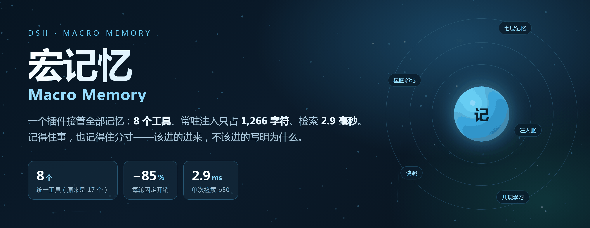

# 宏记忆 · Macro Memory

**让 AI 记住你，而不是记住一堆噪声。**

一个插件接管 DSH 的全部记忆：8 个工具、常驻注入只占 **1,266 字符**、检索 **2.9 毫秒**。 
记得住事，也记得住分寸——该进的进来，不该进的写明为什么。

## 它解决的不是「存不下」，是「记不住、记太贵、说不清」

| 你遇到的 | 它怎么答 |
| --- | --- |
| 聊到第三轮，它忘了第一轮说好的端口和路径 | 七层库里按关键词 × 重要度 × 时间打分，够格的一律进上下文；隔久了还会主动「放回」老条目 |
| 一开记忆插件，每轮先烧一万多 token 讲「怎么用记忆」 | 常驻手册压到 1,266 字符，命中条目按你给的额度整句挤压，长句咬断接上 |
| 它这次没提那条，你也不知道为什么 | 每一轮都落账：进了哪几条、各多少字、谁被挡、挡在哪道闸、最近分数多少 |
| 库一坏，几万条记忆变成 4 KB 空壳 | 自动快照 + 退之前先只读比一次：会丢几条、能找回几条，说清楚才让你换 |
| 记忆插件装了两三个，指令互相打架 | 8 个统一工具、一份手册；旧名字与旧工具不再漏进宿主 |

## 一轮对话里，记忆只做四件事

**① 取候选**　本地检索（无 LLM 参与）+ 星图邻域 + 共现自学习扩词。库 1,200 条时 p50 是 2.9ms，热问句不重拼索引。

**② 过闸**　四道闸各管一段，挡下就记下原因：

| 闸 | 管什么 | 挡下时你会看到 |
| --- | --- | --- |
| 字面兜底 | 只对上一个单字（「的」「了」）不算命中 | 整轮不注入，账上写 `literal` |
| 分数线 | 换说法的问题自动降档（真问句走 0.21 的线） | `floor` + 最近分数，提示补 keywords |
| 同话题 | 不在这一轮的话题里就不占名额 | 不记落选（它不是被分数挡的） |
| 陪跑线 | 不到第一名 ×0.2 的不进来 | `margin`，说明第一名比它强多少 |

**③ 注入**　常驻手册 + 命中条目，按字数挤而不是按条数堆；单条上限与会话预算双层保险，每轮总额可调（默认不限）。

**④ 落账**　`picks=` 写每条真实字数，`drops=` 写五种落选原因，面板照旧念得出对策。

## 只有一份真身

- **七层主库是唯一真源**：`soul`（自我）/ `rules`（准则）/ `user`（主人）/ `project`（项目）/ `topic`（来龙去脉）/ `fact`（原子事实）/ `lesson`（经验教训）。分层不是装饰，是「先问准则、再问人、最后问细节」的读取口径。
- **星图只是索引**：邻居、共现、实体提及都在这儿；坏了删掉重算就行，真身一个字不动。连错的边能一键摘掉，重建也不会再连回来。
- **快照是兜底**：开工前存一致副本（每小时最多一份，留 7 份）；复原前先比一次。读到坏库就明说「读不出来」，不猜、不编。

## 八个工具

| 工具 | 你用它做什么 |
| --- | --- |
| `memory_remember` | 记一条：内容、层级、项目、关键词、重要度；相近的自动合并，顶掉的旧条目标 stale 并留一句「已被取代」 |
| `memory_search` | 检索：默认本地打分 + 沿星图扩散；`mode=graph` 只看关联，`bridge` 找强相关未读，`similar` 找相似条目 |
| `memory_read` | 读全文，顺手带出星图邻居（`neighbors=0` 可关），带预算时只砍邻居、正文一字不截 |
| `memory_update` | 改内容 / 状态 / 关键词；`patch` 只改一句，`append` 补一段，`restore` 退回上一版 |
| `memory_link` | 连与摘：手工连线、解释两条记忆怎么连上的（最短证据链）、把自动连错的边静音 |
| `memory_project` | 项目全景：overview / structure / decisions / quotes / ops / todo 六组 |
| `memory_dream` | 整理本窗口：把这一轮建的、提的记忆逐轮封存成跨会话记忆 |
| `memory_admin` | 运维面板：库位置、星图体检、记忆体检（九类）、来源、成本、注入账、额度、错边、快照、待补连线 |

注入给模型的手册是同一份：`level` 七个、项目六子类、`memory_admin` 十二个动作——手册、schema、常量三处必须是同一件事，错一处就有一条自检红。

## 三分钟上手

1. 在 DSH 市场装 `macro-memory`（或 `npm i dsh-macro-memory`），重启 DSH 生效。
2. 什么都不用配：默认就会记、会检索、会落账。
3. 觉得注入太多或太少，一句话调额度（按轮总额、单条上限、会话预算都能单独设）。

## 三个平台，同一套装法

Windows、macOS、Linux 装的是同一份包、同一套代码：**没有原生依赖，也没有 install 脚本**，SQLite 直接用宿主自带的 `node:sqlite`。

| 平台 | 宏记忆默认落在哪 | 说明 |
| --- | --- | --- |
| Windows | `%DSH_HOME%\macro-memory`（常见是 `D:\dsh-home\macro-memory`） | 与宿主同一套规则 |
| macOS | `~/.dsh/macro-memory` | `$DSH_HOME` 有值时以它为准 |
| Linux | `~/.dsh/macro-memory` | 同上 |

- 宿主 Node ≥ 24（`node:sqlite` 从 22.5 起有，本插件的 `engines` 写在 24）。宿主自己带的 runtime 就是 24.21.0，不用另装。
- mac 上 DSH 的 `app.asar` 带完整性校验（`ElectronAsarIntegrity`），插件不改宿主，走 `profiles` 安装面——和 Windows 一样。
- 库要复原：先 `node tools/restore-live-db.mjs --dry-run` 体检，核对无误再去掉 `--dry-run`（**先退出 DSH**）；脚本自动备份三件套并删掉旧的 `-wal`/`-shm`。
- 平台细节、装法、排障、mac 真机冒烟清单：[docs/MAC.md](docs/MAC.md)。

## 常见问题

**会不会很贵？** 每轮固定开销约 2.2K token（比 0.2.x 少约 85%），检索本身 2.9ms 且不调用任何模型。命中条目按额度挤压，预算花在内容上而不是说明书上。

**会不会记脏？** 写入有层级与项目口径；重复的合并、被取代的标 stale 但不删；体检面板能查出重复、该更新、凑数、超重、没人读、孤立、自证、召回没读、写多收少九类。

**会不会跟别的记忆插件打架？** 它接管记忆面：旧工具名与旧插件名不进宿主，8 个工具的单行说明都 ≤200 字。

**数据在哪？** 本地 SQLite，每个工作区一份（`<工作区>/.dsh-meow/memory.db`），不联网、不上传。

**库坏了怎么办？** 面板只报「读不出来」并指去看快照；复原前先只读比一次，4 KB 空壳快照会单独警告（退它等于清库）。

## 技术规格

| 项 | 现在 |
| --- | --- |
| 版本 | 0.7.0 |
| 自证规模 | **68 支自检 / 4,639 条可执行断言** |
| 常驻注入 | 1,266 字符（模型每轮看到的全部手册） |
| 工具 schema | 8 个，合计 14,494 B |
| 检索 | 2.9 ms（p50，1,200 条库；热问句不重拼索引） |
| 每轮固定开销 | 约 2.2K token |
| 对外检索口径 | gold 宽池 146 条：照抄 1.000 / 换说法 1.000 / 时间锚 0.889 |
| lib/client.js | 190,368 B，sha256 `CBDE145F…` |
| 存储 | 本地 SQLite（每工作区一份）+ 可重建星图索引 + 自动快照 |
| 许可 | MIT |

## 文档

- [版本历史](docs/CHANGELOG.md)：每一版改了什么、读数多少、判据为什么这么画。
- [内部日志](docs/INTERNAL.md)：逐轮开发记录与处方。
- [评测口径](docs/EVAL-CLAIMS.md)：对外能说的数字，以及它怎么量出来的。
- [设计](DESIGN.md)：内部分层、注入、星图、快照的取舍。
- [跨平台](docs/MAC.md)：mac / Linux 的装法、路径规则、复原办法与真机冒烟清单。

## 许可与第三方

本包 **MIT**（见 [LICENSE](LICENSE)）。内置两套 MIT 组件，改动逐条说明在 [THIRD-PARTY-NOTICES.md](THIRD-PARTY-NOTICES.md)：

| 组件 | 来源 | 用途 |
| --- | --- | --- |
| `meow-memory@0.32.8` | [Phant0Meow/dsh-meow-memory](https://github.com/Phant0Meow/dsh-meow-memory) | 检索与记忆内核 |
| `dsh-memory-nebula@1.11.74` | 本仓库作者 | 星图内核 |

Bundled third-party code is MIT: `meow-memory` © 2026 Phant0Meow, `dsh-memory-nebula` © 2026 主人 & 小代码酱.
